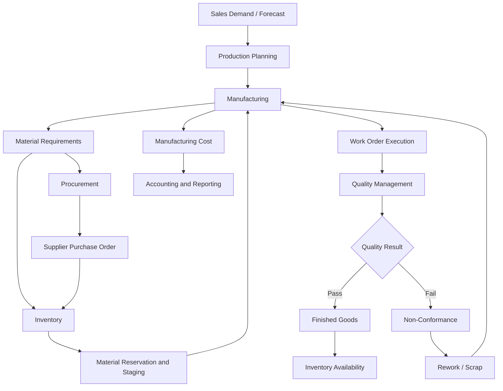

# Functional Specification

**Project:** Astra Manufacturing — Manufacturing & Production Management ERP  
**Document ID:** FS-ERP-001  
**Version:** 1.0  
**Status:** Draft — Portfolio Simulation  
**ERP Platform:** Odoo 19  
**Document Type:** Functional Specification Document (FSD)

---

## Document Control

| Attribute | Details |
|---|---|
| Document Name | Functional Specification |
| Document ID | FS-ERP-001 |
| Project | Astra Manufacturing ERP Implementation |
| Version | 1.0 |
| Status | Draft |
| Prepared By | ERP Implementation Team |
| Reviewers | Business Process Owners, Production Manager, Warehouse Manager, Quality Manager |
| Approval Authority | Project Sponsor |
| Last Updated | 2026-11-08 |

### Revision History

| Version | Date | Author | Description |
|---|---|---|---|
| 1.0 | 2026-11-08 | ERP Implementation Team | Initial functional specification |

---

# 1. Introduction

## 1.1 Purpose

This document defines the functional specifications for implementing Odoo 19 at Astra Manufacturing.

It translates the business requirements and approved business processes into system-level functional behavior, configuration requirements, validation rules, user permissions, and reporting requirements.

The document will serve as the primary reference for:

- Odoo functional configuration.
- ERP implementation.
- Customization assessment.
- Functional testing.
- User Acceptance Testing (UAT).
- End-user training.
- Implementation acceptance.

## 1.2 Project Background

Astra Manufacturing is a hypothetical industrial manufacturing company that requires an integrated ERP solution to manage its manufacturing and supporting business operations.

The initial implementation focuses on the following business areas:

1. Manufacturing Management.
2. Inventory Management.
3. Procurement Management.
4. Quality Management.
5. Maintenance Management.
6. Costing and Accounting.

The implementation uses Odoo 19 as the ERP platform.

The primary objective is to establish an integrated business process that provides operational visibility, transaction traceability, inventory accuracy, production control, and manufacturing cost visibility.

## 1.3 Functional Design Principles

The implementation follows these principles:

| Principle | Description |
|---|---|
| Standard First | Prioritize standard Odoo functionality before custom development. |
| Business Process Alignment | System configuration must support approved business processes. |
| Data Integrity | Transactions must maintain consistent and accurate business data. |
| Traceability | Important transactions must be traceable to their source documents. |
| Least Privilege | Users receive only the permissions required for their responsibilities. |
| Controlled Changes | Master data and operational changes must follow defined authorization rules. |
| Auditability | Important transactions must retain sufficient historical information. |
| Scalability | The initial design should support reasonable future business expansion. |
| Maintainability | Custom development must be minimized and documented. |

## 1.4 Scope

### In Scope

- Product and component master data.
- Product categories and units of measure.
- Bill of Materials management.
- Manufacturing routing.
- Work center configuration.
- Manufacturing orders.
- Work order execution.
- Material reservation and consumption.
- Production reporting.
- Inventory movements.
- Reordering and replenishment.
- Purchase requisition and procurement workflows, where included in the approved scope.
- Quality inspections.
- Quality alerts and non-conformance handling.
- Rework and scrap.
- Equipment and maintenance requests.
- Manufacturing cost monitoring.
- User access control.
- Operational reporting.

### Out of Scope

The following features are not included in the initial implementation:

- Advanced finite-capacity optimization.
- Multi-company consolidation.
- Multi-factory production planning.
- Automated machine integration.
- IoT-based manufacturing execution.
- Advanced statistical process control.
- Full Product Lifecycle Management implementation.
- Advanced subcontracting.
- Payroll integration.
- Advanced demand forecasting.
- Custom mobile applications.
- External supplier portal development.

These features may be evaluated in subsequent implementation phases.

## 1.5 Reference Documents

| Document | Purpose |
|---|---|
| `00_business_requirements_gathering.md` | Requirements elicitation methodology |
| `01_business_requirements.md` | Approved business requirements |
| `02_master_data_and_bom.md` | Product, component, BoM, routing, and cost master data |
| `business_processes/01_manufacturing_process.md` | Manufacturing business process |
| `business_processes/02_inventory_management.md` | Inventory business process |
| `business_processes/03_procurement_process.md` | Procurement business process |
| `business_processes/04_quality_management.md` | Quality management business process |
| `business_processes/05_maintenance_management.md` | Maintenance business process |
| `business_processes/06_costing_and_accounting.md` | Costing and accounting business process |
| `04_technical_architecture.md` | Technical architecture |
| `05_test_strategy_and_test_cases.md` | Testing strategy and test cases |

---

# 2. Solution Overview

## 2.1 Proposed ERP Applications

The following Odoo applications are included in the proposed solution.

| Application | Business Purpose | Priority |
|---|---|---|
| Manufacturing | Manage manufacturing orders, BoMs, routing, and work orders | Critical |
| Inventory | Manage stock, locations, transfers, and replenishment | Critical |
| Purchase | Manage supplier purchasing and purchase orders | High |
| Quality | Manage inspections, quality checks, and quality alerts | High |
| Maintenance | Manage equipment and maintenance activities | Medium |
| Accounting | Manage financial transactions and manufacturing cost visibility | High |
| Sales | Provide customer demand for MTO and MTS planning | Medium |

The final application list must be validated against the selected Odoo edition, licensing, and installed application dependencies.

## 2.2 Proposed Business Architecture



## 2.3 System of Record

Odoo will act as the primary system of record for the initial implementation.

| Business Data | System of Record |
|---|---|
| Product master | Odoo |
| Component master | Odoo |
| BoM | Odoo |
| Routing | Odoo |
| Work centers | Odoo |
| Manufacturing orders | Odoo |
| Work orders | Odoo |
| Inventory transactions | Odoo |
| Purchase orders | Odoo |
| Quality checks | Odoo |
| Quality alerts | Odoo |
| Equipment | Odoo |
| Maintenance requests | Odoo |
| Accounting transactions | Odoo Accounting |

External spreadsheets may be used for approved analysis or migration preparation, but they must not become an uncontrolled alternative source of operational truth.

---

# 3. Functional Requirements Overview

## 3.1 Requirement Classification

Functional requirements are classified using the following priorities:

| Priority | Definition |
|---|---|
| Must Have | Required for initial go-live |
| Should Have | Important but may be implemented after critical requirements |
| Could Have | Useful enhancement |
| Won't Have | Explicitly excluded from the current implementation phase |

## 3.2 Functional Requirement Categories

The existing BRD contains functional requirements identified as `FR-001` through `FR-081`.

The following categories are used to organize their functional implementation.

| Category | Functional Area | Requirement Reference |
|---|---|---|
| FNC-01 | Product and Master Data | To be mapped from BRD |
| FNC-02 | Bill of Materials | To be mapped from BRD |
| FNC-03 | Manufacturing Orders | To be mapped from BRD |
| FNC-04 | Routing and Work Orders | To be mapped from BRD |
| FNC-05 | Work Center Management | To be mapped from BRD |
| FNC-06 | Inventory Management | To be mapped from BRD |
| FNC-07 | Procurement | To be mapped from BRD |
| FNC-08 | Quality Management | To be mapped from BRD |
| FNC-09 | Maintenance Management | To be mapped from BRD |
| FNC-10 | Costing and Accounting | To be mapped from BRD |
| FNC-11 | Reporting and Analytics | To be mapped from BRD |
| FNC-12 | Security and Access Control | To be mapped from BRD |

**Important:** These categories are functional design groupings, not replacements for the original BRD requirement IDs. Each original FR must be mapped to one or more functional specifications in the final traceability matrix.

---

# 4. Functional Specification — Master Data Management

## 4.1 Product Master Management

**Functional ID:** FS-MD-001

**Objective:** Allow authorized users to create and maintain products used in manufacturing and inventory operations.

### Functional Behavior

The system must allow authorized users to:

1. Create products.
2. Define product names and internal references.
3. Assign product categories.
4. Define units of measure.
5. Configure product tracking requirements.
6. Configure manufacturing-related product settings.
7. Define replenishment methods where applicable.
8. Maintain product status and availability.

### Product Master Fields

| Field | Required | Description |
|---|---|---|
| Product Name | Yes | Product display name |
| Internal Reference | Yes | Unique product code |
| Product Category | Yes | Product classification |
| Unit of Measure | Yes | Stock and operational unit |
| Purchase UoM | Conditional | Purchasing unit |
| Product Type | Yes | Applicable Odoo product type |
| Tracking | Conditional | None, lot, or serial tracking |
| Cost | Conditional | Product cost information |
| Sales Configuration | Conditional | Sales-related settings |
| Purchase Configuration | Conditional | Procurement-related settings |
| Manufacturing Configuration | Conditional | Manufacturing-related settings |
| Active Status | Yes | Determines whether product remains available |

### Initial Product Master

| Product Code | Product Name | Classification |
|---|---|---|
| WP100 | Industrial Water Pump | Finished Product |
| EM200 | Industrial Electric Motor | Manufactured Subassembly |

The full component master list is maintained in `02_master_data_and_bom.md`.

### Validation Rules

- Internal references must be unique within the applicable company.
- Product names must be meaningful and consistent.
- Products used in manufacturing must have the correct configuration.
- Units of measure must be compatible with their applicable UoM categories.
- Archived products must not be selected for new operational transactions unless an authorized exception is supported.

### Odoo Solution

**Application:** Inventory / Manufacturing

**Approach:** Standard product master configuration.

**Customization:** Not expected.

---

## 4.2 Product Category Management

**Functional ID:** FS-MD-002

**Objective:** Classify products and establish relevant inventory and accounting properties.

### Initial Categories

| Category Code | Category Name | Purpose |
|---|---|---|
| CAT-FG | Finished Goods | Products ready for sale |
| CAT-SFG | Semi-Finished Goods | Manufactured subassemblies |
| CAT-RM | Raw Materials | Components and production materials |
| CAT-CONS | Consumables | Operational consumables |
| CAT-PKG | Packaging Materials | Packaging components |

### Functional Behavior

The system must allow authorized users to:

- Create product categories.
- Assign products to categories.
- Configure relevant inventory valuation settings.
- Configure costing methods where supported by the selected configuration.
- Maintain accounting properties where required.

### Validation Rules

- Every relevant product must belong to an appropriate category.
- Category changes must be reviewed when they affect inventory valuation or accounting behavior.
- Financial configuration must be reviewed by the Finance Manager.

### Odoo Solution

**Application:** Inventory / Accounting

**Approach:** Standard product category configuration.

---

## 4.3 Unit of Measure Management

**Functional ID:** FS-MD-003

**Objective:** Ensure consistent product quantities across purchasing, inventory, and manufacturing.

### Proposed Units of Measure

| UoM | Category | Example Usage |
|---|---|---|
| Units | Unit | Pumps, motors, bearings |
| kg | Weight | Metal and raw materials |
| g | Weight | Small material quantities |
| m | Length | Cables and metal profiles |
| mm | Length | Dimensional measurements |
| L | Volume | Lubricants and liquids |
| Box | Unit | Packaging or grouped quantities, if configured appropriately |

### Functional Behavior

The system must:

- Support configured units of measure.
- Support valid conversions within the same UoM category.
- Prevent invalid conversions across incompatible categories.
- Maintain consistent quantities across relevant transactions.

### Validation Rules

- UoM conversions must be approved.
- Product UoM and purchase UoM must be compatible.
- Conversion factors must reflect actual operational standards.

### Odoo Solution

**Application:** Inventory / Purchase / Manufacturing

**Approach:** Standard UoM configuration.

---

# 5. Functional Specification — Bill of Materials

## 5.1 Bill of Materials Management

**Functional ID:** FS-BOM-001

**Objective:** Define the components and quantities required to manufacture each product.

### Functional Behavior

The system must allow authorized users to:

1. Create BoMs.
2. Select manufactured products.
3. Define manufacturing quantities.
4. Add required components.
5. Define component quantities.
6. Define applicable operations.
7. Maintain BoM configuration.
8. Review BoM component requirements.
9. Use multilevel BoMs where applicable.

### BoM Structure

| Field | Required | Description |
|---|---|---|
| BoM Product | Yes | Manufactured product |
| BoM Quantity | Yes | Quantity produced by the BoM |
| BoM Type | Yes | Manufacturing, Kit, or applicable supported type |
| Components | Conditional | Required component lines |
| Operations | Conditional | Manufacturing operations |
| Company | Conditional | Applicable company |
| Routing | Conditional | Applicable production routing |
| Consumption Policy | Yes | Defines component consumption flexibility |

### Example BoM Structure

```text
WP100 - Industrial Water Pump
│
├── EM200 - Industrial Electric Motor
│   ├── Motor Housing
│   ├── Stator Assembly
│   ├── Rotor Assembly
│   ├── Bearings
│   └── Electrical Components
│
├── Pump Casing
├── Impeller
├── Mechanical Seal
├── Coupling
├── Fasteners
└── Packaging Materials
```

The actual component quantities and BoM relationships must follow the approved master data document.

### Validation Rules

- A BoM must reference a valid manufactured product.
- Component quantities must be greater than zero.
- Components must use compatible units of measure.
- Circular BoM dependencies must not be permitted.
- BoM changes must be controlled.
- Only approved BoMs may be used for production.
- Obsolete components must not be used in new production configurations.

### Odoo Solution

**Application:** Manufacturing

**Approach:** Standard BoM configuration.

**Customization:** Not expected initially.

---

## 5.2 Multilevel BoM

**Functional ID:** FS-BOM-002

**Objective:** Support manufacturing products that require manufactured subassemblies.

### Functional Behavior

The system must support:

- Parent manufactured products.
- Manufactured subassemblies.
- Component-level requirements.
- Separate BoMs for applicable subassemblies.
- Replenishment of subassemblies.

### Example

| Level | Product | Manufacturing Role |
|---|---|---|
| 0 | WP100 | Finished Product |
| 1 | EM200 | Manufactured Subassembly |
| 2 | Motor Components | Components of EM200 |

### Expected Behavior

When WP100 requires EM200:

- The system must identify EM200 as a required component.
- EM200 must have its own manufacturing definition if it is produced internally.
- The selected replenishment strategy determines how EM200 is supplied.
- The production planner must consider the availability and lead time of the subassembly.

### Odoo Solution

**Application:** Manufacturing / Inventory

**Approach:** Standard multilevel BoM and replenishment configuration.

---

# 6. Functional Specification — Manufacturing Management

## 6.1 Manufacturing Order Management

**Functional ID:** FS-MFG-001

**Objective:** Manage manufacturing orders from creation through completion.

### Functional Behavior

The system must allow authorized users to:

1. Create manufacturing orders.
2. Select manufactured products.
3. Define planned quantities.
4. Select applicable BoMs.
5. Review component requirements.
6. Review expected operations.
7. Confirm manufacturing orders.
8. Track manufacturing order status.
9. Record actual production.
10. Complete manufacturing orders.
11. Review completed manufacturing history.

### Manufacturing Order Information

| Field | Required | Description |
|---|---|---|
| MO Reference | System-generated | Unique manufacturing order number |
| Product | Yes | Manufactured product |
| Quantity | Yes | Planned production quantity |
| BoM | Yes | Applicable BoM |
| Scheduled Date | Conditional | Planned production date |
| Responsible User | Conditional | Assigned user |
| Source Document | Conditional | Related demand reference |
| Component Moves | System-generated | Required material movements |
| Work Orders | Conditional | Generated operations |
| Lot/Serial | Conditional | Tracking reference |
| Status | System-managed | Current MO state |

### Manufacturing Order Status

The implementation must use the actual standard Odoo workflow states rather than introducing custom states unnecessarily.

The functional process should distinguish:

- Draft.
- Confirmed / planned.
- In progress.
- Completed.
- Cancelled.

Exact state labels and transitions must be verified against the installed Odoo 19 version.

### Business Validations

- A manufacturing order must reference a valid manufactured product.
- The selected BoM must be applicable to the product.
- Planned quantities must be positive.
- Required material availability must be reviewed.
- Mandatory work order operations must be completed before final production completion.
- Required quality checks must be completed before applicable quality release.
- Actual production quantities must be recorded accurately.

### Odoo Solution

**Application:** Manufacturing

**Approach:** Standard Manufacturing Orders.

---

## 6.2 Manufacturing Planning

**Functional ID:** FS-MFG-002

**Objective:** Support production planning based on demand, inventory, and available resources.

### Functional Behavior

The system must support the planning process through:

- Manufacturing order scheduling.
- Component availability review.
- Replenishment evaluation.
- Work center availability.
- Manufacturing lead time.
- Production priority management.

### Planning Inputs

| Input | Source |
|---|---|
| Customer demand | Sales |
| Forecast demand | Approved planning input |
| Current inventory | Inventory |
| Component availability | Inventory |
| BoM requirements | Manufacturing |
| Manufacturing lead time | Product / BoM configuration |
| Work center capacity | Manufacturing |
| Maintenance downtime | Maintenance / Work Center |

### Planning Decision Rules

| Condition | Expected Action |
|---|---|
| Material available | Continue production planning |
| Material shortage | Trigger replenishment |
| Work center unavailable | Reschedule production |
| BoM missing | Block planning until master data is corrected |
| Production demand exceeds capacity | Escalate for planning review |
| Subassembly unavailable | Evaluate subassembly replenishment |

### Odoo Solution

**Application:** Manufacturing / Inventory

**Approach:** Standard manufacturing planning and replenishment functionality.

**Customization:** Advanced scheduling requirements must be evaluated separately.

---

## 6.3 Manufacturing Routing

**Functional ID:** FS-MFG-003

**Objective:** Define the sequence of operations required to manufacture a product.

### Initial Work Centers

| Work Center Code | Work Center |
|---|---|
| WC-MCH | Machining |
| WC-FAB | Fabrication |
| WC-ASM | Assembly |
| WC-TST | Testing |

### Example Routing

| Sequence | Operation | Work Center |
|---|---|---|
| 10 | Machining | Machining |
| 20 | Fabrication | Fabrication |
| 30 | Assembly | Assembly |
| 40 | Testing | Testing |

The actual routing must be defined separately for WP100 and EM200.

### Functional Behavior

The system must:

- Define manufacturing operations.
- Assign operations to work centers.
- Define operation sequences.
- Maintain expected operation durations.
- Provide operation instructions.
- Support operation-level production tracking.

### Validation Rules

- Each operation must have an appropriate work center.
- Operation sequences must be valid.
- Operation durations must be greater than zero where required.
- Routing changes must be reviewed.
- Work order dependencies must be configured when operationally required.

### Odoo Solution

**Application:** Manufacturing

**Approach:** Standard BoM Operations and Work Centers.

---

## 6.4 Work Center Management

**Functional ID:** FS-MFG-004

**Objective:** Manage production resources and monitor their availability and performance.

### Functional Behavior

The system must support:

- Work center creation.
- Work center configuration.
- Working calendars.
- Capacity configuration.
- Operation assignment.
- Productivity tracking.
- Cost configuration.
- Availability monitoring.

### Work Center Fields

| Field | Description |
|---|---|
| Work Center Name | Production resource name |
| Code | Unique internal identifier |
| Working Hours | Applicable working calendar |
| Capacity | Production capacity |
| Time Efficiency | Productivity standard |
| Cost per Hour | Work center operating cost assumption |
| Setup Time | Preparation time |
| Cleanup Time | Cleanup time |
| Allowed Employees | Qualified employees, if used |
| Equipment | Associated equipment, where applicable |

### Validation Rules

- Work centers must have valid operating calendars.
- Capacity must reflect realistic operational constraints.
- Work centers must be active before assignment.
- Work center availability must be reviewed during scheduling.
- Maintenance downtime must be considered.

### Odoo Solution

**Application:** Manufacturing / Maintenance

**Approach:** Standard Work Centers and associated maintenance functionality.

---

## 6.5 Work Order Execution

**Functional ID:** FS-MFG-005

**Objective:** Track individual manufacturing operations.

### Functional Behavior

The system must allow production users to:

1. View assigned work orders.
2. Review operation instructions.
3. Identify the assigned work center.
4. Start work orders.
5. Pause work orders where supported.
6. Complete work orders.
7. Record actual operation duration.
8. Record production quantities.
9. Record relevant production notes.

### Work Order Information

| Field | Description |
|---|---|
| Work Order Reference | Unique operation record |
| Manufacturing Order | Parent MO |
| Operation | Manufacturing activity |
| Work Center | Assigned resource |
| Planned Duration | Expected duration |
| Actual Duration | Recorded duration |
| Operator | Responsible employee |
| Start Time | Actual start |
| End Time | Actual completion |
| Quantity | Recorded production quantity |
| Status | Work order status |

### Validation Rules

- Work orders must belong to a valid manufacturing order.
- Work orders must use the applicable routing.
- Required predecessor operations must be completed when dependencies are configured.
- Actual operation time must be recorded according to the selected tracking method.
- Mandatory inspections must not be bypassed.

### Odoo Solution

**Application:** Manufacturing

**Approach:** Standard Work Orders and Shop Floor functionality.

---

## 6.6 Material Consumption

**Functional ID:** FS-MFG-006

**Objective:** Record actual component consumption during production.

### Functional Behavior

The system must:

- Calculate expected component requirements from the BoM.
- Track material reservation and movement.
- Record consumed component quantities.
- Support applicable lot and serial traceability.
- Identify consumption differences.
- Record permitted component substitutions.
- Maintain manufacturing order traceability.

### Consumption Validation

The system must apply the configured BoM consumption policy.

For example:

| Policy | Expected Behavior |
|---|---|
| Blocked | Consumption must follow the defined BoM quantity |
| Allowed | Consumption may differ from the BoM |
| Allowed with Warning | Consumption variance is permitted but generates a warning |

The exact available policy values and behavior must be verified in the installed Odoo 19 configuration.

### Consumption Variance

\[
\text{Variance}
=
\text{Actual Consumption}
-
\text{Expected Consumption}
\]

The system must provide sufficient information to identify unusual consumption.

### Odoo Solution

**Application:** Manufacturing / Inventory

**Approach:** Standard component moves and consumption configuration.

---

## 6.7 Production Quantity Recording

**Functional ID:** FS-MFG-007

**Objective:** Record actual quantities produced, rejected, and scrapped.

### Functional Behavior

The system must support recording:

- Planned quantity.
- Actual production quantity.
- Good quantity.
- Rejected quantity.
- Scrap quantity.
- Remaining quantity.

### Validation Rules

- Production quantities must use the configured UoM.
- Quantity records must be associated with a manufacturing order.
- Rejected output must be handled through the quality process.
- Scrap must be recorded through the appropriate scrap process.
- Completed quantities must reconcile with production records.

### Odoo Solution

**Application:** Manufacturing / Quality / Inventory

**Approach:** Standard production registration, quality checks, and scrap workflows.

---

# 7. Functional Specification — Inventory Management

## 7.1 Inventory Location Management

**Functional ID:** FS-INV-001

**Objective:** Maintain controlled storage and production locations.

### Proposed Locations

| Location Code | Location Name | Purpose |
|---|---|---|
| WH/Stock | Main Stock | General inventory |
| WH/Raw | Raw Materials | Component storage |
| WH/Production | Production | Production staging |
| WH/Finished | Finished Goods | Finished product storage |
| WH/Quality | Quality Hold | Quality inspection hold |
| WH/Scrap | Scrap | Rejected or scrapped materials |

These locations represent the proposed business design. Their exact hierarchy and usage must be finalized during warehouse configuration.

### Functional Behavior

The system must support:

- Internal locations.
- Inventory movements.
- Production staging.
- Finished goods storage.
- Quality hold handling.
- Scrap handling.

### Odoo Solution

**Application:** Inventory

**Approach:** Standard locations and stock moves.

---

## 7.2 Inventory Availability

**Functional ID:** FS-INV-002

**Objective:** Provide reliable stock availability information.

### Functional Behavior

Users must be able to review:

- On-hand quantity.
- Reserved quantity.
- Available quantity.
- Incoming quantity.
- Outgoing quantity.
- Forecasted quantity.

### Availability Calculation

Available quantity must not be confused with physical on-hand stock.

The planning process must consider reservations and other demand.

### Validation Rules

- Rejected stock must not be treated as usable stock.
- Reserved quantities must be accounted for.
- Stock movements must be validated.
- Inventory discrepancies must be investigated.

### Odoo Solution

**Application:** Inventory

**Approach:** Standard stock availability and forecast information.

---

## 7.3 Material Reservation and Internal Transfers

**Functional ID:** FS-INV-003

**Objective:** Ensure that production materials are allocated and moved correctly.

### Functional Behavior

The system must:

- Reserve available components according to the configured stock workflow.
- Generate or support internal material transfers where required.
- Track material movement from warehouse to production.
- Maintain transaction references.
- Support applicable lot and serial tracking.

### Validation Rules

- Materials must match production requirements.
- Internal transfers must use valid source and destination locations.
- Stock quantities must not become negative unless explicitly permitted by approved system policy.
- Rejected materials must not be issued as normal production components.

### Odoo Solution

**Application:** Inventory / Manufacturing

**Approach:** Standard reservation and internal transfer functionality.

---

## 7.4 Reordering Rules

**Functional ID:** FS-INV-004

**Objective:** Replenish components when inventory reaches defined thresholds.

### Functional Behavior

The system must support:

- Minimum stock levels.
- Maximum stock levels.
- Replenishment quantities.
- Procurement lead times.
- Manufacturing replenishment routes where applicable.
- Purchase replenishment routes where applicable.

### Reordering Rule Parameters

| Parameter | Description |
|---|---|
| Product | Replenished product |
| Location | Applicable stock location |
| Minimum Quantity | Replenishment threshold |
| Maximum Quantity | Target stock quantity |
| Multiple Quantity | Optional order multiple |
| Route | Buy or Manufacture, as applicable |
| Lead Time | Replenishment lead time |

### Business Rules

- Reordering rules must be configured for appropriate products.
- Forecasted stock must be considered.
- Reserved stock and future demand must be evaluated.
- Replenishment routes must be correct.
- Procurement quantities must respect defined replenishment policies.

### Odoo Solution

**Application:** Inventory / Purchase / Manufacturing

**Approach:** Standard replenishment and reordering rules.

---

## 7.5 Lot and Serial Number Traceability

**Functional ID:** FS-INV-005

**Objective:** Maintain traceability for selected components and finished products.

### Functional Behavior

The system must support:

- Lot tracking.
- Serial tracking.
- Traceability from components to manufactured products.
- Traceability from manufactured products to consumed components.
- Historical movement review.

### Tracking Policy

The tracking method must be defined per product.

| Product Type | Proposed Tracking |
|---|---|
| Selected raw materials | Lot |
| Critical components | Lot or Serial |
| Finished products | Lot or Serial, depending on business requirements |
| Non-critical consumables | No tracking, unless required |

### Odoo Solution

**Application:** Inventory / Manufacturing

**Approach:** Standard lot and serial number tracking.

---

# 8. Functional Specification — Procurement Management

## 8.1 Supplier Master

**Functional ID:** FS-PUR-001

**Objective:** Maintain supplier information for procurement operations.

### Functional Behavior

The system must allow authorized users to:

- Create suppliers.
- Maintain supplier contact information.
- Maintain purchasing details.
- Assign supplier references to products.
- Maintain supplier status.

### Validation Rules

- Supplier records must contain required information.
- Duplicate supplier records should be avoided.
- Inactive suppliers must not be used for new purchasing without authorization.

### Odoo Solution

**Application:** Purchase / Contacts

---

## 8.2 Purchase Order Management

**Functional ID:** FS-PUR-002

**Objective:** Manage procurement transactions for components and materials.

### Functional Behavior

The system must support:

1. Purchase quotation creation.
2. Supplier selection.
3. Product selection.
4. Quantity definition.
5. Price definition.
6. Expected delivery date.
7. Purchase order confirmation.
8. Goods receipt processing.
9. Supplier invoice matching where included in the accounting scope.

### Validation Rules

- Purchase orders must reference valid suppliers.
- Purchased products must be configured appropriately.
- Quantities must be positive.
- Purchase orders must follow authorization rules.
- Goods receipt quantities must be recorded accurately.

### Odoo Solution

**Application:** Purchase / Inventory / Accounting

---

## 8.3 Procurement Replenishment

**Functional ID:** FS-PUR-003

**Objective:** Replenish components required for manufacturing.

### Functional Behavior

The system must support purchase replenishment triggered by:

- Reordering rules.
- Manufacturing demand.
- Approved manual procurement.
- Forecasted inventory shortages.

### Expected Workflow

```text
Material Shortage
      |
      v
Replenishment Requirement
      |
      v
Purchase RFQ
      |
      v
Supplier Selection
      |
      v
Purchase Order
      |
      v
Goods Receipt
      |
      v
Quality Inspection (if required)
      |
      v
Inventory Availability
```

### Odoo Solution

**Application:** Purchase / Inventory / Quality

---

# 9. Functional Specification — Quality Management

## 9.1 Quality Control Point Management

**Functional ID:** FS-QLT-001

**Objective:** Define when and where quality inspections must be performed.

### Functional Behavior

The system must allow authorized users to:

- Create quality control points.
- Assign products or product categories.
- Assign operational triggers.
- Define inspection types.
- Assign responsible quality teams.
- Define inspection instructions.
- Configure failure instructions.

### Proposed Inspection Stages

| Stage | Inspection Example |
|---|---|
| Incoming Inspection | Component condition and specification |
| Machining Inspection | Dimensional verification |
| Fabrication Inspection | Weld and fabrication condition |
| Assembly Inspection | Alignment and assembly verification |
| Final Inspection | Product performance and conformity |

### Odoo Solution

**Application:** Quality

**Approach:** Standard Quality Control Points and Quality Checks.

---

## 9.2 Quality Inspection Execution

**Functional ID:** FS-QLT-002

**Objective:** Record inspection results against defined quality criteria.

### Functional Behavior

The system must support appropriate inspection methods, such as:

- Pass / Fail.
- Measurement.
- Instructions.
- Other supported inspection types where justified.

### Inspection Record

| Field | Description |
|---|---|
| Quality Check Reference | Unique check reference |
| Product | Inspected product |
| Operation | Related operation |
| Manufacturing Order | Related MO |
| Inspection Type | Inspection method |
| Inspection Result | Result |
| Inspector | Responsible user |
| Inspection Date | Date and time |
| Notes | Inspection remarks |

### Validation Rules

- Mandatory inspections must be completed.
- Measurement results must be compared with approved tolerance values.
- Failed inspections must be documented.
- Quality checks must retain traceability to their source operations or transactions.

### Odoo Solution

**Application:** Quality / Manufacturing / Inventory

---

## 9.3 Non-Conformance Management

**Functional ID:** FS-QLT-003

**Objective:** Record and manage products that fail quality requirements.

### Functional Behavior

The system must support:

- Defect identification.
- Defect classification.
- Quality alert creation.
- Affected quantity recording.
- Root cause investigation.
- Corrective action tracking.
- Quality disposition.

### Defect Disposition

| Disposition | Expected Action |
|---|---|
| Rework | Correct the defect and reinspect |
| Scrap | Record and isolate unusable output |
| Accept by Concession | Allow release only through documented authorization |
| Hold | Prevent further processing or release pending decision |

Acceptance by concession must be explicitly approved by authorized personnel and must comply with applicable product and regulatory requirements.

### Odoo Solution

**Application:** Quality / Inventory / Manufacturing

**Approach:** Standard quality alerts, checks, and associated inventory workflows.

**Customization:** Evaluate only if the approved disposition process cannot be implemented adequately with standard functionality.

---

## 9.4 Rework Management

**Functional ID:** FS-QLT-004

**Objective:** Control defective output that can be corrected.

### Functional Behavior

The system must support:

- Rework identification.
- Rework authorization.
- Rework instructions.
- Additional material consumption.
- Additional operation time.
- Reinspection.
- Final disposition.

### Validation Rules

- Rework must have a traceable source.
- Rework must be authorized.
- Rework output must be reinspected.
- Additional consumption must be recorded.
- Rework costs must be considered in manufacturing cost analysis.

---

## 9.5 Scrap Management

**Functional ID:** FS-QLT-005

**Objective:** Control unusable products and materials.

### Functional Behavior

The system must support:

- Scrap identification.
- Scrap reason recording.
- Scrap quantity recording.
- Scrap authorization.
- Scrap inventory movement.
- Scrap reporting.

### Validation Rules

- Scrap must have an identifiable reason.
- Scrap quantities must be traceable.
- Scrap must not remain available as normal inventory.
- Scrap records must be associated with the appropriate operational source where possible.

### Odoo Solution

**Application:** Inventory / Manufacturing / Quality

**Approach:** Standard scrap functionality and quality disposition workflow.

---

# 10. Functional Specification — Maintenance Management

## 10.1 Equipment Management

**Functional ID:** FS-MNT-001

**Objective:** Maintain records of production equipment.

### Functional Behavior

The system must allow authorized users to:

- Create equipment records.
- Assign equipment categories.
- Assign equipment to work centers where applicable.
- Record equipment information.
- Maintain equipment status.
- Review maintenance history.

### Initial Equipment Categories

| Category | Example |
|---|---|
| Machining Equipment | CNC Machine |
| Fabrication Equipment | Welding Machine |
| Assembly Equipment | Assembly Tools |
| Testing Equipment | Functional Test Bench |

Specific equipment names and identifiers must be confirmed during master data preparation.

---

## 10.2 Maintenance Requests

**Functional ID:** FS-MNT-002

**Objective:** Record and manage equipment maintenance activities.

### Functional Behavior

The system must support:

- Maintenance request creation.
- Equipment selection.
- Maintenance type selection.
- Priority assignment.
- Responsible technician assignment.
- Maintenance scheduling.
- Maintenance completion.
- Maintenance history.

### Maintenance Types

- Corrective Maintenance.
- Preventive Maintenance.

### Business Rules

- Equipment breakdowns affecting production must be escalated.
- Maintenance requests must identify affected equipment.
- Equipment must not be treated as available while formally unavailable.
- Maintenance completion must be recorded.

### Odoo Solution

**Application:** Maintenance / Manufacturing

---

## 10.3 Work Center Availability

**Functional ID:** FS-MNT-003

**Objective:** Consider equipment and maintenance availability during production planning.

### Functional Behavior

The planning process must consider:

- Work center working hours.
- Scheduled downtime.
- Maintenance-related unavailability.
- Alternative work center options, where supported and approved.

### Validation Rules

- Production scheduling must not knowingly assign work to unavailable resources.
- Emergency breakdowns must trigger production schedule review.
- Rescheduling decisions must be recorded where operationally required.

---

# 11. Functional Specification — Costing and Accounting

## 11.1 Product Cost Configuration

**Functional ID:** FS-CST-001

**Objective:** Configure product costing in accordance with the approved accounting policy.

### Functional Behavior

The system must support the selected costing methodology.

Potential costing methods include:

- Standard Price.
- Average Cost (AVCO).
- First In, First Out (FIFO).

The final costing method must be approved by the Finance Manager and must align with the applicable accounting and inventory valuation policy.

### Validation Rules

- Costing method must be consistent with the approved financial policy.
- Product category valuation settings must be reviewed.
- Product costs must be maintained accurately.
- Cost changes must be controlled.

---

## 11.2 Manufacturing Cost Analysis

**Functional ID:** FS-CST-002

**Objective:** Provide visibility into manufacturing costs.

### Cost Components

| Cost Component | Description |
|---|---|
| Component Cost | Cost of consumed materials |
| Work Center Cost | Cost associated with operation time |
| Labor Cost | Labor-related cost where configured |
| Scrap Cost | Cost impact of scrapped materials or output |
| Rework Cost | Additional cost caused by rework |
| Overhead | Additional production overhead where supported |

### Functional Behavior

The system must provide information for reviewing:

- Expected material costs.
- Actual material costs.
- Work center costs.
- Production cost.
- Cost variance.
- Manufacturing order cost history.

### Important Design Consideration

Do not assume that a manufacturing order's cost is identical to the final accounting inventory valuation.

The accounting treatment depends on the selected costing method, valuation configuration, installed applications, and financial policy.

The implementation must validate the expected accounting entries with Finance.

---

# 12. Functional Specification — Reporting and Analytics

## 12.1 Manufacturing Reports

**Functional ID:** FS-RPT-001

The system should provide visibility into:

| Report | Purpose | Audience |
|---|---|---|
| Manufacturing Order Overview | Monitor MO status | Production Manager |
| Production Schedule | Monitor planned production | Production Planner |
| Work Order Status | Monitor operations | Supervisor |
| Production Output | Monitor production quantities | Production Manager |
| Material Consumption | Analyze material usage | Production / Warehouse |
| Work Center Performance | Analyze resource utilization | Production Manager |
| Production Delay | Identify late operations | Production Manager |
| Manufacturing Cost | Review production costs | Finance |

## 12.2 Inventory Reports

**Functional ID:** FS-RPT-002

| Report | Purpose |
|---|---|
| Stock On Hand | Review current inventory |
| Forecasted Inventory | Review projected stock |
| Inventory Valuation | Review inventory value |
| Stock Movement | Review material movements |
| Replenishment | Identify products requiring replenishment |
| Lot / Serial Traceability | Review product history |

## 12.3 Quality Reports

**Functional ID:** FS-RPT-003

| Report | Purpose |
|---|---|
| Quality Check Overview | Monitor inspection activities |
| Defect Report | Analyze defects |
| Quality Alert Report | Track non-conformance |
| Rework Report | Monitor rework activities |
| Scrap Report | Monitor rejected output |
| First Pass Yield | Evaluate quality performance |

## 12.4 Maintenance Reports

**Functional ID:** FS-RPT-004

| Report | Purpose |
|---|---|
| Equipment Overview | Review equipment records |
| Maintenance Request Report | Track maintenance activities |
| Preventive Maintenance Schedule | Monitor preventive work |
| Equipment Downtime | Analyze downtime |

## 12.5 KPI Dashboard

**Functional ID:** FS-RPT-005

The initial dashboard should include:

| KPI | Formula |
|---|---|
| Schedule Adherence | Orders completed on time / Total orders due × 100 |
| Production Achievement | Actual good output / Planned output × 100 |
| First Pass Yield | Units passing first inspection / Total inspected units × 100 |
| Defect Rate | Defective units / Total inspected units × 100 |
| Rework Rate | Units requiring rework / Total produced units × 100 |
| Scrap Rate | Scrapped units / Total produced units × 100 |
| Work Center Utilization | Productive time / Available working time × 100 |
| Material Consumption Variance | (Actual consumption - Expected consumption) / Expected consumption × 100 |

KPI definitions must be standardized before dashboard implementation.

The system must avoid double-counting defective units, reworked units, and inspection attempts.

---

# 13. User Roles and Access Control

## 13.1 User Role Matrix

The following matrix represents proposed functional access. Final access rights must be tested against actual Odoo groups and record rules.

| Role | Manufacturing | Inventory | Purchase | Quality | Maintenance | Accounting |
|---|---|---|---|---|---|---|
| Production Manager | Manager | Read | Read | Read | Read | Read |
| Production Planner | User | Read | Read | Read | Read | None |
| Production Supervisor | User | Read | None | Read | Read | None |
| Production Operator | Limited User | Limited | None | Limited | None | None |
| Warehouse Manager | Read | Manager | Read | Read | None | None |
| Warehouse Operator | Read | User | None | Limited | None | None |
| Procurement Manager | Read | Read | Manager | Read | None | None |
| Quality Inspector | Read | Read | None | User | None | None |
| Quality Manager | Read | Read | None | Manager | Read | None |
| Maintenance Technician | Read | Limited | None | None | User | None |
| Finance Manager | Read | Read | Read | Read | Read | Manager |
| System Administrator | Technical Administration | Technical Administration | Technical Administration | Technical Administration | Technical Administration | Technical Administration |

## 13.2 Access Control Requirements

The system must:

1. Restrict sensitive operations to authorized roles.
2. Prevent unauthorized master data modification.
3. Restrict financial operations to authorized finance users.
4. Restrict quality disposition approval to authorized quality personnel.
5. Maintain transaction ownership and traceability.
6. Apply least-privilege access.
7. Review access rights periodically.

## 13.3 Separation of Duties

Where operationally practical:

- Production operators should not approve their own quality concessions.
- Warehouse operators should not independently approve inventory adjustments outside their authority.
- Users who maintain critical BoM master data should not bypass the required review process.
- Scrap authorization should be separated from routine production recording.
- Accounting configuration should be restricted to authorized finance personnel.

Standard Odoo access rights do not automatically implement every proposed approval or separation-of-duties rule. Any additional approval enforcement must be evaluated during configuration and gap analysis.

---

# 14. Business Rules and System Validations

## 14.1 Global Validation Requirements

| Validation ID | Validation Rule | Functional Area |
|---|---|---|
| VAL-001 | Required fields must be completed before transaction confirmation. | General |
| VAL-002 | Quantities must be positive where applicable. | General |
| VAL-003 | Product references must be valid. | Master Data |
| VAL-004 | UoM conversions must be valid. | Master Data |
| VAL-005 | Confirmed transactions must retain source references. | General |
| VAL-006 | Unauthorized users must not perform restricted actions. | Security |
| VAL-007 | Mandatory inspections must be completed before applicable release. | Quality |
| VAL-008 | Scrap must be recorded through the approved process. | Inventory / Quality |
| VAL-009 | Material consumption must be traceable to production. | Manufacturing |
| VAL-010 | Critical master data changes must follow change control. | Master Data |

## 14.2 Manufacturing-Specific Validations

| Validation ID | Rule |
|---|---|
| VAL-MFG-001 | Manufacturing orders must reference valid products. |
| VAL-MFG-002 | Manufacturing orders must use applicable BoMs. |
| VAL-MFG-003 | Required components must be identified. |
| VAL-MFG-004 | Work orders must use valid operations and work centers. |
| VAL-MFG-005 | Mandatory operation dependencies must be respected. |
| VAL-MFG-006 | Production quantities must be recorded accurately. |
| VAL-MFG-007 | Actual material consumption must be recorded according to the configured policy. |
| VAL-MFG-008 | Production exceptions must be documented. |
| VAL-MFG-009 | Rework and scrap must have traceable records. |
| VAL-MFG-010 | Required completion conditions must be satisfied before finalization. |

---

# 15. Functional Gap Analysis

## 15.1 Gap Analysis Principles

The implementation must prioritize standard Odoo functionality.

A customization should only be proposed when:

1. A validated business requirement cannot be met adequately through standard configuration.
2. A documented operational gap exists.
3. The gap has a measurable business impact.
4. The proposed customization has an acceptable maintenance cost.
5. The Project Sponsor approves the proposed solution.

## 15.2 Initial Gap Assessment

The following is an initial assessment, not a claim that all requirements have already been tested.

| Gap ID | Requirement | Standard Odoo Capability | Initial Assessment | Action |
|---|---|---|---|---|
| GAP-001 | Manufacturing order management | Manufacturing Orders | Standard | Configure |
| GAP-002 | Multi-level BoM | Multilevel BoMs | Standard | Configure |
| GAP-003 | Work order execution | Work Orders / Shop Floor | Standard | Configure |
| GAP-004 | Work center management | Work Centers | Standard | Configure |
| GAP-005 | Material reservation | Inventory / Manufacturing | Standard | Validate workflow |
| GAP-006 | Quality inspections | Quality Checks / QCP | Standard | Configure |
| GAP-007 | Quality alerts | Quality Alerts | Standard | Configure |
| GAP-008 | Scrap handling | Scrap workflow | Standard | Configure |
| GAP-009 | Equipment maintenance | Maintenance | Standard | Configure |
| GAP-010 | Advanced production scheduling | Depends on planning requirements | To be assessed | Perform fit-gap analysis |
| GAP-011 | Specialized approval hierarchy | Depends on required workflow | To be assessed | Evaluate standard capabilities |
| GAP-012 | Custom management dashboard | Standard reports plus possible extensions | To be assessed | Validate reporting requirements |

## 15.3 Custom Development Policy

Any custom development must have a documented specification containing:

- Business requirement reference.
- Functional gap.
- Standard Odoo functionality evaluated.
- Proposed technical solution.
- Data model impact.
- Security implications.
- Testing requirements.
- Upgrade implications.
- Approval status.

No custom module should be developed solely to reproduce a standard Odoo feature.

---

# 16. Non-Functional Requirements Mapping

The detailed non-functional requirements remain defined in `01_business_requirements.md`.

This section translates them into implementation considerations.

| NFR Category | Functional / Technical Consideration |
|---|---|
| Performance | Optimize configuration and custom queries; validate response time under realistic workloads |
| Availability | Define operational availability and maintenance windows |
| Security | Apply role-based access and secure authentication |
| Auditability | Maintain relevant transaction history and change tracking |
| Data Integrity | Apply field validation and transaction controls |
| Scalability | Avoid unnecessary custom dependencies |
| Maintainability | Document custom modules and configuration |
| Backup and Recovery | Establish backup and restoration procedures |
| Usability | Provide role-appropriate menus and operational workflows |
| Compatibility | Validate compatibility with the selected Odoo 19 build and installed modules |

The BRD's proposed NFR targets must be validated before they are treated as contractual acceptance thresholds.

---

# 17. Data Migration and Initial Configuration

## 17.1 Data Migration Scope

The initial implementation may require importing:

- Product master data.
- Product categories.
- Units of measure.
- Component master data.
- BoMs.
- Work centers.
- Manufacturing operations.
- Supplier records.
- Opening inventory balances.
- Lot and serial records, where applicable.
- Equipment records.

## 17.2 Data Migration Procedure

1. Identify source data.
2. Review source data completeness.
3. Clean duplicate and invalid records.
4. Standardize product codes and naming.
5. Validate UoM definitions.
6. Validate BoM relationships.
7. Validate work center configuration.
8. Prepare import templates.
9. Import master data into a test environment.
10. Validate imported records.
11. Perform migration reconciliation.
12. Obtain business approval.
13. Import approved data into the production environment.

## 17.3 Migration Controls

- Source data must be approved by its business owner.
- Duplicate records must be resolved before import.
- Import errors must be documented.
- Record counts must be reconciled.
- Critical master data must be reviewed after import.
- Opening inventory must be reconciled with approved stock records.

---

# 18. Functional Testing Requirements

## 18.1 Testing Approach

Each functional specification must have one or more test cases.

Testing must include:

- Positive scenarios.
- Negative scenarios.
- Boundary scenarios.
- Permission scenarios.
- Integration scenarios.
- Exception handling.
- Regression testing.

## 18.2 Initial Functional Test Coverage

| Test ID | Functional Area | Test Scenario | Expected Result |
|---|---|---|---|
| TC-FS-001 | Product Master | Create valid manufactured product | Product is saved successfully |
| TC-FS-002 | Product Master | Create duplicate internal reference | Duplicate is prevented according to configured validation |
| TC-FS-003 | BoM | Create valid BoM | BoM is saved successfully |
| TC-FS-004 | BoM | Use invalid component quantity | Invalid quantity is rejected |
| TC-FS-005 | Manufacturing | Create manufacturing order | MO is created successfully |
| TC-FS-006 | Manufacturing | Confirm MO with valid BoM | MO is confirmed |
| TC-FS-007 | Manufacturing | Review component requirements | Correct requirements are displayed |
| TC-FS-008 | Work Center | Assign operation to valid work center | Operation is saved |
| TC-FS-009 | Work Orders | Execute work order | Operation progress is recorded |
| TC-FS-010 | Inventory | Check material availability | Availability is displayed correctly |
| TC-FS-011 | Inventory | Reserve production materials | Valid reservation is created |
| TC-FS-012 | Manufacturing | Record material consumption | Consumption is recorded |
| TC-FS-013 | Quality | Execute passing inspection | Inspection passes |
| TC-FS-014 | Quality | Execute failing inspection | Failed result is recorded |
| TC-FS-015 | Quality | Create quality alert | Alert is created and traceable |
| TC-FS-016 | Scrap | Record scrap quantity | Scrap movement is recorded |
| TC-FS-017 | Maintenance | Create maintenance request | Request is created |
| TC-FS-018 | Reporting | Review manufacturing report | Correct production data is displayed |
| TC-FS-019 | Security | Unauthorized user attempts restricted action | Access is denied |
| TC-FS-020 | Costing | Review manufacturing cost | Relevant cost information is available |

Detailed test steps, test data, expected results, and evidence must be maintained in `05_test_strategy_and_test_cases.md`.

---

# 19. Requirement Traceability Matrix

## 19.1 Purpose

The Requirement Traceability Matrix (RTM) connects business requirements to functional specifications, configuration, and test cases.

It provides evidence that approved business requirements are addressed by the implementation.

## 19.2 Traceability Structure

| BRD Requirement | Functional Specification | Odoo Application | Implementation Type | Test Case |
|---|---|---|---|---|
| FR-XXX | FS-MD-001 | Inventory | Standard Configuration | TC-FS-001 |
| FR-XXX | FS-BOM-001 | Manufacturing | Standard Configuration | TC-FS-003 |
| FR-XXX | FS-MFG-001 | Manufacturing | Standard Configuration | TC-FS-005 |
| FR-XXX | FS-MFG-003 | Manufacturing | Standard Configuration | TC-FS-008 |
| FR-XXX | FS-MFG-005 | Manufacturing | Standard Configuration | TC-FS-009 |
| FR-XXX | FS-INV-002 | Inventory | Standard Configuration | TC-FS-010 |
| FR-XXX | FS-QLT-002 | Quality | Standard Configuration | TC-FS-013 |
| FR-XXX | FS-MNT-002 | Maintenance | Standard Configuration | TC-FS-017 |
| FR-XXX | FS-CST-002 | Accounting / Manufacturing | Configuration and Validation | TC-FS-020 |

`FR-XXX` is a placeholder, not an actual requirement identifier.

Every placeholder must be replaced with the corresponding requirement ID from `01_business_requirements.md`.

## 19.3 Traceability Rules

1. Every approved functional requirement must map to at least one functional specification.
2. Every functional specification must have a business justification.
3. Every Must Have requirement must have corresponding test coverage.
4. Every customization must reference the requirement that justifies it.
5. Changes to requirements must trigger impact analysis.
6. Unmapped requirements must be recorded as open items.

---

# 20. Implementation Configuration Checklist

## 20.1 General Configuration

- [ ] Configure company information.
- [ ] Configure company currency.
- [ ] Configure timezone.
- [ ] Configure fiscal settings.
- [ ] Install approved Odoo applications.
- [ ] Configure user accounts.
- [ ] Configure security groups.

## 20.2 Master Data

- [ ] Configure product categories.
- [ ] Configure units of measure.
- [ ] Create finished goods.
- [ ] Create subassemblies.
- [ ] Create raw materials.
- [ ] Create consumables.
- [ ] Validate product references.
- [ ] Validate product tracking settings.

## 20.3 Manufacturing

- [ ] Enable Work Orders.
- [ ] Create work centers.
- [ ] Configure work center calendars.
- [ ] Configure work center capacity.
- [ ] Configure work center costs.
- [ ] Create BoMs.
- [ ] Configure multilevel BoMs.
- [ ] Configure manufacturing operations.
- [ ] Configure operation dependencies where required.
- [ ] Validate manufacturing order workflow.
- [ ] Validate material consumption behavior.

## 20.4 Inventory

- [ ] Configure warehouse.
- [ ] Configure stock locations.
- [ ] Configure internal transfer types.
- [ ] Configure replenishment routes.
- [ ] Configure reordering rules.
- [ ] Configure lot and serial tracking.
- [ ] Configure inventory valuation.
- [ ] Configure scrap location.

## 20.5 Procurement

- [ ] Create supplier records.
- [ ] Configure purchasing products.
- [ ] Configure supplier product information.
- [ ] Configure purchase workflows.
- [ ] Validate goods receipt process.

## 20.6 Quality

- [ ] Configure quality teams.
- [ ] Configure quality control points.
- [ ] Configure inspection types.
- [ ] Configure inspection criteria.
- [ ] Configure quality alerts.
- [ ] Configure quality failure handling.
- [ ] Validate quality release process.

## 20.7 Maintenance

- [ ] Configure equipment categories.
- [ ] Create equipment records.
- [ ] Assign equipment to relevant work centers.
- [ ] Configure maintenance teams.
- [ ] Validate maintenance request workflow.
- [ ] Validate downtime handling.

## 20.8 Accounting and Costing

- [ ] Configure costing method.
- [ ] Configure product categories.
- [ ] Configure inventory valuation.
- [ ] Configure accounting properties.
- [ ] Validate manufacturing cost behavior.
- [ ] Reconcile test accounting entries.

## 20.9 Testing and Go-Live

- [ ] Execute functional tests.
- [ ] Execute integration tests.
- [ ] Execute security tests.
- [ ] Execute UAT.
- [ ] Resolve critical defects.
- [ ] Obtain business approval.
- [ ] Prepare user training.
- [ ] Prepare opening data.
- [ ] Obtain go-live authorization.

---

# 21. Assumptions, Constraints, and Open Issues

## 21.1 Assumptions

| ID | Assumption | Status |
|---|---|---|
| FS-ASM-001 | Astra Manufacturing operates one manufacturing facility. | Illustrative |
| FS-ASM-002 | The initial product scope includes WP100 and EM200. | Illustrative |
| FS-ASM-003 | Odoo 19 is the target ERP platform. | Project Decision |
| FS-ASM-004 | Standard Odoo functionality is preferred. | Proposed |
| FS-ASM-005 | Manufacturing uses approved BoMs and routings. | Proposed |
| FS-ASM-006 | Work order-based execution is required. | Proposed |
| FS-ASM-007 | Quality inspections are required at selected stages. | Proposed |
| FS-ASM-008 | Manufacturing cost visibility is required. | Proposed |
| FS-ASM-009 | The implementation initially uses one company. | Illustrative |

## 21.2 Constraints

| ID | Constraint |
|---|---|
| FS-CON-001 | Initial implementation focuses on one manufacturing facility. |
| FS-CON-002 | Advanced production optimization is excluded. |
| FS-CON-003 | Machine automation is excluded. |
| FS-CON-004 | Custom development requires documented approval. |
| FS-CON-005 | Final functionality depends on the installed Odoo 19 edition and applications. |
| FS-CON-006 | Operational data must be validated before go-live. |

## 21.3 Open Issues

| ID | Open Issue | Owner |
|---|---|---|
| FS-OPEN-001 | Confirm exact mapping of FR-001 through FR-081. | Business Analyst |
| FS-OPEN-002 | Confirm final product and component master data. | Engineering |
| FS-OPEN-003 | Confirm approved BoM quantities. | Engineering |
| FS-OPEN-004 | Confirm routing for WP100 and EM200. | Production |
| FS-OPEN-005 | Confirm work center capacity and calendars. | Production |
| FS-OPEN-006 | Confirm inventory replenishment policies. | Warehouse / Procurement |
| FS-OPEN-007 | Confirm inspection criteria and tolerances. | Quality |
| FS-OPEN-008 | Confirm rework and scrap approval rules. | Quality |
| FS-OPEN-009 | Confirm costing and inventory valuation policies. | Finance |
| FS-OPEN-010 | Confirm final user access matrix. | Project Manager |
| FS-OPEN-011 | Confirm Odoo edition and application availability. | Technical Lead |
| FS-OPEN-012 | Confirm which reports require custom development. | Business Owners |

---

# 22. Functional Specification Approval

This document must be reviewed and approved before the implementation team begins configuration based on the proposed functional design.

| Role | Responsibility | Approval |
|---|---|---|
| Project Sponsor | Approves overall functional scope | Pending |
| Production Manager | Approves manufacturing functionality | Pending |
| Warehouse Manager | Approves inventory functionality | Pending |
| Procurement Manager | Approves purchasing functionality | Pending |
| Quality Manager | Approves quality functionality | Pending |
| Finance Manager | Approves costing and accounting functionality | Pending |
| Technical Lead | Reviews technical feasibility | Pending |

Approval status is intentionally marked Pending because this is a simulated portfolio project, not a record of actual stakeholder approval.

---

# 23. Final Notes

This Functional Specification defines the proposed functional behavior of the Astra Manufacturing ERP implementation.

It is the bridge between business requirements and the technical implementation of Odoo 19.

The implementation team must use this document together with the business requirements, master data, and business process documentation.

The recommended next steps are:

1. Finalize the exact mapping between `FR-001` through `FR-081` and the functional specifications.
2. Validate the product and component master data.
3. Validate BoM structures and manufacturing routings.
4. Confirm the Odoo applications and edition.
5. Configure standard Odoo functionality.
6. Perform a fit-gap analysis.
7. Document approved custom development, if any.
8. Prepare the technical architecture.
9. Develop detailed test cases.
10. Execute functional testing and UAT.

The implementation should not proceed to custom development until the standard Odoo configuration has been evaluated and the relevant functional gaps have been documented.