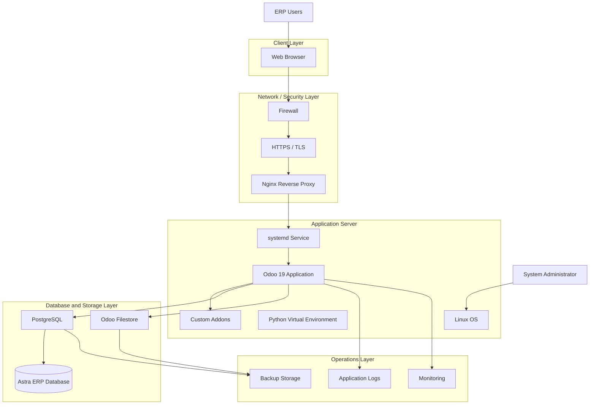
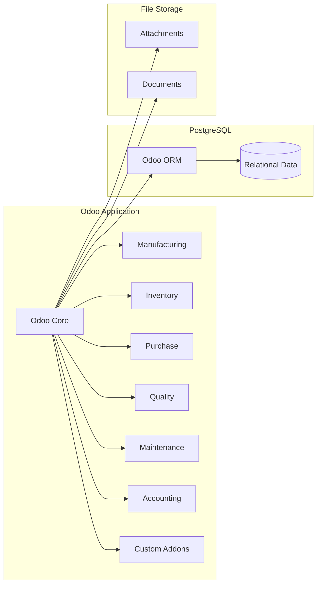
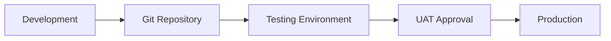
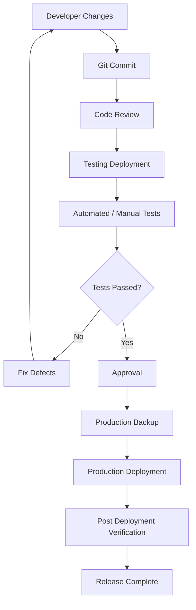

# Technical Architecture

**Project:** Astra Manufacturing — Manufacturing & Production Management ERP  
**Document ID:** TA-ERP-001  
**Version:** 1.0  
**Status:** Draft — Portfolio Simulation  
**ERP Platform:** Odoo 19  
**Database:** PostgreSQL  
**Deployment Model:** On-Premise / Self-Hosted  
**Installation Method:** Source Installation  
**Containerization:** Not Used

---

# Document Control

| Attribute | Details |
|---|---|
| Document Name | Technical Architecture |
| Document ID | TA-ERP-001 |
| Project | Astra Manufacturing ERP Implementation |
| Version | 1.0 |
| Status | Draft |
| Prepared By | ERP Technical Team |
| Reviewed By | Technical Lead |
| Approval Authority | Project Sponsor |
| Last Updated | 2026-11-08 |

## Revision History

| Version | Date | Author | Description |
|---|---|---|---|
| 1.0 | 2026-11-08 | ERP Technical Team | Initial technical architecture |

---

# 1. Introduction

## 1.1 Purpose

This document defines the technical architecture for implementing the Astra Manufacturing ERP system using Odoo 19.

It describes the infrastructure, application architecture, database architecture, deployment strategy, security controls, backup procedures, development standards, and operational requirements.

The document serves as a technical reference for:

- Environment preparation.
- Odoo installation.
- PostgreSQL configuration.
- Custom module development.
- Application deployment.
- Security implementation.
- Database administration.
- Backup and recovery.
- Monitoring and maintenance.
- Technical testing.

## 1.2 Project Background

Astra Manufacturing requires an integrated ERP platform to support its manufacturing and operational processes.

Odoo 19 is selected as the ERP application platform.

The proposed implementation uses:

- Linux server environment.
- Odoo 19 installed from source.
- Python virtual environment.
- PostgreSQL database server.
- Custom addons directory.
- Nginx reverse proxy for production.
- systemd service management.
- Git-based source code management.

Docker and Docker Compose are explicitly excluded from this architecture.

## 1.3 Architecture Objectives

The technical architecture must:

1. Provide a stable Odoo 19 runtime environment.
2. Separate application and database responsibilities.
3. Support controlled custom module development.
4. Protect database credentials and application secrets.
5. Provide secure access through HTTPS in production.
6. Support reliable database and filestore backups.
7. Enable controlled application updates.
8. Support development, testing, and production environments.
9. Minimize unnecessary customization.
10. Maintain a clear deployment and recovery procedure.

## 1.4 Architecture Principles

| Principle | Description |
|---|---|
| Separation of Concerns | Application, database, proxy, and storage responsibilities must be clearly separated. |
| Standard First | Prefer Odoo standard functionality over custom development. |
| Least Privilege | Services and users must receive only necessary permissions. |
| Environment Separation | Development, testing, and production must not share uncontrolled data or configurations. |
| Configuration Management | Application configuration must be maintained outside application source code. |
| Version Control | Custom source code must be managed using Git. |
| Recoverability | Database and filestore must be backed up and restoration must be tested. |
| Security by Default | Exposed services and administrative access must be restricted. |
| Reproducibility | Installation and deployment steps must be documented and repeatable. |

---

# 2. Architecture Overview

## 2.1 High-Level Architecture

The solution consists of the following major components:

1. Client Layer.
2. Reverse Proxy Layer.
3. Application Layer.
4. Database Layer.
5. File Storage Layer.
6. Monitoring and Backup Layer.

### Architecture Diagram



## 2.2 Component Responsibilities

| Component | Responsibility |
|---|---|
| Linux OS | Hosts application and database services |
| Nginx | Handles reverse proxy and HTTPS termination |
| Odoo 19 | Provides ERP business functionality |
| Python Virtual Environment | Isolates Python dependencies |
| PostgreSQL | Stores structured ERP data |
| Odoo Filestore | Stores uploaded files and attachments |
| Custom Addons | Contains approved business-specific extensions |
| systemd | Manages Odoo service lifecycle |
| Git | Manages application customization source code |
| Backup Storage | Stores recoverable database and file backups |
| Monitoring | Tracks application and infrastructure health |

## 2.3 Logical Architecture



The logical application modules interact through Odoo's ORM and supported application interfaces.

Custom modules must not bypass Odoo's business logic by directly manipulating application tables.

---

# 3. Technology Stack

## 3.1 Proposed Technology Stack

| Layer | Technology | Purpose |
|---|---|---|
| Operating System | Ubuntu Server LTS | Server operating environment |
| ERP Framework | Odoo 19 | ERP application |
| Programming Language | Python | Odoo backend development |
| Frontend | JavaScript / XML / OWL | Odoo user interface customization |
| Database | PostgreSQL | Persistent relational storage |
| Reverse Proxy | Nginx | HTTP routing and HTTPS termination |
| Process Manager | systemd | Application service management |
| Source Control | Git | Source code version control |
| Python Environment | venv | Dependency isolation |
| Backup | PostgreSQL utilities and filesystem backup | Recovery |
| Monitoring | OS and application monitoring tools | Operational visibility |

The precise operating system release, Python version, PostgreSQL version, and package dependencies must be verified against the official Odoo 19 installation requirements before installation.

## 3.2 Technology Selection Rationale

### Odoo 19

Odoo is selected because it provides integrated applications for:

- Manufacturing.
- Inventory.
- Procurement.
- Quality.
- Maintenance.
- Accounting.

### PostgreSQL

PostgreSQL is selected because it is the supported relational database platform for Odoo.

### Python Virtual Environment

A Python virtual environment isolates the dependencies required by the Odoo installation.

It reduces the risk of conflicting Python packages between unrelated projects.

### Nginx

Nginx provides:

- Reverse proxy functionality.
- HTTPS termination.
- HTTP to HTTPS redirection.
- Request size limits.
- Proxy timeout configuration.
- Static file and attachment serving integration where configured.

### Git

Git is used to manage custom addon source code and implementation changes.

---

# 4. Infrastructure Architecture

## 4.1 Infrastructure Topology

The initial architecture uses one Linux server hosting Odoo and PostgreSQL.

For a larger production environment, the application and database layers may be separated into dedicated servers.

### Initial Deployment

```text
Astra Manufacturing Server
│
├── Linux Operating System
│
├── Nginx
│
├── Odoo 19
│   ├── Odoo Core
│   ├── Standard Addons
│   └── Custom Addons
│
├── Python Virtual Environment
│
├── PostgreSQL
│   └── astra_manufacturing
│
├── Odoo Filestore
│
└── Application Logs
```

This single-server topology is appropriate for a controlled portfolio implementation and a small deployment subject to resource validation.

It is not equivalent to a highly available production architecture.

## 4.2 Proposed Environment Specifications

The following values are illustrative sizing assumptions, not benchmarked production capacity.

| Resource | Development | Testing | Initial Production Proposal |
|---|---|---|---|
| CPU | 2 vCPU | 2–4 vCPU | 4–8 vCPU |
| RAM | 4 GB | 4–8 GB | 8–16 GB |
| Storage | 40 GB SSD | 60 GB SSD | 100 GB+ SSD |
| Operating System | Ubuntu Server | Ubuntu Server | Ubuntu Server |
| PostgreSQL | Local | Local or Separate | Local or Separate |
| Odoo Workers | 0 / threaded | Based on test setup | Sized based on workload |
| HTTPS | Optional local TLS | Recommended | Required |
| Backup | Manual / Automated | Automated | Automated and off-server |

Final resource sizing must consider:

- Number of concurrent users.
- Database size.
- Number of manufacturing transactions.
- Number of attachments.
- Reporting complexity.
- Scheduled jobs.
- Custom module workload.
- Database query performance.

## 4.3 Network Architecture

### Required Network Ports

| Port | Protocol | Service | Access |
|---|---|---|---|
| 22 | TCP | SSH | Restricted administrator IPs |
| 80 | TCP | HTTP | Public or internal web access for HTTPS redirection |
| 443 | TCP | HTTPS | Authorized ERP users |
| 8069 | TCP | Odoo HTTP | Localhost or trusted reverse proxy |
| 8072 | TCP | Odoo gevent / WebSocket | Localhost or trusted reverse proxy, when applicable |
| 5432 | TCP | PostgreSQL | Localhost or authorized application server |

PostgreSQL should not be exposed directly to the public internet.

Odoo application ports should not be publicly exposed when Nginx is used as the reverse proxy.

---

# 5. Operating System Architecture

## 5.1 Operating System

The proposed operating system is Ubuntu Server LTS.

The installation must use a supported and maintained operating system release.

## 5.2 Linux Service Users

The following operating system accounts are proposed:

| User | Purpose |
|---|---|
| root | System administration |
| odoo | Runs the Odoo application |
| postgres | Runs PostgreSQL |
| deploy | Optional deployment account |

### Security Rules

- Odoo must not run as root.
- PostgreSQL must run under its dedicated system account.
- Custom addon directories must be writable only by authorized developers or deployment processes.
- Application runtime directories must have appropriate ownership.
- SSH access must be restricted.
- Administrative privileges must use controlled privilege escalation.

## 5.3 Directory Structure

The proposed filesystem structure is:

```text
/opt/
└── odoo/
    ├── server/
    │   └── odoo/
    │       ├── odoo-bin
    │       ├── odoo/
    │       └── addons/
    │
    ├── custom-addons/
    │   ├── astra_manufacturing/
    │   ├── astra_quality/
    │   └── astra_maintenance/
    │
    └── venv/

/etc/
└── odoo/
    └── odoo.conf

/var/lib/
└── odoo/
    └── filestore/
        └── astra_manufacturing/

/var/log/
└── odoo/
    └── odoo-server.log

/var/backups/
└── odoo/
    ├── database/
    ├── filestore/
    └── configuration/
```

### Directory Ownership

| Directory | Owner | Purpose |
|---|---|---|
| `/opt/odoo/server` | Deployment administrator | Odoo source |
| `/opt/odoo/custom-addons` | Deployment administrator | Custom modules |
| `/opt/odoo/venv` | Deployment administrator | Python environment |
| `/etc/odoo` | root | Configuration |
| `/var/lib/odoo` | odoo | Runtime data and filestore |
| `/var/log/odoo` | odoo | Application logs |
| `/var/backups/odoo` | Backup administrator | Backup storage |

The actual ownership and permissions must be applied consistently with the deployment method.

---

# 6. Application Architecture

## 6.1 Odoo Installation Model

Odoo 19 will be installed from its source repository.

The installation will use:

- Official Odoo source code.
- Python virtual environment.
- Required system dependencies.
- PostgreSQL.
- External custom addon directories.

The source installation provides flexibility for development and customization.

## 6.2 Odoo Source Structure

```text
/opt/odoo/server/odoo/
│
├── odoo-bin
│
├── odoo/
│   ├── addons/
│   ├── models/
│   ├── fields.py
│   ├── api.py
│   └── ...
│
├── addons/
│   ├── base/
│   ├── web/
│   ├── sale/
│   ├── purchase/
│   ├── stock/
│   ├── mrp/
│   ├── quality/
│   ├── maintenance/
│   └── ...
│
└── setup/
```

The exact source tree depends on the selected Odoo repository and edition.

## 6.3 Python Virtual Environment

A dedicated Python virtual environment must be created for Odoo.

Example:

```bash
cd /opt/odoo

python3 -m venv venv

source venv/bin/activate

python -m pip install --upgrade pip setuptools wheel
```

Python dependencies must be installed according to the official Odoo 19 requirements and the selected deployment method.

Example:

```bash
cd /opt/odoo/server/odoo

/opt/odoo/venv/bin/pip install -r requirements.txt
```

Do not install Odoo dependencies globally unless there is a documented operational reason.

## 6.4 Addons Architecture

The addons architecture is separated into three categories.

### 1. Odoo Core Addons

Contains standard Odoo modules.

Examples:

- `base`
- `web`
- `stock`
- `mrp`
- `purchase`
- `quality`
- `maintenance`
- `account`

### 2. Official Enterprise Addons

Applicable only if the selected Odoo edition and license provide access to them.

Enterprise source code must not be mixed with Community source code without following the applicable licensing and deployment requirements.

### 3. Custom Addons

Contains business-specific functionality developed for Astra Manufacturing.

Proposed custom addons:

| Module | Purpose | Initial Status |
|---|---|---|
| `astra_manufacturing` | Manufacturing-specific extensions | Optional |
| `astra_quality` | Quality-specific extensions | Optional |
| `astra_maintenance` | Maintenance-specific extensions | Optional |
| `astra_reporting` | Additional reporting | Optional |

These are proposed module names, not a commitment to develop all four modules.

Custom development must only proceed after the functional gap analysis in `03_functional_specification.md`.

## 6.5 Addons Path Configuration

The Odoo configuration must define the required addon directories.

Example:

```ini
addons_path = /opt/odoo/server/odoo/odoo/addons,/opt/odoo/server/odoo/addons,/opt/odoo/custom-addons
```

The actual directories must be checked against the installed source tree.

## 6.6 Custom Module Structure

Example:

```text
astra_manufacturing/
│
├── __init__.py
├── __manifest__.py
│
├── models/
│   ├── __init__.py
│   └── manufacturing_order.py
│
├── views/
│   └── manufacturing_order_views.xml
│
├── security/
│   ├── ir.model.access.csv
│   └── security.xml
│
├── data/
│   └── sequence.xml
│
├── report/
│   └── manufacturing_report.xml
│
├── static/
│   └── description/
│       └── icon.png
│
└── tests/
    ├── __init__.py
    └── test_manufacturing_order.py
```

The module structure must follow Odoo development conventions.

Only files required by the module should be included.

---

# 7. Database Architecture

## 7.1 Database Platform

PostgreSQL is used as the relational database management system.

It stores:

- Business master data.
- Manufacturing transactions.
- Inventory transactions.
- Procurement transactions.
- Quality records.
- Maintenance records.
- Accounting data.
- User and security information.
- Application configuration data.

## 7.2 Database Naming Convention

| Environment | Database Name |
|---|---|
| Development | `astra_manufacturing_dev` |
| Testing | `astra_manufacturing_test` |
| Production | `astra_manufacturing` |

Production and non-production databases must remain separate.

## 7.3 PostgreSQL Access Model

Odoo must connect to PostgreSQL through a dedicated database account.

Example:

```text
PostgreSQL
│
├── postgres
│   └── Database Administration
│
└── odoo
    └── Odoo Application Database Access
```

The Odoo application account must not be a PostgreSQL superuser.

The database owner and application connection user should be managed separately where practical.

## 7.4 Database Connection

For an application and database hosted on the same machine, a local PostgreSQL Unix socket is preferred where supported by the operating system and configuration.

If TCP localhost is used, the database should listen only on the required local interface.

If the database is hosted on a separate server:

- Restrict network access to the application server.
- Configure PostgreSQL authentication.
- Use encrypted database connections where appropriate.
- Do not expose PostgreSQL to untrusted networks.

## 7.5 Database Configuration

The following parameters require review:

| Parameter | Purpose |
|---|---|
| `db_host` | PostgreSQL hostname or socket configuration |
| `db_port` | PostgreSQL port |
| `db_user` | Odoo database account |
| `db_password` | Database credential |
| `db_name` | Database selection |
| `dbfilter` | Database filtering |
| `db_maxconn` | Database connection pool limit |

The final values must be determined from the actual PostgreSQL installation and expected workload.

## 7.6 Data Integrity

The implementation must use Odoo ORM for application-level data operations.

Direct SQL should be limited to controlled administrative tasks, diagnostics, and approved migration operations.

Custom modules must not bypass:

- Model access rights.
- Record rules.
- Business validations.
- ORM constraints.
- Supported transaction handling.

## 7.7 Database Performance

Database performance must be evaluated through:

- Query execution analysis.
- Database connection monitoring.
- Index review.
- Slow query identification.
- Table growth monitoring.
- Vacuum and analyze operations.
- PostgreSQL resource monitoring.

Custom SQL and reporting queries must be reviewed for performance impact.

---

# 8. File Storage Architecture

## 8.1 Odoo Filestore

Odoo stores uploaded files and attachments in its filestore.

Examples include:

- Product images.
- Manufacturing documents.
- Quality inspection attachments.
- Maintenance documents.
- Supplier documents.
- Technical drawings.
- Other ERP attachments.

The filestore is associated with the relevant Odoo database.

## 8.2 Storage Location

The proposed filestore location is:

```text
/var/lib/odoo/filestore/
└── astra_manufacturing/
```

The actual location must be verified using the configured Odoo data directory and database name.

## 8.3 Storage Requirements

- Filestore must be included in backup procedures.
- Odoo must have the required read and write permissions.
- Backup files must not be stored only on the same disk as the original data.
- Storage capacity must be monitored.
- Access to confidential documents must be restricted.
- Retention policies must be defined.

## 8.4 Database and Filestore Consistency

Database backups and filestore backups must represent a consistent recovery point.

A database-only backup is insufficient for a complete Odoo restoration when attachments are stored in the filestore.

The backup process must coordinate the database dump and filestore copy, preferably through a controlled backup window or a snapshot/locking strategy that prevents inconsistent attachment changes during backup.

---

# 9. Environment Architecture

## 9.1 Environment Separation

The project uses three environments.

| Environment | Purpose |
|---|---|
| Development | Custom module development and configuration |
| Testing | Functional, integration, and regression testing |
| Production | Live ERP operations |

## 9.2 Development Environment

Purpose:

- Develop custom addons.
- Configure Odoo.
- Test business logic.
- Perform debugging.
- Experiment with master data.

Characteristics:

- Developer access.
- Development logging.
- Demo data may be enabled in a separate database.
- Development-only debugging options may be enabled.
- No real confidential production data unless explicitly approved and sanitized.

## 9.3 Testing Environment

Purpose:

- Validate functional specifications.
- Execute test cases.
- Perform integration testing.
- Conduct UAT.
- Validate deployment procedures.

Characteristics:

- Controlled test data.
- Production-like configuration.
- Restricted access.
- Stable module versions.
- Documented test evidence.

## 9.4 Production Environment

Purpose:

- Support actual business operations.

Characteristics:

- Restricted administrative access.
- No development debug flags.
- HTTPS enabled.
- Dedicated application service account.
- Production database.
- Automated backup.
- Controlled deployment.
- Monitoring and alerting.

## 9.5 Environment Promotion

The deployment process follows:



Changes must not be deployed directly from an unreviewed developer working directory into production.

---

# 10. Odoo Runtime Configuration

## 10.1 Configuration File

The Odoo configuration file is stored at:

```text
/etc/odoo/odoo.conf
```

It must be readable by the Odoo service account and writable only by authorized administrators.

## 10.2 Proposed Production Configuration

Example:

```ini
[options]

; Application
admin_passwd = CHANGE_THIS_TO_A_LONG_RANDOM_SECRET
http_interface = 127.0.0.1
http_port = 8069
gevent_port = 8072

; Database
db_host = False
db_port = False
db_user = odoo
db_password = CHANGE_THIS_TO_A_SECURE_PASSWORD
dbfilter = ^astra_manufacturing$
list_db = False

; Addons
addons_path = /opt/odoo/server/odoo/odoo/addons,/opt/odoo/server/odoo/addons,/opt/odoo/custom-addons

; Data
data_dir = /var/lib/odoo

; Logging
logfile = /var/log/odoo/odoo-server.log
log_level = info

; Security and Proxy
proxy_mode = True

; Performance
workers = 4
max_cron_threads = 2

; Request and Memory Limits
limit_request = 8192
limit_time_cpu = 60
limit_time_real = 120
limit_memory_soft = 2147483648
limit_memory_hard = 2684354560
```

**Important configuration notes:**

1. The example assumes Nginx is the trusted reverse proxy.
2. `proxy_mode = True` must not be enabled when Odoo is directly exposed without a trusted reverse proxy.
3. `db_host = False` and `db_port = False` represent the local Unix socket approach; verify this against the actual PostgreSQL setup.
4. Worker counts and resource limits are illustrative, not universal production values.
5. Worker sizing must consider available CPU and memory, expected concurrent users, cron workloads, and database connection capacity.
6. `gevent_port` is relevant when using the applicable gevent/WebSocket deployment mode. Configure Nginx routing consistently with the installed Odoo version.
7. Credentials must be replaced with generated secrets.
8. Never commit production credentials to Git.
9. The database filter and database restriction must be tested with the actual database name.
10. Do not expose database management functionality to untrusted users.

## 10.3 Development Configuration

Development configuration may use:

```ini
[options]

admin_passwd = CHANGE_THIS_SECRET

http_interface = 127.0.0.1
http_port = 8069

db_host = False
db_port = False
db_user = odoo
db_password = DEVELOPMENT_DATABASE_PASSWORD
dbfilter = ^astra_manufacturing_dev$
list_db = False

addons_path = /opt/odoo/server/odoo/odoo/addons,/opt/odoo/server/odoo/addons,/opt/odoo/custom-addons

data_dir = /var/lib/odoo

log_level = debug

workers = 0
max_cron_threads = 2
```

Development-only options such as `--dev=all` may be used when required.

They must not be carried into production configuration.

---

# 11. Process and Service Management

## 11.1 systemd Service

Production Odoo must run as a managed Linux service.

Proposed service file:

```ini
[Unit]
Description=Odoo 19 ERP Application
Documentation=https://www.odoo.com/documentation/19.0/
After=network.target postgresql.service
Requires=postgresql.service

[Service]
Type=simple

User=odoo
Group=odoo

WorkingDirectory=/opt/odoo/server/odoo

ExecStart=/opt/odoo/venv/bin/python /opt/odoo/server/odoo/odoo-bin -c /etc/odoo/odoo.conf

Restart=on-failure
RestartSec=5

KillSignal=SIGINT
TimeoutStopSec=60

LimitNOFILE=65535

[Install]
WantedBy=multi-user.target
```

The service file must be reviewed for the actual PostgreSQL topology and filesystem ownership.

## 11.2 Service Management Commands

Reload systemd:

```bash
sudo systemctl daemon-reload
```

Enable Odoo at startup:

```bash
sudo systemctl enable odoo
```

Start Odoo:

```bash
sudo systemctl start odoo
```

Check service status:

```bash
sudo systemctl status odoo
```

Restart Odoo:

```bash
sudo systemctl restart odoo
```

View logs:

```bash
sudo journalctl -u odoo -f
```

## 11.3 Service Management Requirements

- Odoo must start automatically after server reboot.
- Service failures must be logged.
- Service restart behavior must be controlled.
- The Odoo process must run under a non-root account.
- Configuration changes must follow change management.
- Application updates must be followed by functional verification.

---

# 12. Reverse Proxy and HTTPS Architecture

## 12.1 Nginx Responsibilities

Nginx is used in production to:

- Accept incoming HTTP and HTTPS requests.
- Redirect HTTP to HTTPS.
- Terminate TLS.
- Forward application requests to Odoo.
- Forward applicable WebSocket requests.
- Apply request size and timeout limits.

## 12.2 Request Flow

```text
ERP User
   |
   v
HTTPS Request
   |
   v
Nginx Reverse Proxy
   |
   +------> Odoo HTTP :8069
   |
   +------> Odoo Gevent/WebSocket :8072
   |
   v
Odoo Application
   |
   v
PostgreSQL
```

## 12.3 Example Nginx Configuration

The following is a starting template.

The WebSocket route and upstream must be validated against the installed Odoo 19 deployment mode.

```nginx
upstream odoo_backend {
    server 127.0.0.1:8069;
}

upstream odoo_gevent {
    server 127.0.0.1:8072;
}

server {
    listen 80;
    server_name erp.example.com;

    return 301 https://$host$request_uri;
}

server {
    listen 443 ssl;
    server_name erp.example.com;

    ssl_certificate /etc/letsencrypt/live/erp.example.com/fullchain.pem;
    ssl_certificate_key /etc/letsencrypt/live/erp.example.com/privkey.pem;

    client_max_body_size 50m;

    proxy_read_timeout 720s;
    proxy_connect_timeout 60s;
    proxy_send_timeout 720s;

    location /websocket {
        proxy_pass http://odoo_gevent;

        proxy_http_version 1.1;

        proxy_set_header Upgrade $http_upgrade;
        proxy_set_header Connection "upgrade";

        proxy_set_header Host $host;
        proxy_set_header X-Real-IP $remote_addr;
        proxy_set_header X-Forwarded-For $proxy_add_x_forwarded_for;
        proxy_set_header X-Forwarded-Proto $scheme;
    }

    location / {
        proxy_pass http://odoo_backend;

        proxy_http_version 1.1;

        proxy_set_header Host $host;
        proxy_set_header X-Real-IP $remote_addr;
        proxy_set_header X-Forwarded-For $proxy_add_x_forwarded_for;
        proxy_set_header X-Forwarded-Proto $scheme;
    }
}
```

The example assumes the applicable Odoo gevent service is running on port 8072.

If the selected Odoo runtime does not use this endpoint, the configuration must be adapted.

## 12.4 HTTPS Requirements

Production must:

- Use a valid TLS certificate.
- Redirect HTTP traffic to HTTPS.
- Use supported TLS configurations.
- Renew certificates automatically.
- Restrict access to private administrative interfaces.
- Avoid transmitting authentication credentials over plain HTTP.

---

# 13. Security Architecture

## 13.1 Security Objectives

The security architecture must protect:

- User accounts.
- ERP business data.
- Database credentials.
- Application secrets.
- Uploaded files.
- Custom source code.
- Administrative interfaces.
- Network access.

## 13.2 Authentication

The system must:

- Use individual user accounts.
- Avoid shared operational accounts.
- Enforce appropriate password policies.
- Disable inactive accounts.
- Restrict administrator access.
- Use additional authentication controls where supported and appropriate.

## 13.3 Authorization

Authorization must use:

- Odoo user groups.
- Access Control Lists (ACLs).
- Record rules.
- Company restrictions.
- Menu and model access controls.

The actual role design is documented in `03_functional_specification.md`.

## 13.4 Database Security

- PostgreSQL must not be publicly accessible.
- Odoo must use a dedicated database user.
- PostgreSQL superuser credentials must not be stored in Odoo configuration.
- Database credentials must be protected.
- Administrative database access must be restricted.
- Database backups must be encrypted when stored outside trusted infrastructure.

## 13.5 Application Security

- Odoo must not run as root.
- Odoo must run behind a trusted reverse proxy in production.
- `proxy_mode` must only be enabled behind that proxy.
- Database listing and database management exposure must be restricted.
- Production secrets must not be committed to Git.
- Custom modules must be reviewed before deployment.
- Untrusted Python code must never be executed through custom addons.
- Development debug options must not be enabled in production.

## 13.6 Firewall Policy

Proposed firewall rules:

| Port | Allow From | Policy |
|---|---|---|
| 22 | Administrator IPs | Allow |
| 80 | Required web clients | Allow for HTTPS redirection |
| 443 | Authorized web clients | Allow |
| 8069 | Localhost / trusted proxy | Deny public access |
| 8072 | Localhost / trusted proxy | Deny public access |
| 5432 | Localhost / authorized application server | Deny public access |

Firewall implementation must match the actual network topology.

## 13.7 Secrets Management

The following must be treated as secrets:

- Odoo master password.
- PostgreSQL credentials.
- SMTP credentials.
- TLS private keys.
- External integration tokens.
- Backup encryption keys.

Secrets must not be:

- Hardcoded in Python source code.
- Committed to Git.
- Included in public portfolio repositories.
- Exposed in logs.
- Shared through unsecured channels.

---

# 14. Backup and Disaster Recovery

## 14.1 Backup Scope

The backup process must cover:

1. PostgreSQL database.
2. Odoo filestore.
3. Odoo configuration.
4. Custom addons source code.
5. Relevant deployment and service configuration.
6. Backup encryption keys and recovery documentation, stored securely.

## 14.2 Backup Strategy

Proposed backup schedule:

| Backup Type | Frequency | Retention |
|---|---|---|
| Database Backup | Daily | 30 days |
| Filestore Backup | Daily | 30 days |
| Configuration Backup | After approved changes | Versioned |
| Custom Addons Backup | Git-based continuous versioning | Repository policy |
| Full Recovery Backup | Weekly | 8 weeks |
| Off-site Backup | Daily | Based on retention policy |

These are proposed portfolio settings and must be adapted to actual business recovery requirements.

## 14.3 Database Backup

Example using PostgreSQL:

```bash
pg_dump \
    -h localhost \
    -U odoo_backup \
    -Fc \
    -f astra_manufacturing.dump \
    astra_manufacturing
```

The backup account and authentication method must be configured securely.

Avoid exposing passwords directly in shell history or process arguments.

Use an appropriate protected PostgreSQL authentication method, such as a restricted password file or a controlled local authentication mechanism.

## 14.4 Filestore Backup

Example:

```bash
tar -czf astra_filestore.tar.gz \
    -C /var/lib/odoo/filestore \
    astra_manufacturing
```

This command is only a file archive example.

A production backup procedure must coordinate the filestore snapshot with the database backup to ensure consistency.

## 14.5 Backup Storage

Backups must be stored:

- Outside the application source directory.
- Outside the PostgreSQL data directory.
- Outside the primary failure domain where possible.
- In an access-controlled location.
- With encryption where appropriate.

A backup located only on the same physical server is not sufficient protection against server loss.

## 14.6 Recovery Objectives

The BRD contains proposed recovery targets:

| Metric | Proposed Target |
|---|---|
| Recovery Point Objective (RPO) | 24 hours |
| Recovery Time Objective (RTO) | 4 hours |

These targets must be validated through a realistic restoration exercise.

## 14.7 Restoration Procedure

1. Prepare a clean compatible Linux environment.
2. Install compatible Odoo and PostgreSQL versions.
3. Restore the PostgreSQL database.
4. Restore the matching filestore.
5. Restore Odoo configuration.
6. Restore compatible custom addons.
7. Validate filesystem ownership and permissions.
8. Start PostgreSQL.
9. Start Odoo.
10. Verify database connectivity.
11. Verify attachment availability.
12. Verify core ERP operations.
13. Record restoration evidence.
14. Obtain recovery approval.

## 14.8 Recovery Testing

Recovery tests must verify:

- Database restoration.
- Filestore restoration.
- User authentication.
- Manufacturing order availability.
- Inventory availability.
- Quality record availability.
- Accounting record availability.
- Attachment availability.
- Custom module compatibility.

A successful backup job does not prove that the system can be restored. Restoration must be tested periodically.

---

# 15. Logging and Monitoring

## 15.1 Application Logging

Odoo application logs must capture relevant operational information.

Examples:

- Application startup and shutdown.
- Module loading.
- Database connection issues.
- Application exceptions.
- Scheduled job failures.
- Performance-related warnings.
- Security-related errors.

## 15.2 Log Management

Logs must:

- Be stored outside the source repository.
- Use appropriate permissions.
- Rotate automatically.
- Have defined retention.
- Avoid recording sensitive secrets.
- Be available for troubleshooting.

## 15.3 Infrastructure Monitoring

The following metrics should be monitored:

| Metric | Purpose |
|---|---|
| CPU Utilization | Identify CPU saturation |
| Memory Usage | Detect memory pressure |
| Disk Usage | Prevent storage exhaustion |
| Database Connections | Monitor connection capacity |
| PostgreSQL Performance | Identify database bottlenecks |
| Odoo Service Status | Detect application downtime |
| HTTP Response Time | Evaluate application responsiveness |
| Backup Status | Verify backup completion |
| SSL Certificate Expiry | Prevent certificate expiration |

## 15.4 Alerting

Alerts should be generated for:

- Odoo service failure.
- PostgreSQL service failure.
- Disk space below defined thresholds.
- Repeated application errors.
- Backup failures.
- Certificate expiration.
- Abnormal resource consumption.

Thresholds must be defined based on observed workload and operational requirements.

---

# 16. Source Code Management

## 16.1 Git Repository Structure

Proposed repository structure:

```text
astra-manufacturing-erp/
│
├── README.md
│
├── documentations/
│   ├── 00_business_requirements_gathering.md
│   ├── 01_business_requirements.md
│   ├── 02_master_data_and_bom.md
│   ├── 03_functional_specification.md
│   ├── 04_technical_architecture.md
│   └── 05_test_strategy_and_test_cases.md
│
├── business_processes/
│   ├── 01_manufacturing_process.md
│   ├── 02_inventory_management.md
│   ├── 03_procurement_process.md
│   ├── 04_quality_management.md
│   ├── 05_maintenance_management.md
│   └── 06_costing_and_accounting.md
│
├── custom_addons/
│   ├── astra_manufacturing/
│   ├── astra_quality/
│   ├── astra_maintenance/
│   └── astra_reporting/
│
├── deployment/
│   ├── odoo.conf.example
│   ├── odoo.service
│   ├── nginx/
│   │   └── odoo.conf.example
│   └── scripts/
│       ├── backup_database.sh
│       ├── backup_filestore.sh
│       └── restore_database.sh
│
├── migrations/
│
├── tests/
│
└── .gitignore
```

The `custom_addons` directory may remain empty until a validated customization is required.

The directory structure must be adjusted to the actual repository implementation.

## 16.2 Branching Strategy

A simple Git workflow is proposed:

| Branch | Purpose |
|---|---|
| `main` | Stable and production-ready code |
| `develop` | Integration branch |
| `feature/*` | New functionality |
| `bugfix/*` | Defect fixes |
| `hotfix/*` | Urgent production fixes |

## 16.3 Commit Convention

Use meaningful commit messages.

Examples:

```text
feat: add manufacturing order validation

fix: correct work center operation assignment

refactor: simplify production workflow

test: add manufacturing order test cases

docs: update technical architecture
```

## 16.4 Code Review Requirements

Before merging custom code:

- Review Python implementation.
- Review XML views.
- Review access control configuration.
- Review model constraints.
- Review dependencies.
- Review test coverage.
- Review database migration impact.
- Review performance implications.
- Confirm compatibility with Odoo 19.

## 16.5 Git Ignore

The repository must exclude:

- Python virtual environments.
- Python cache files.
- Runtime logs.
- Local configuration containing secrets.
- Database dumps.
- Filestore contents.
- Temporary files.
- Editor-specific files.

Example:

```gitignore
# Python
__pycache__/
*.py[cod]
*.pyo

# Virtual environments
venv/
.venv/

# Odoo runtime
*.log
*.pid

# Secrets and local configuration
odoo.conf
.env
.env.*

# Database and backup files
*.dump
*.sql
*.backup
*.tar.gz

# Runtime data
filestore/

# IDE
.idea/
.vscode/

# OS
.DS_Store
```

Keep sanitized configuration templates such as `odoo.conf.example` in version control.

---

# 17. Deployment Architecture

## 17.1 Deployment Strategy

Production deployment must use a controlled release process.

The proposed deployment flow is:



## 17.2 Deployment Procedure

1. Confirm release scope.
2. Review changes.
3. Verify test environment results.
4. Obtain deployment approval.
5. Create a database backup.
6. Create a matching filestore backup.
7. Record the deployed Git commit.
8. Deploy approved source code.
9. Update dependencies if required.
10. Stop Odoo service.
11. Upgrade affected modules.
12. Start Odoo service.
13. Review application logs.
14. Perform smoke tests.
15. Verify critical ERP workflows.
16. Record deployment evidence.

## 17.3 Module Upgrade

Module upgrades must be executed in a controlled maintenance window.

Example:

```bash
sudo -u odoo \
    /opt/odoo/venv/bin/python \
    /opt/odoo/server/odoo/odoo-bin \
    -c /etc/odoo/odoo.conf \
    -d astra_manufacturing \
    -u astra_manufacturing \
    --stop-after-init
```

The module name must match the actual installed custom module.

For multiple modules, use a controlled comma-separated module list.

Do not use `-u all` as a routine production deployment shortcut.

Module upgrades can alter database schema and data. A tested backup and recovery plan must exist before upgrading.

## 17.4 Rollback Strategy

If deployment fails:

1. Stop the affected Odoo service.
2. Identify the failure.
3. Determine whether the database was modified.
4. Restore the matching database and filestore when necessary.
5. Restore the previous compatible code release.
6. Start Odoo.
7. Verify critical transactions.
8. Record the incident.

Restoring an old database without its matching filestore can result in missing or inconsistent attachments.

Code rollback alone is not always sufficient after a database schema migration.

---

# 18. Performance and Scalability

## 18.1 Performance Objectives

The system must be evaluated under realistic business workloads.

Testing must cover:

- Concurrent users.
- Manufacturing order creation.
- Work order execution.
- Inventory transactions.
- Quality inspection processing.
- Procurement operations.
- Reporting queries.
- Scheduled jobs.

## 18.2 Odoo Worker Configuration

Odoo supports different runtime modes.

### Development Mode

The default threaded mode is suitable for development and demonstrations.

It is not the recommended production configuration for a workload that requires multiprocessing performance.

### Production Mode

Production should use multiprocessing where supported and appropriately sized.

Worker configuration must consider:

- CPU availability.
- Memory limits.
- Number of concurrent requests.
- Cron workloads.
- Long-running requests.
- Database connection limits.

A worker configuration must not be copied blindly from another server.

## 18.3 Database Optimization

Database optimization must prioritize:

- Appropriate indexes.
- Efficient ORM queries.
- Avoidance of N+1 query patterns.
- Efficient batch processing.
- Proper transaction boundaries.
- Query plan analysis.
- Database maintenance.

Custom modules must avoid unnecessary database queries inside loops.

## 18.4 Scalability Roadmap

Potential future improvements:

| Phase | Improvement |
|---|---|
| Phase 1 | Single-server deployment |
| Phase 2 | Dedicated PostgreSQL server |
| Phase 3 | External backup storage and monitoring |
| Phase 4 | Dedicated application server resources |
| Phase 5 | Read replica evaluation for supported read workloads |
| Phase 6 | High availability and disaster recovery architecture |

Each phase requires workload evidence and business justification.

---

# 19. Technical Dependencies and Integration

## 19.1 Internal Application Dependencies

| Application | Dependency |
|---|---|
| Manufacturing | Inventory |
| Purchase | Inventory |
| Quality | Manufacturing / Inventory, depending on workflow |
| Maintenance | Manufacturing, where work center integration is required |
| Accounting | Inventory and Purchase integration |

Actual Odoo module dependencies must be confirmed from the installed module manifests.

## 19.2 External Integrations

No external integrations are mandatory in the initial scope.

Potential future integrations include:

- Supplier systems.
- Customer systems.
- Barcode scanners.
- Manufacturing equipment.
- Email services.
- Business intelligence platforms.

Any external integration must define:

- Business purpose.
- Authentication method.
- API contract.
- Data ownership.
- Error handling.
- Retry policy.
- Logging.
- Security requirements.
- Testing requirements.

## 19.3 Integration Architecture Principle

External systems should integrate through supported Odoo interfaces and APIs.

Direct database integration with external systems is discouraged because it bypasses Odoo's application logic and can create data integrity problems.

---

# 20. Technical Testing Strategy

## 20.1 Infrastructure Testing

| Test ID | Scenario | Expected Result |
|---|---|---|
| TC-TECH-001 | Verify Linux environment | Supported OS is available |
| TC-TECH-002 | Verify Python virtual environment | Required dependencies are installed |
| TC-TECH-003 | Verify PostgreSQL service | Database service is operational |
| TC-TECH-004 | Verify database connectivity | Odoo connects successfully |
| TC-TECH-005 | Verify Odoo service startup | Odoo starts without errors |
| TC-TECH-006 | Verify custom addon loading | Approved custom addons are detected |
| TC-TECH-007 | Verify Nginx proxy | Requests reach Odoo |
| TC-TECH-008 | Verify HTTPS | Valid TLS connection is established |
| TC-TECH-009 | Verify firewall | Unnecessary ports are inaccessible |
| TC-TECH-010 | Verify backup procedure | Database and filestore backups are generated |
| TC-TECH-011 | Verify restore procedure | System can be restored |
| TC-TECH-012 | Verify log rotation | Logs are managed correctly |

## 20.2 Application Testing

Application functionality must be tested against:

- `03_functional_specification.md`
- `05_test_strategy_and_test_cases.md`

## 20.3 Security Testing

Security testing must include:

- Unauthorized database access attempts.
- Unauthorized application access.
- User role restrictions.
- Restricted service port verification.
- HTTPS validation.
- Secrets exposure review.
- Backup access review.
- Custom module access control testing.

---

# 21. Technical Risks and Mitigation

| Risk ID | Risk | Impact | Mitigation |
|---|---|---|---|
| RSK-TECH-001 | Incompatible Python dependencies | Application installation failure | Use documented Odoo 19 requirements and isolated venv |
| RSK-TECH-002 | PostgreSQL connection failure | ERP unavailable | Validate authentication and connectivity |
| RSK-TECH-003 | Incorrect addons path | Custom modules unavailable | Validate source directories and configuration |
| RSK-TECH-004 | Database corruption | Data loss | Maintain tested backups |
| RSK-TECH-005 | Filestore not backed up | Missing attachments after recovery | Include filestore in recovery procedures |
| RSK-TECH-006 | Insecure reverse proxy | Credential exposure or proxy spoofing | Configure HTTPS and trusted proxy settings |
| RSK-TECH-007 | Excessive worker allocation | Memory exhaustion | Size workers based on available resources |
| RSK-TECH-008 | Unreviewed custom code | Application instability | Apply code review and testing |
| RSK-TECH-009 | Uncontrolled production upgrades | Downtime or data migration failure | Use tested release and rollback procedures |
| RSK-TECH-010 | Disk exhaustion | Application or database failure | Monitor disk capacity and retention |
| RSK-TECH-011 | Credential leakage | Unauthorized access | Use protected secret storage |
| RSK-TECH-012 | Untested recovery process | Extended downtime | Perform scheduled restoration exercises |

---

# 22. Technical Assumptions and Constraints

## 22.1 Assumptions

| ID | Assumption | Status |
|---|---|---|
| TA-ASM-001 | Odoo 19 is the selected ERP platform. | Project Decision |
| TA-ASM-002 | Linux is the target server operating system. | Proposed |
| TA-ASM-003 | PostgreSQL is the database platform. | Project Decision |
| TA-ASM-004 | Odoo is installed from source. | Project Decision |
| TA-ASM-005 | Python dependencies are isolated in a virtual environment. | Proposed |
| TA-ASM-006 | Custom addons are maintained in Git. | Proposed |
| TA-ASM-007 | Production access uses HTTPS. | Proposed |
| TA-ASM-008 | Database and filestore backups are maintained. | Proposed |
| TA-ASM-009 | The initial deployment uses a single application/database server. | Illustrative |
| TA-ASM-010 | Docker is excluded. | Project Decision |

## 22.2 Constraints

| ID | Constraint |
|---|---|
| TA-CON-001 | The initial deployment does not use Docker or container orchestration. |
| TA-CON-002 | Application functionality depends on the selected Odoo edition. |
| TA-CON-003 | Enterprise features require appropriate licensing and source access. |
| TA-CON-004 | Production capacity must be validated under realistic workload. |
| TA-CON-005 | Database and filestore recovery must be coordinated. |
| TA-CON-006 | Custom modules must remain compatible with Odoo 19. |
| TA-CON-007 | Major Odoo version upgrades require separate migration planning. |

## 22.3 Open Issues

| ID | Open Issue | Owner |
|---|---|---|
| TA-OPEN-001 | Confirm final Ubuntu LTS release. | Technical Lead |
| TA-OPEN-002 | Confirm compatible Python version. | Technical Lead |
| TA-OPEN-003 | Confirm PostgreSQL version. | Database Administrator |
| TA-OPEN-004 | Confirm Odoo Community or Enterprise edition. | Project Sponsor |
| TA-OPEN-005 | Confirm expected concurrent users. | Project Manager |
| TA-OPEN-006 | Confirm production server capacity. | Infrastructure Administrator |
| TA-OPEN-007 | Confirm domain name and TLS certificate. | Infrastructure Administrator |
| TA-OPEN-008 | Confirm backup destination. | Infrastructure Administrator |
| TA-OPEN-009 | Confirm final RPO and RTO. | Project Sponsor |
| TA-OPEN-010 | Confirm monitoring and alerting platform. | Technical Lead |
| TA-OPEN-011 | Confirm final custom addon scope. | Functional / Technical Team |

---

# 23. Technical Architecture Acceptance Criteria

The architecture is considered technically ready for implementation when:

| ID | Acceptance Criteria |
|---|---|
| TA-AC-001 | The target Linux environment is prepared. |
| TA-AC-002 | Odoo 19 is installed successfully. |
| TA-AC-003 | Python dependencies are isolated and reproducible. |
| TA-AC-004 | PostgreSQL is configured securely. |
| TA-AC-005 | Odoo connects successfully to PostgreSQL. |
| TA-AC-006 | The custom addon directory is configured correctly. |
| TA-AC-007 | Odoo runs under a dedicated non-root service account. |
| TA-AC-008 | Odoo service starts automatically through systemd. |
| TA-AC-009 | Production HTTP traffic is secured through HTTPS. |
| TA-AC-010 | Public access to PostgreSQL is blocked. |
| TA-AC-011 | Production secrets are not committed to Git. |
| TA-AC-012 | Database and filestore backups are configured. |
| TA-AC-013 | Database and filestore restoration has been tested. |
| TA-AC-014 | Application and infrastructure logs are available. |
| TA-AC-015 | Deployment and rollback procedures are documented. |
| TA-AC-016 | Critical infrastructure tests pass. |

---

# 24. Architecture Approval

| Role | Responsibility | Approval |
|---|---|---|
| Project Sponsor | Approves architecture direction | Pending |
| Technical Lead | Reviews architecture and technical feasibility | Pending |
| Database Administrator | Reviews database design | Pending |
| Infrastructure Administrator | Reviews infrastructure and security | Pending |
| Development Lead | Reviews application and addon architecture | Pending |

Approval status is intentionally marked Pending because this is a simulated portfolio project.

---

# 25. Final Notes

This document defines the proposed technical architecture for the Astra Manufacturing ERP implementation using Odoo 19 without Docker.

The architecture prioritizes:

- Standard Odoo functionality.
- Linux-based deployment.
- PostgreSQL database reliability.
- Python dependency isolation.
- Controlled custom addon development.
- Secure production access.
- Database and filestore recoverability.
- Reproducible deployments.

The next implementation activities are:

1. Finalize the Odoo edition.
2. Confirm supported operating system and dependency versions.
3. Prepare the Linux development environment.
4. Install PostgreSQL.
5. Install Odoo 19 from source.
6. Configure the Python virtual environment.
7. Configure Odoo and its addon paths.
8. Initialize the development database.
9. Install the required Odoo applications.
10. Configure the production architecture.
11. Implement backup and recovery procedures.
12. Validate the architecture against technical acceptance criteria.

No production deployment should be considered complete until security, backup, restoration, and operational verification have been tested.

---

# 26. Official Technical References

The following official documentation should be used when implementing this architecture:

| Reference | Purpose |
|---|---|
| Odoo 19 Documentation — Installation | Odoo installation requirements |
| Odoo 19 Documentation — CLI | Runtime and command-line configuration |
| Odoo 19 Documentation — Deployment | Production configuration and reverse proxy |
| Odoo 19 Documentation — Database Management | Database backup and restoration |
| PostgreSQL Documentation | Database administration |
| Ubuntu Server Documentation | Linux administration |
| Nginx Documentation | Reverse proxy and TLS configuration |

**Official URLs:**

- Odoo 19 Documentation: https://www.odoo.com/documentation/19.0/
- Odoo 19 CLI: https://www.odoo.com/documentation/19.0/developer/reference/cli.html
- Odoo 19 Deployment: https://www.odoo.com/documentation/19.0/administration/on_premise/deploy.html
- PostgreSQL Documentation: https://www.postgresql.org/docs/
- Ubuntu Server Documentation: https://documentation.ubuntu.com/server/
- Nginx Documentation: https://nginx.org/en/docs/