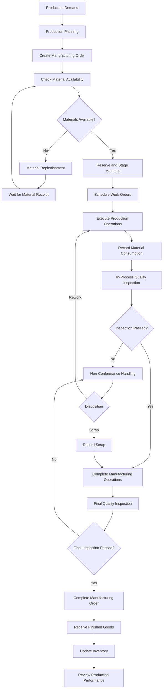

# Manufacturing Process

**Project:** Astra Manufacturing — Manufacturing & Production Management ERP  
**Document ID:** BP-MFG-001  
**Version:** 1.0  
**Status:** Draft — Portfolio Simulation  
**ERP Platform:** Odoo 19  
**Business Domain:** Manufacturing and Production Management  
**Related Documents:**
- `00_business_requirements_gathering.md`
- `01_business_requirements.md`
- `02_master_data_and_bom.md`
- `03_functional_specification.md`
- `04_technical_architecture.md`
- `05_test_strategy_and_test_cases.md`
- `business_processes/02_inventory_management.md`
- `business_processes/03_procurement_process.md`
- `business_processes/04_quality_management.md`
- `business_processes/05_maintenance_management.md`
- `business_processes/06_costing_and_accounting.md`

---

## 1. Purpose

This document defines the end-to-end manufacturing business processes for Astra Manufacturing.

It describes how production demand is converted into manufacturing orders, how production activities are planned and executed, how materials and work centers are managed, and how finished products are inspected and transferred into inventory.

The document serves as a business process reference for:

- ERP implementation.
- Manufacturing workflow configuration.
- Functional specification development.
- User acceptance testing.
- End-user training.
- Business process validation.

This document focuses on the intended business operations rather than detailed Odoo technical configuration.

## 2. Business Context

### 2.1 Company Overview

Astra Manufacturing is a hypothetical industrial manufacturing company established for this ERP implementation portfolio project.

The company manufactures industrial equipment, including:

| Product Code | Product Name | Product Type |
|---|---|---|
| WP100 | Industrial Water Pump | Finished Product |
| EM200 | Industrial Electric Motor | Subassembly / Manufactured Product |

The manufacturing operation consists of several production activities, including machining, fabrication, assembly, and testing.

The company intends to implement an integrated manufacturing management process to improve:

- Production planning and scheduling.
- Material availability management.
- Work order execution.
- Production traceability.
- Quality control.
- Work center utilization.
- Manufacturing cost visibility.
- Production performance monitoring.

### 2.2 Manufacturing Operating Model

The initial manufacturing operating model uses the following assumptions:

| Parameter | Business Decision |
|---|---|
| Manufacturing facility | One manufacturing facility |
| Production strategy | Primarily Make-to-Stock (MTS), with selected Make-to-Order (MTO) scenarios |
| Production planning | Based on demand, forecast, and inventory replenishment |
| Manufacturing orders | Created through replenishment or manual planning |
| Production execution | Work order-based |
| Production tracking | By manufacturing order and operation |
| Material consumption | Recorded against manufacturing orders |
| Finished goods | Received into finished goods inventory after production completion and required quality approval |
| Production costing | Based on configured product costing and recorded production consumption |
| ERP platform | Odoo 19 |

These assumptions are illustrative and must be validated against actual operational requirements before a real implementation.

### 2.3 Manufacturing Scope

The manufacturing process covers:

1. Production demand identification.
2. Production planning.
3. Manufacturing order creation.
4. Material availability verification.
5. Material reservation and staging.
6. Work order scheduling.
7. Production execution.
8. Material consumption recording.
9. In-process quality inspection.
10. Production completion.
11. Final quality inspection.
12. Finished goods inventory update.
13. Production performance monitoring.

### 2.4 Out of Scope

The following activities are outside the initial manufacturing process scope:

- Advanced production optimization.
- Multi-factory production planning.
- Advanced finite-capacity scheduling.
- Automated machine integration and IoT.
- Detailed labor payroll processing.
- Product lifecycle management (PLM).
- Advanced subcontracting.
- Advanced maintenance planning beyond the defined maintenance process.
- Advanced statistical process control (SPC).

These capabilities may be considered in future project phases.

---

## 3. Manufacturing Organization and Responsibilities

### 3.1 Organizational Roles

| Role | Responsibilities |
|---|---|
| Production Manager | Approves production plans, monitors production performance, and resolves major production issues |
| Production Planner | Converts demand into production plans and creates or schedules manufacturing orders |
| Production Supervisor | Coordinates daily production activities and monitors work order execution |
| Production Operator | Executes assigned production operations and records production results |
| Warehouse Manager | Ensures material availability and coordinates material movements |
| Warehouse Operator | Picks, stages, and transfers production materials |
| Quality Inspector | Performs inspections and records inspection results |
| Quality Manager | Reviews quality issues and approves quality-related dispositions |
| Maintenance Technician | Performs maintenance and resolves equipment breakdowns |
| Cost Accountant | Reviews manufacturing costs and production cost variances |

### 3.2 Responsibility Matrix

Legend:

- R = Responsible
- A = Accountable
- C = Consulted
- I = Informed

| Activity | Production Manager | Planner | Supervisor | Operator | Warehouse | Quality | Maintenance | Finance |
|---|---|---|---|---|---|---|---|---|
| Production planning | A | R | C | I | C | I | I | C |
| Manufacturing order creation | I | R | A | I | C | I | I | I |
| Material availability check | I | R | C | I | A/R | I | I | I |
| Material picking and staging | I | C | C | I | A/R | I | I | I |
| Work order execution | I | I | A | R | I | C | C | I |
| Material consumption recording | I | I | A | R | C | I | I | I |
| In-process inspection | I | I | C | C | I | A/R | I | I |
| Production issue escalation | A | C | R | R | C | C | C | I |
| Final inspection | I | I | C | I | I | A/R | I | I |
| Manufacturing order closure | A | R | R | C | C | C | I | C |
| Production cost review | I | C | I | I | C | I | I | A/R |

The matrix represents the proposed operating model. Actual authorization rights should be finalized during business requirements validation.

---

## 4. Manufacturing Master Data Dependencies

Manufacturing activities depend on accurate and approved master data.

### 4.1 Product Master

The following products are included in the initial manufacturing scope:

| Product Code | Product Name | Manufacturing Role |
|---|---|---|
| WP100 | Industrial Water Pump | Finished Product |
| EM200 | Industrial Electric Motor | Manufactured Subassembly |

Product attributes must include the appropriate:

- Product category.
- Unit of measure.
- Product type and inventory behavior.
- Manufacturing configuration.
- Costing configuration.
- Routes and replenishment settings, where applicable.

Detailed product master data is defined in `02_master_data_and_bom.md`.

### 4.2 Bill of Materials

Each manufactured product must have an approved Bill of Materials (BoM).

The BoM defines:

- Required components.
- Component quantities.
- Units of measure.
- Manufacturing quantity.
- BoM structure.
- Component consumption rules.
- Applicable manufacturing operations, where relevant.

Illustrative product structure:

```text
WP100 - Industrial Water Pump
│
├── EM200 - Industrial Electric Motor
│   ├── Motor Housing
│   ├── Stator Assembly
│   ├── Rotor Assembly
│   ├── Bearings
│   └── Electrical Components
│
├── Pump Casing
├── Impeller
├── Mechanical Seal
├── Coupling
├── Fasteners
└── Packaging Materials
```

This structure is an illustrative multi-level BoM. Actual component quantities and engineering relationships must be validated before production.

### 4.3 Manufacturing Routing

A routing defines the sequence of manufacturing operations required to produce a product.

Example routing:

| Sequence | Operation | Work Center | Description |
|---|---|---|---|
| 10 | Machining | Machining | Machine components to specified dimensions |
| 20 | Fabrication | Fabrication | Prepare and assemble fabricated parts |
| 30 | Assembly | Assembly | Assemble components into the final product |
| 40 | Testing | Testing | Perform functional and performance tests |

Not every product necessarily requires all four operations. The applicable routing must be determined from its approved BoM and manufacturing engineering requirements.

### 4.4 Work Centers

The initial manufacturing environment uses the following work centers:

| Work Center | Main Responsibility |
|---|---|
| Machining | Component machining |
| Fabrication | Fabrication and preparation |
| Assembly | Product and subassembly assembly |
| Testing | Functional and performance testing |

Each work center should have defined:

- Working calendar.
- Capacity.
- Expected production duration.
- Setup time.
- Cleanup time, if applicable.
- Cost per hour.
- Allowed operations.
- Availability and maintenance considerations.

The values must be validated against actual production capacity and operating schedules.

### 4.5 Master Data Governance

The following controls apply:

1. Only authorized users may create or modify manufacturing master data.
2. BoM changes must be reviewed by the Engineering Manager or designated approver.
3. Routing changes must be reviewed by the Production Manager.
4. Work center capacity and cost changes must be reviewed by the relevant operational and finance owners.
5. Obsolete components and manufacturing configurations must not be used for new production orders.
6. Master data changes must be traceable.

---

## 5. End-to-End Manufacturing Process

### 5.1 Process Overview

The manufacturing process follows this high-level workflow:



The diagram represents the intended business flow. Detailed exception handling and quality disposition rules are defined in the Quality Management process document.

### 5.2 Process Stages

| Stage | Process | Primary Owner | Expected Output |
|---|---|---|---|
| 1 | Production demand identification | Planner | Confirmed production demand |
| 2 | Production planning | Planner | Production plan |
| 3 | Manufacturing order creation | Planner | Manufacturing order |
| 4 | Material availability verification | Warehouse / Planner | Material availability status |
| 5 | Material reservation and staging | Warehouse | Production materials ready |
| 6 | Work order scheduling | Planner / Supervisor | Scheduled operations |
| 7 | Production execution | Operator | Completed production operations |
| 8 | Material consumption recording | Operator / Supervisor | Recorded material consumption |
| 9 | Quality inspection | Quality Inspector | Inspection result |
| 10 | Production completion | Supervisor / Planner | Completed manufacturing order |
| 11 | Finished goods receipt | Warehouse | Finished goods inventory |
| 12 | Production performance review | Production Manager | Production performance report |

---

## 6. Detailed Manufacturing Procedures

### 6.1 Production Demand Identification

**Objective:** Identify the quantity of products that must be manufactured.

Production demand may originate from:

- Sales orders.
- Inventory replenishment requirements.
- Minimum stock policies.
- Forecast demand.
- Approved production plans.
- Manual production requests.

#### Procedure

1. The Production Planner reviews current inventory levels.
2. The planner reviews confirmed sales demand and forecast demand.
3. The planner evaluates available finished goods inventory.
4. The planner identifies the required production quantity.
5. The planner considers production lead time and available capacity.
6. The planner prepares the production plan.
7. The Production Manager reviews and approves the plan according to the company's authorization policy.

#### Business Rules

| Rule ID | Business Rule |
|---|---|
| MFG-BR-001 | Production demand must have an identifiable source. |
| MFG-BR-002 | Available finished goods inventory must be considered before creating additional production demand. |
| MFG-BR-003 | Production quantities must be consistent with approved planning decisions. |
| MFG-BR-004 | Production plans must consider material availability and work center capacity. |
| MFG-BR-005 | Urgent production requests must be reviewed by the authorized production representative. |

#### Expected Output

- Production demand record.
- Approved production plan.
- Planned production quantity.
- Requested production date.

### 6.2 Production Planning

**Objective:** Convert production demand into an executable production schedule.

#### Planning Considerations

The Production Planner must consider:

1. Required production quantity.
2. Current inventory.
3. Material availability.
4. BoM completeness.
5. Manufacturing lead time.
6. Work center capacity.
7. Work center availability.
8. Maintenance schedules.
9. Production priority.
10. Delivery commitments.

#### Procedure

1. Review approved production demand.
2. Identify the applicable product BoM.
3. Verify the applicable manufacturing routing.
4. Calculate the required production quantity.
5. Estimate material requirements.
6. Check material availability.
7. Review work center capacity and availability.
8. Identify scheduling conflicts.
9. Adjust the production schedule if required.
10. Submit the production plan for approval.

#### Planning Decision

| Condition | Action |
|---|---|
| Materials available and capacity available | Proceed with manufacturing order scheduling |
| Materials unavailable | Trigger procurement or replenishment process |
| Work center unavailable | Reschedule production or use an approved alternative |
| BoM incomplete | Stop planning until master data is corrected |
| Engineering change pending | Verify the applicable BoM and revision before production |
| Demand exceeds available capacity | Escalate for production prioritization or capacity adjustment |

#### Expected Output

An approved production schedule containing:

- Product.
- Planned quantity.
- Planned start date.
- Planned finish date.
- Production priority.
- Applicable BoM.
- Applicable routing.
- Assigned work centers.

### 6.3 Manufacturing Order Creation

**Objective:** Create a formal production document authorizing manufacturing activities.

A Manufacturing Order (MO) defines what product must be manufactured, how much must be produced, and which components are required.

#### Procedure

1. The Production Planner creates a manufacturing order.
2. The planner selects the product to manufacture.
3. The planner enters the planned production quantity.
4. The planner selects the applicable BoM.
5. The system determines the required components and operations based on the selected manufacturing configuration.
6. The planner verifies the planned production dates.
7. The planner reviews the component requirements.
8. The manufacturing order is confirmed according to the approval policy.
9. Work orders are generated when the configured manufacturing process requires operation-level execution.

#### Required Manufacturing Order Information

| Field | Description |
|---|---|
| Manufacturing Order Number | Unique production reference |
| Product | Product to be manufactured |
| Quantity | Planned production quantity |
| BoM | Applicable Bill of Materials |
| Planned Start Date | Expected production start |
| Planned Finish Date | Expected production completion |
| Source Location | Component source location |
| Destination Location | Finished goods destination |
| Responsible User | Assigned production planner or responsible person |
| Origin | Related sales order or replenishment reference, if applicable |
| State | Current manufacturing order status |

#### Business Rules

| Rule ID | Business Rule |
|---|---|
| MFG-BR-006 | Every manufacturing order must reference a valid manufactured product. |
| MFG-BR-007 | A manufacturing order must use an approved BoM. |
| MFG-BR-008 | Planned quantities must use the product's configured unit of measure. |
| MFG-BR-009 | Manufacturing orders must have traceable references. |
| MFG-BR-010 | Changes to confirmed production orders must follow the change-control procedure. |

#### Expected Output

A confirmed manufacturing order ready for material availability verification.

### 6.4 Material Availability Verification

**Objective:** Ensure that all required components are available before production begins.

#### Procedure

1. Review the component requirements generated from the BoM.
2. Check available stock for each component.
3. Consider reserved quantities and other outstanding demand.
4. Verify the material source locations.
5. Identify shortages.
6. Determine whether available materials meet production requirements.
7. Escalate shortages to the procurement or warehouse team.
8. Recheck material availability after replenishment.

#### Material Availability Decision

| Condition | Action |
|---|---|
| All required components available | Proceed to material reservation |
| Some components unavailable | Hold production until shortage is resolved |
| Component partially available | Evaluate whether partial production is permitted |
| Component damaged or rejected | Exclude it from usable stock and initiate replacement |
| Component not found in stock | Trigger procurement or internal replenishment |

#### Business Rules

| Rule ID | Business Rule |
|---|---|
| MFG-BR-011 | Production must not consume unavailable materials. |
| MFG-BR-012 | Reserved stock must not be treated as freely available inventory. |
| MFG-BR-013 | Rejected materials must not be issued for normal production. |
| MFG-BR-014 | Material shortages must be recorded and communicated to the responsible team. |
| MFG-BR-015 | Partial production is permitted only when explicitly authorized and operationally feasible. |

#### Expected Output

A material availability status:

- Available.
- Partially Available.
- Unavailable.
- On Hold.

### 6.5 Material Reservation and Staging

**Objective:** Prepare the required components for production execution.

#### Procedure

1. The Warehouse Operator receives the material request.
2. The operator identifies the required components.
3. The operator picks components from the appropriate stock locations.
4. The operator verifies product identity and quantity.
5. The operator checks applicable lot or serial information.
6. The operator transfers the materials to the designated production staging location, where applicable.
7. The operator confirms the material movement.
8. The Production Supervisor verifies that materials are ready for production.

#### Controls

- Materials must match the approved BoM.
- Quantities must match the production requirement.
- Lot and serial tracking must be respected when configured.
- Damaged or rejected materials must not be staged as usable components.
- Material substitutions require authorized approval and appropriate BoM or production-order handling.

#### Expected Output

Production materials are available at the designated production location.

### 6.6 Work Order Scheduling

**Objective:** Assign manufacturing operations to work centers and establish an execution sequence.

#### Procedure

1. Review the operations generated from the manufacturing routing.
2. Verify the required work centers.
3. Check work center calendars and availability.
4. Review expected operation durations.
5. Consider work center capacity.
6. Check maintenance downtime and other operational constraints.
7. Arrange operation sequences.
8. Assign production operators or responsible teams.
9. Communicate the production schedule.

#### Example Operation Schedule

| Sequence | Operation | Work Center | Planned Duration | Responsible Team |
|---|---|---|---|---|
| 10 | Machining | Machining | 60 minutes | Machining Team |
| 20 | Fabrication | Fabrication | 45 minutes | Fabrication Team |
| 30 | Assembly | Assembly | 90 minutes | Assembly Team |
| 40 | Testing | Testing | 30 minutes | Testing Team |

The durations are illustrative values for the portfolio simulation, not measured production standards.

#### Scheduling Rules

| Rule ID | Business Rule |
|---|---|
| MFG-BR-016 | Operations must follow the approved routing sequence. |
| MFG-BR-017 | Each operation must be assigned to an appropriate work center. |
| MFG-BR-018 | Scheduling must consider work center capacity and availability. |
| MFG-BR-019 | Operations must not begin before required predecessor operations are completed. |
| MFG-BR-020 | Work center downtime must be considered during scheduling. |

#### Expected Output

A scheduled set of work orders ready for production execution.

### 6.7 Production Execution

**Objective:** Execute manufacturing operations according to the approved routing and production instructions.

#### Procedure

1. The Production Supervisor releases the scheduled work orders.
2. The Production Operator reviews the assigned operation.
3. The operator verifies the product, materials, and work instructions.
4. The operator checks equipment readiness.
5. The operator starts the assigned work order.
6. The operator performs the manufacturing operation.
7. The operator records operation progress.
8. The operator records actual production time.
9. The operator reports completed quantities.
10. The operator reports rejected or defective quantities.
11. The Production Supervisor reviews the operation results.
12. The next operation becomes eligible for execution according to the configured workflow.

#### Production Operation Records

| Information | Description |
|---|---|
| Manufacturing Order | Related manufacturing order |
| Work Order | Specific production operation |
| Operation | Manufacturing activity |
| Work Center | Assigned production resource |
| Operator | Person executing the operation |
| Start Time | Actual operation start |
| End Time | Actual operation finish |
| Duration | Recorded execution time |
| Quantity Produced | Completed quantity |
| Quantity Rejected | Rejected quantity |
| Production Notes | Operational remarks |

#### Production Execution Controls

- Operators must follow approved work instructions.
- Production must use approved materials.
- Equipment must be safe and operational.
- Production results must be recorded accurately.
- Unexpected production deviations must be reported.
- Operators must not bypass mandatory quality inspections.
- Production quantities must reconcile with consumption and finished output according to the applicable process.

#### Expected Output

Completed or partially completed work orders with recorded production results.

### 6.8 Material Consumption Recording

**Objective:** Record the actual components consumed during manufacturing.

Material consumption must be traceable to the relevant manufacturing order.

#### Procedure

1. Identify the components consumed during production.
2. Compare actual consumption with BoM requirements.
3. Record the consumed quantities.
4. Record lot or serial information when applicable.
5. Identify excess consumption or material shortages.
6. Record approved component substitutions, if applicable.
7. Review unusual consumption variances.
8. Confirm material movements according to the configured inventory workflow.

#### Consumption Variance

Material consumption variance is calculated as:

\[
\text{Consumption Variance}
=
\text{Actual Consumption}
-
\text{Expected Consumption}
\]

Example:

| Component | Expected Quantity | Actual Quantity | Variance |
|---|---:|---:|---:|
| Bearing | 4 units | 4 units | 0 |
| Fasteners | 8 units | 9 units | +1 |
| Mechanical Seal | 1 unit | 1 unit | 0 |

The example represents one production batch and is illustrative.

#### Business Rules

| Rule ID | Business Rule |
|---|---|
| MFG-BR-021 | Material consumption must be associated with a manufacturing order. |
| MFG-BR-022 | Actual consumption must be recorded accurately. |
| MFG-BR-023 | Material substitutions require authorization. |
| MFG-BR-024 | Material consumption variances must be reviewed when they exceed defined tolerances. |
| MFG-BR-025 | Lot and serial traceability must be maintained where applicable. |

#### Expected Output

Accurate material consumption records and traceable inventory movements.

### 6.9 In-Process Quality Inspection

**Objective:** Verify that intermediate production outputs meet defined quality requirements.

In-process inspections may be required after selected manufacturing operations.

Examples:

- Machined component dimensional inspection.
- Fabricated part visual inspection.
- Assembly alignment verification.
- Electrical connection inspection.

#### Procedure

1. Identify the operation requiring inspection.
2. Notify the Quality Inspector.
3. Provide the relevant product and manufacturing order information.
4. Perform the defined inspection.
5. Compare inspection results with approved acceptance criteria.
6. Record the inspection result.
7. If the result passes, authorize progression to the next operation.
8. If the result fails, create or update a non-conformance record.
9. Determine the appropriate disposition.

#### Inspection Results

| Result | Meaning | Action |
|---|---|---|
| Pass | Product meets acceptance criteria | Continue production |
| Fail | Product does not meet acceptance criteria | Hold affected output and initiate non-conformance handling |
| Pending | Inspection has not been completed | Do not proceed when inspection is mandatory |

Detailed inspection parameters, defect classifications, rework, scrap, and approval workflows are defined in `business_processes/04_quality_management.md`.

#### Expected Output

Approved in-process inspection results or documented non-conformance records.

### 6.10 Production Exception Handling

**Objective:** Control unexpected events that may interrupt production.

Common manufacturing exceptions include:

- Material shortage.
- Machine breakdown.
- Quality failure.
- Operator unavailability.
- Incorrect BoM.
- Incorrect routing.
- Production quantity variance.
- Unexpected operation delay.

#### Exception Handling Matrix

| Exception | Immediate Action | Responsible Team | Resolution |
|---|---|---|---|
| Material shortage | Hold affected production activity | Warehouse / Procurement | Replenish required materials |
| Machine breakdown | Stop affected operation safely | Maintenance | Repair or authorize alternative equipment |
| Quality failure | Hold affected output | Quality | Rework, accept by authorized concession, or scrap |
| Operator unavailability | Notify supervisor | Production | Reassign qualified operator |
| Incorrect BoM | Stop affected production and verify master data | Engineering / Production | Correct approved BoM and assess affected orders |
| Incorrect routing | Hold affected operation | Production Engineering | Correct routing and reschedule |
| Production delay | Record delay and assess impact | Supervisor / Planner | Revise schedule and communicate impact |
| Excess consumption | Record variance and investigate | Production / Warehouse | Identify root cause and approve adjustment if necessary |

#### General Escalation Process

1. Identify the production exception.
2. Stop or hold the affected activity when necessary.
3. Record the issue and its operational impact.
4. Notify the responsible supervisor.
5. Assign the appropriate resolution owner.
6. Determine the required corrective action.
7. Obtain approval when required.
8. Execute the resolution.
9. Verify that production can safely resume.
10. Record the resolution and close the issue.

#### Business Rules

| Rule ID | Business Rule |
|---|---|
| MFG-BR-026 | Production exceptions must be documented. |
| MFG-BR-027 | Unsafe production activities must be stopped immediately. |
| MFG-BR-028 | Quality failures must follow the approved non-conformance process. |
| MFG-BR-029 | Equipment breakdowns must be escalated to Maintenance. |
| MFG-BR-030 | Production resumption requires resolution of blocking issues. |

### 6.11 Rework and Scrap Handling

**Objective:** Ensure defective production output is handled consistently and traceably.

#### Rework Process

1. Identify defective output.
2. Record the defect.
3. Isolate the affected quantity.
4. Obtain a quality disposition decision.
5. Define the rework instruction.
6. Assign the rework activity.
7. Execute rework.
8. Record additional material and labor consumption where applicable.
9. Perform reinspection.
10. Release the output only after the required approval.

#### Scrap Process

1. Identify output that cannot be economically or technically reworked.
2. Record the defect and affected quantity.
3. Obtain scrap authorization.
4. Move the affected quantity to the designated scrap location or process it through the approved inventory workflow.
5. Record the scrap quantity and reason.
6. Update production and inventory records.
7. Review the financial impact where applicable.

#### Business Rules

| Rule ID | Business Rule |
|---|---|
| MFG-BR-031 | Rework must be authorized and documented. |
| MFG-BR-032 | Reworked output must undergo the required reinspection. |
| MFG-BR-033 | Scrap requires documented authorization. |
| MFG-BR-034 | Scrap quantities must be traceable to the relevant manufacturing order. |
| MFG-BR-035 | Rework and scrap must be reflected in production performance and cost analysis. |

Detailed disposition rules are maintained in the Quality Management process document.

### 6.12 Final Production Inspection

**Objective:** Confirm that completed products satisfy the required quality and functional specifications.

#### Procedure

1. The Production Supervisor submits completed output for final inspection.
2. The Quality Inspector verifies product identity and quantity.
3. The inspector performs required visual, dimensional, and functional inspections.
4. The inspector records test results.
5. The inspector compares results with approved acceptance criteria.
6. The inspector records the final inspection status.
7. Failed products are placed on hold and handled through the non-conformance process.
8. Passed products are released for the applicable finished goods receipt process.

#### Final Inspection Checklist

| Inspection Item | Example Verification |
|---|---|
| Product identity | Correct product and specification |
| Physical condition | No unacceptable visible damage |
| Assembly quality | Correct assembly and alignment |
| Dimensional conformity | Meets approved dimensional tolerance |
| Functional performance | Operates within defined specifications |
| Electrical safety | Meets applicable approved test requirements |
| Documentation | Required inspection records are complete |
| Packaging condition | Meets packaging requirements |

The actual inspection criteria must be approved by the Quality Manager and Engineering.

#### Expected Output

- Final inspection passed.
- Final inspection failed.
- Pending inspection.

### 6.13 Manufacturing Order Completion

**Objective:** Complete the manufacturing order after required production activities and controls have been satisfied.

#### Completion Preconditions

Before the manufacturing order is completed, verify that:

1. Required operations have been completed.
2. Actual production quantities have been recorded.
3. Material consumption has been recorded.
4. Required quality inspections have been completed.
5. Outstanding production exceptions have been resolved or formally dispositioned.
6. Scrap and rework quantities have been recorded.
7. Finished product quantities have been reconciled.
8. Required production documentation is complete.

#### Procedure

1. The Production Supervisor reviews the completed work orders.
2. The supervisor verifies operation results.
3. The supervisor checks material consumption.
4. The supervisor confirms the production quantity.
5. The supervisor checks outstanding quality issues.
6. The Production Planner reviews the manufacturing order.
7. The authorized user completes the manufacturing order in the ERP system.
8. The system processes the corresponding inventory movements according to the configured workflow.

#### Business Rules

| Rule ID | Business Rule |
|---|---|
| MFG-BR-036 | Required production operations must be completed before final closure. |
| MFG-BR-037 | Mandatory quality inspections must be completed before release. |
| MFG-BR-038 | Production quantities must be reconciled before completion. |
| MFG-BR-039 | Outstanding blocking issues must be resolved before completion. |
| MFG-BR-040 | Manufacturing order completion must be traceable to an authorized user. |

#### Expected Output

A completed manufacturing order with recorded production and consumption data.

### 6.14 Finished Goods Receipt

**Objective:** Update finished goods inventory after manufacturing completion and required quality release.

#### Procedure

1. The Warehouse Operator receives the finished production output.
2. The operator verifies the product and quantity.
3. The operator checks applicable lot or serial information.
4. The operator verifies the quality release status.
5. The operator transfers the finished products to the designated finished goods location.
6. The operator validates the inventory movement.
7. The system updates the available stock according to the configured inventory workflow.
8. The Warehouse Manager verifies the inventory record.

#### Controls

- Only approved finished goods may be released to normal sellable inventory.
- Product quantities must match the production completion records.
- Lot and serial tracking must be maintained where applicable.
- Damaged or rejected finished goods must remain segregated.
- Inventory movements must be traceable to the manufacturing order.

#### Expected Output

Finished products recorded in the appropriate inventory location and available for subsequent business processes according to their stock status.

### 6.15 Production Performance Review

**Objective:** Evaluate manufacturing performance and identify improvement opportunities.

The Production Manager reviews production performance periodically.

#### Review Activities

1. Compare planned and actual production quantities.
2. Compare planned and actual completion dates.
3. Review work center utilization.
4. Review production cycle time.
5. Analyze material consumption variance.
6. Review defect and rejection rates.
7. Review rework and scrap quantities.
8. Identify production bottlenecks.
9. Review recurring production exceptions.
10. Define corrective and preventive actions.

#### Expected Output

- Production performance report.
- Variance analysis.
- Corrective action list.
- Production improvement recommendations.

---

## 7. Production Planning Strategies

### 7.1 Make-to-Stock (MTS)

Make-to-Stock is used when products are manufactured based on forecast demand or inventory replenishment requirements.

#### Process

1. Review forecast demand.
2. Check current inventory.
3. Calculate required replenishment quantity.
4. Evaluate production capacity.
5. Create manufacturing orders.
6. Execute production.
7. Store completed products in finished goods inventory.
8. Fulfill future customer demand from available stock.

#### Business Characteristics

- Production is initiated before a specific customer order.
- Finished goods are maintained in inventory.
- Replenishment rules may be used.
- Forecast accuracy influences inventory requirements.

### 7.2 Make-to-Order (MTO)

Make-to-Order is used when production is triggered by a specific customer demand.

#### Process

1. Receive a confirmed customer order.
2. Determine the required manufacturing quantity.
3. Check whether sufficient finished goods are available.
4. If production is required, create the corresponding manufacturing demand.
5. Verify component availability.
6. Execute manufacturing.
7. Complete quality inspection.
8. Release finished goods for the related customer demand.

#### Business Characteristics

- Production is linked to a specific demand.
- Finished goods may be produced only after customer confirmation.
- Order traceability is important.
- Lead time must be communicated accurately.

### 7.3 MTS and MTO Decision Matrix

| Business Scenario | Planning Strategy |
|---|---|
| Standard product with predictable demand | MTS |
| Product with frequent replenishment requirements | MTS |
| Product manufactured for a confirmed customer order | MTO |
| Product with customer-specific configuration | MTO, subject to engineering approval |
| Product with uncertain demand and high inventory risk | Evaluate MTO or a hybrid strategy |

The initial implementation should define the replenishment strategy per product rather than applying MTS or MTO indiscriminately.

---

## 8. Manufacturing Controls and Approval

### 8.1 Key Operational Controls

| Control ID | Control Description | Control Owner |
|---|---|---|
| MFG-CTL-001 | Verify approved BoM before manufacturing order confirmation | Production Planner |
| MFG-CTL-002 | Verify material availability before production execution | Warehouse Manager |
| MFG-CTL-003 | Verify routing and work center assignment | Production Supervisor |
| MFG-CTL-004 | Record actual production quantities | Production Operator |
| MFG-CTL-005 | Record actual material consumption | Production Operator / Supervisor |
| MFG-CTL-006 | Enforce mandatory quality inspections | Quality Manager |
| MFG-CTL-007 | Control rework and scrap authorization | Quality Manager |
| MFG-CTL-008 | Verify manufacturing order completion | Production Supervisor |
| MFG-CTL-009 | Reconcile finished goods inventory | Warehouse Manager |
| MFG-CTL-010 | Review production cost variances | Cost Accountant |

### 8.2 Approval Matrix

| Activity | Requester | Reviewer / Approver |
|---|---|---|
| Production plan | Production Planner | Production Manager |
| Manufacturing order | Production Planner | Production Supervisor or designated approver |
| BoM modification | Engineering | Engineering Manager |
| Routing modification | Production Engineering | Production Manager |
| Material substitution | Production / Engineering | Authorized Engineering and Quality representatives |
| Rework disposition | Quality Inspector | Quality Manager |
| Scrap disposition | Quality Inspector | Quality Manager |
| Production schedule change | Production Planner | Production Manager |
| Production order closure | Production Supervisor | Authorized production representative |

The approval matrix is a proposed governance model. Final approval rights must be aligned with the company's delegation of authority.

---

## 9. Manufacturing KPIs

The following KPIs are proposed for monitoring manufacturing performance.

All initial targets are illustrative portfolio assumptions, not validated operational commitments.

### 9.1 Production Schedule Adherence

Measures the percentage of production orders completed according to the approved schedule.

\[
\text{Schedule Adherence}
=
\frac{\text{Orders Completed On Time}}
{\text{Total Orders Due}}
\times 100
\]

Illustrative target: ≥ 95%.

### 9.2 Production Achievement Rate

Measures actual production output against planned production output.

\[
\text{Production Achievement}
=
\frac{\text{Actual Good Output}}
{\text{Planned Output}}
\times 100
\]

Illustrative target: ≥ 95%.

### 9.3 First Pass Yield (FPY)

Measures the proportion of output that passes inspection without rework.

\[
\text{FPY}
=
\frac{\text{Units Passing First Inspection}}
{\text{Total Units Inspected}}
\times 100
\]

Illustrative target: ≥ 98%.

### 9.4 Defect Rate

Measures the percentage of inspected units classified as defective.

\[
\text{Defect Rate}
=
\frac{\text{Defective Units}}
{\text{Total Units Inspected}}
\times 100
\]

Illustrative target: ≤ 2%.

### 9.5 Rework Rate

Measures the proportion of produced units requiring rework.

\[
\text{Rework Rate}
=
\frac{\text{Units Requiring Rework}}
{\text{Total Units Produced}}
\times 100
\]

Illustrative target: ≤ 2%.

### 9.6 Scrap Rate

Measures the proportion of production output classified as scrap.

\[
\text{Scrap Rate}
=
\frac{\text{Scrapped Units}}
{\text{Total Units Produced}}
\times 100
\]

Illustrative target: ≤ 1%.

### 9.7 Material Consumption Variance

Measures the difference between expected and actual material consumption.

\[
\text{Consumption Variance (\%)}
=
\frac{\text{Actual Consumption} - \text{Expected Consumption}}
{\text{Expected Consumption}}
\times 100
\]

Illustrative target: within an approved tolerance defined per component.

### 9.8 Work Center Utilization

Measures the extent to which available work center time is used for productive operations.

\[
\text{Work Center Utilization}
=
\frac{\text{Actual Productive Time}}
{\text{Available Working Time}}
\times 100
\]

Illustrative target: established after baseline measurement.

### 9.9 KPI Governance

Each KPI must have:

- A documented definition.
- A defined calculation method.
- A clear data source.
- An accountable owner.
- A reporting frequency.
- A validated target.
- A defined exception and escalation process.

KPI targets must be reviewed after sufficient production history is available.

---

## 10. Odoo 19 Business Process Mapping

This section maps the proposed manufacturing process to Odoo 19 application capabilities.

It is a high-level mapping, not a complete technical configuration guide.

| Business Process | Odoo Application / Feature | Business Purpose |
|---|---|---|
| Production demand | Sales, Inventory, Manufacturing | Identify production requirements |
| Production planning | Manufacturing | Plan manufacturing activities |
| Manufacturing order creation | Manufacturing | Create production orders |
| BoM management | Manufacturing | Define component requirements |
| Routing management | Manufacturing | Define manufacturing operations |
| Work center management | Manufacturing | Define production resources |
| Work order execution | Manufacturing | Track individual operations |
| Material availability | Inventory / Manufacturing | Check component availability |
| Material reservation and movements | Inventory / Manufacturing | Control component movements |
| Material consumption | Manufacturing / Inventory | Record component consumption |
| Quality inspection | Quality / Manufacturing | Perform production quality checks |
| Non-conformance | Quality | Record and manage quality issues |
| Rework and scrap | Manufacturing / Inventory / Quality | Control defective production output |
| Finished goods receipt | Inventory / Manufacturing | Record finished product inventory |
| Production costing | Manufacturing / Accounting | Review production costs |
| Production reporting | Manufacturing / Reporting | Monitor production performance |

### 10.1 Relevant Odoo Configuration Areas

The following areas should be evaluated during implementation:

**Manufacturing**

- Manufacturing settings.
- Product manufacturing configuration.
- Bills of Materials.
- Operations and work orders.
- Work centers.
- Manufacturing order workflow.
- Manufacturing reporting.

**Inventory**

- Warehouses and locations.
- Inventory routes.
- Stock rules.
- Internal transfers.
- Lot and serial tracking.
- Scrap locations.
- Inventory valuation.

**Quality**

- Quality control points.
- Quality checks.
- Quality alerts.
- Inspection types.
- Quality teams and responsibilities.

**Maintenance**

- Equipment records.
- Preventive maintenance.
- Corrective maintenance.
- Maintenance requests.
- Work center availability considerations.

**Accounting**

- Product costing configuration.
- Inventory valuation.
- Manufacturing cost analysis.
- Cost variance review.

Actual configuration depends on installed applications, edition, company settings, and validated Odoo 19 behavior.

### 10.2 Standard Functionality vs Custom Development

The implementation should prioritize standard Odoo capabilities.

| Requirement | Initial Approach | Customization Position |
|---|---|---|
| Manufacturing order management | Standard Odoo Manufacturing | Not expected initially |
| BoM management | Standard Odoo Manufacturing | Not expected initially |
| Routing and work orders | Standard Odoo Manufacturing | Not expected initially |
| Work center management | Standard Odoo Manufacturing | Not expected initially |
| Material movements | Standard Odoo Inventory | Not expected initially |
| Quality checks | Standard Odoo Quality | Evaluate configuration first |
| Production reporting | Standard reporting | Custom reports only if justified |
| Advanced approval workflow | Evaluate standard configuration | Customization may be required |
| Advanced production scheduling | Evaluate standard capabilities | May require additional solution |
| Specialized machine integration | Not included in initial scope | Future phase |

No custom development should be proposed until the functional gap has been documented and standard configuration has been evaluated.

---

## 11. Process Exceptions and Risk Management

| Risk ID | Risk | Potential Impact | Mitigation |
|---|---|---|---|
| MFG-RSK-001 | Incorrect BoM | Incorrect material consumption and production output | BoM review and approval |
| MFG-RSK-002 | Inaccurate inventory | Production delays and material shortages | Regular stock reconciliation |
| MFG-RSK-003 | Work center breakdown | Production schedule disruption | Maintenance planning |
| MFG-RSK-004 | Incomplete routing | Incorrect operation execution | Routing validation |
| MFG-RSK-005 | Unrecorded material consumption | Inaccurate inventory and costing | Consumption recording controls |
| MFG-RSK-006 | Uncontrolled rework | Increased production costs and quality risks | Formal rework authorization |
| MFG-RSK-007 | Unrecorded scrap | Inventory and cost inaccuracies | Scrap recording and approval |
| MFG-RSK-008 | Production quantity mismatch | Incorrect finished goods inventory | Quantity reconciliation |
| MFG-RSK-009 | Unapproved master data changes | Incorrect production configuration | Access control and change management |
| MFG-RSK-010 | Incomplete quality inspection | Defective products released to customers | Mandatory quality checkpoints |

---

## 12. Reporting Requirements

The manufacturing function should provide operational visibility through the following reports.

| Report ID | Report Name | Purpose | Primary Audience |
|---|---|---|---|
| MFG-RPT-001 | Manufacturing Order Overview | Monitor manufacturing order status | Production Manager |
| MFG-RPT-002 | Production Schedule | Monitor planned production activities | Production Planner |
| MFG-RPT-003 | Work Order Status | Monitor operation-level progress | Production Supervisor |
| MFG-RPT-004 | Material Availability Report | Identify production material shortages | Warehouse Manager |
| MFG-RPT-005 | Material Consumption Report | Analyze expected versus actual consumption | Production / Finance |
| MFG-RPT-006 | Production Output Report | Monitor actual production quantities | Production Manager |
| MFG-RPT-007 | Work Center Performance Report | Monitor work center utilization and delays | Production Manager |
| MFG-RPT-008 | Production Quality Report | Monitor inspection and defect results | Quality Manager |
| MFG-RPT-009 | Rework and Scrap Report | Monitor defective output and associated losses | Quality / Production |
| MFG-RPT-010 | Manufacturing Cost Report | Review manufacturing costs | Cost Accountant |

Report availability and calculation details must be confirmed during functional specification design.

---

## 13. Process Acceptance Criteria

The manufacturing process is considered successfully implemented when the following conditions are met.

| Acceptance ID | Acceptance Criteria |
|---|---|
| MFG-AC-001 | Users can create manufacturing orders for approved manufactured products. |
| MFG-AC-002 | Manufacturing orders use the correct approved BoM. |
| MFG-AC-003 | Required components are calculated from the applicable BoM. |
| MFG-AC-004 | Material availability can be reviewed before production execution. |
| MFG-AC-005 | Material shortages can be identified and handled. |
| MFG-AC-006 | Work orders are generated for products with configured manufacturing operations. |
| MFG-AC-007 | Work orders are assigned to appropriate work centers. |
| MFG-AC-008 | Users can record production operation progress. |
| MFG-AC-009 | Actual production quantities can be recorded. |
| MFG-AC-010 | Actual material consumption can be recorded and traced. |
| MFG-AC-011 | Mandatory quality inspections are enforced according to the configured process. |
| MFG-AC-012 | Quality failures can be held and handled through the non-conformance process. |
| MFG-AC-013 | Rework and scrap quantities can be recorded. |
| MFG-AC-014 | Manufacturing orders cannot be completed while mandatory blocking requirements remain unresolved. |
| MFG-AC-015 | Finished goods are recorded in the appropriate inventory location after completion. |
| MFG-AC-016 | Manufacturing order records provide traceability of production activities. |
| MFG-AC-017 | Production output and material consumption can be reviewed through reports. |
| MFG-AC-018 | Authorized users can review production performance indicators. |

These criteria must be converted into detailed functional and test acceptance criteria in the relevant project documents.

---

## 14. Dependencies and Related Business Processes

Manufacturing does not operate independently. It relies on other business functions.

| Related Process | Dependency |
|---|---|
| Business Requirements | Defines the business requirements and constraints |
| Master Data and BoM | Defines products, components, BoMs, routing, and cost assumptions |
| Inventory Management | Controls component availability, material movements, and finished goods inventory |
| Procurement Process | Replenishes unavailable components |
| Quality Management | Controls inspections, defects, rework, scrap, and quality release |
| Maintenance Management | Maintains equipment and work center availability |
| Costing and Accounting | Records and analyzes manufacturing costs |
| Sales Management | Provides customer demand and delivery requirements |

The manufacturing process must be validated together with these related processes to ensure end-to-end consistency.

---

## 15. Assumptions and Open Issues

### 15.1 Assumptions

| Assumption ID | Description | Status |
|---|---|---|
| MFG-ASM-001 | Astra Manufacturing operates one manufacturing facility. | Illustrative |
| MFG-ASM-002 | The company manufactures WP100 and EM200. | Illustrative |
| MFG-ASM-003 | Manufacturing uses approved BoMs and routings. | Proposed |
| MFG-ASM-004 | Work order-based production execution is required. | Proposed |
| MFG-ASM-005 | The initial operating model supports MTS and selected MTO scenarios. | Proposed |
| MFG-ASM-006 | Quality inspections are required at selected production stages. | Proposed |
| MFG-ASM-007 | Production operators record actual production results. | Proposed |
| MFG-ASM-008 | Material consumption must be traceable to manufacturing orders. | Proposed |
| MFG-ASM-009 | Rework and scrap require documented quality disposition. | Proposed |
| MFG-ASM-010 | Production cost information is required for management reporting. | Proposed |

### 15.2 Open Issues

The following issues require business validation before implementation:

| Issue ID | Open Question | Responsible Stakeholder |
|---|---|---|
| MFG-OPEN-001 | What is the actual production planning horizon? | Production Manager |
| MFG-OPEN-002 | What are the approved production batch sizes? | Production Manager |
| MFG-OPEN-003 | What are the actual standard operation times? | Production Engineering |
| MFG-OPEN-004 | What is the approved work center capacity? | Production Manager |
| MFG-OPEN-005 | Which components require lot or serial tracking? | Warehouse / Quality |
| MFG-OPEN-006 | Which operations require mandatory quality inspections? | Quality Manager |
| MFG-OPEN-007 | What is the permitted material consumption variance? | Production / Finance |
| MFG-OPEN-008 | What is the authorization policy for material substitutions? | Engineering / Quality |
| MFG-OPEN-009 | What is the approved rework and scrap authorization hierarchy? | Quality Manager |
| MFG-OPEN-010 | What are the production costing policies? | Finance Manager |
| MFG-OPEN-011 | What are the required production reporting frequencies? | Production Manager |
| MFG-OPEN-012 | Which production products use MTS versus MTO? | Production / Sales |

### 15.3 Validation Note

Astra Manufacturing is a hypothetical portfolio case study.

All products, production workflows, operational policies, durations, KPI targets, and organizational roles in this document are illustrative unless independently validated.

For a real implementation, these details must be confirmed through stakeholder interviews, process workshops, operational observation, and formal business approval.

---

## 16. Document Change History

| Version | Date | Author | Description |
|---|---|---|---|
| 1.0 | 2026-11-08 | ERP Implementation Team | Initial manufacturing process documentation |

---

## 17. Final Notes

This document defines the proposed manufacturing business process for Astra Manufacturing.

It should be used as the process reference for:

1. Designing the Odoo Manufacturing configuration.
2. Defining manufacturing-related functional requirements.
3. Mapping business requirements to system capabilities.
4. Preparing test scenarios and user acceptance tests.
5. Training manufacturing and warehouse users.

The next implementation activity is to translate this process into the Functional Specification, identifying the relevant Odoo configuration, user roles, workflows, validations, reports, and any genuine functional gaps requiring customization.