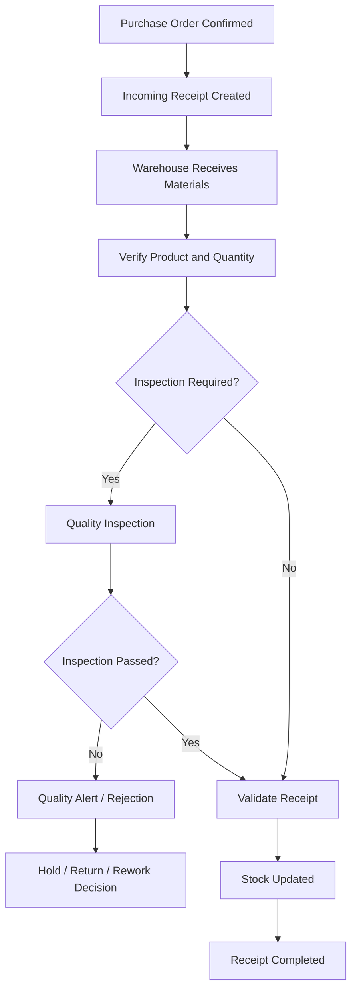
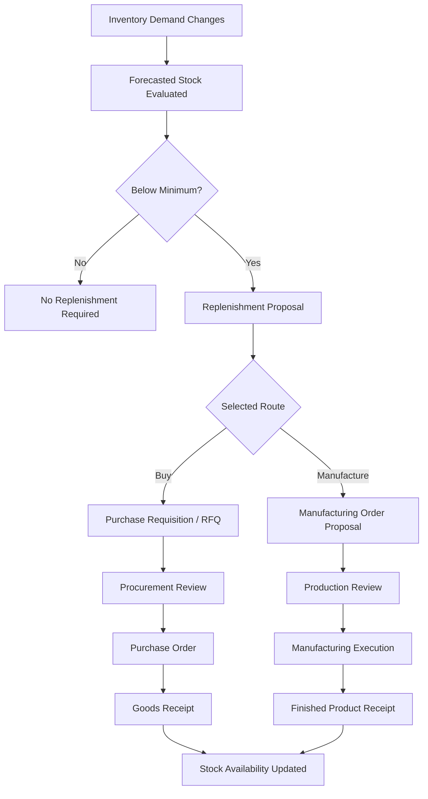
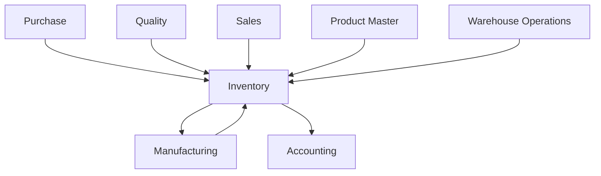

# 02 — Inventory Management

**Project:** Astrea Manufacturing — Manufacturing & Production Management ERP  
**ERP Platform:** Odoo 19  
**Database:** PostgreSQL  
**Document Type:** Business Process & Functional Configuration Specification  
**Version:** 1.0  
**Status:** Draft — Portfolio Simulation  
**Document Path:** `documentations/02_inventory_management.md`

---

# 1. Introduction

## 1.1 Purpose

This document defines the inventory management business processes, operational workflows, master data requirements, system configuration, inventory control policies, and integration requirements for the Astrea Manufacturing ERP implementation.

The objective is to establish a structured inventory management process that ensures:

- Accurate inventory records.
- Reliable material availability information.
- Controlled warehouse operations.
- Efficient material replenishment.
- Traceable inventory movements.
- Proper material issuance to manufacturing.
- Accurate finished goods receipts.
- Effective inventory valuation and reporting.
- Reduced inventory discrepancies and operational disruptions.

This document serves as a functional reference for configuring the Inventory application in Odoo 19.

## 1.2 Business Background

Astrea Manufacturing is a hypothetical manufacturing company producing industrial water pumps and electric motors.

The company requires an integrated inventory management system to control raw materials, components, work-in-progress-related stock movements, and finished goods.

The proposed inventory management process must support procurement, manufacturing, quality inspection, warehouse operations, and financial reporting.

## 1.3 Inventory Management Objectives

| ID | Objective | Description |
|---|---|---|
| INV-OBJ-001 | Inventory Accuracy | Maintain accurate stock records |
| INV-OBJ-002 | Material Availability | Ensure components are available for production |
| INV-OBJ-003 | Inventory Traceability | Track inventory movements and origins |
| INV-OBJ-004 | Replenishment Control | Automate replenishment based on configured rules |
| INV-OBJ-005 | Warehouse Efficiency | Standardize receiving, storage, picking, and delivery |
| INV-OBJ-006 | Stock Valuation | Maintain reliable inventory valuation |
| INV-OBJ-007 | Operational Visibility | Provide accurate inventory reports |
| INV-OBJ-008 | Inventory Security | Restrict unauthorized stock operations |

## 1.4 Scope

### In Scope

- Product inventory configuration.
- Product categories.
- Units of Measure.
- Warehouse and location management.
- Incoming receipts.
- Internal transfers.
- Outgoing stock operations.
- Manufacturing material consumption.
- Finished goods receipts.
- Inventory adjustments.
- Reordering rules.
- Lot and serial number tracking where applicable.
- Inventory valuation.
- Inventory reporting.
- Inventory access rights.
- Inventory process testing.

### Out of Scope

- Advanced third-party warehouse management integrations.
- Automated warehouse robotics.
- Barcode hardware procurement.
- Transportation management systems.
- International customs management.
- Advanced demand forecasting beyond the configured system capabilities.
- External logistics provider integrations.

---

# 2. Inventory Operating Model

## 2.1 Inventory Categories

The proposed inventory structure includes the following categories.

| Category | Description | Example |
|---|---|---|
| Raw Materials | Materials used in production | Steel, copper |
| Components | Manufactured or purchased components | Bearing Set, Impeller |
| Subassemblies | Intermediate manufactured products | Electric Motor Assembly |
| Finished Goods | Products ready for sale or delivery | WP100, EM200 |
| Consumables | Materials used during operations | Lubricants, packaging |
| Scrap | Rejected or unusable materials | Defective components |

The actual category structure must be aligned with the final product and accounting configuration.

## 2.2 Inventory Product Classification

The following illustrative product master data is proposed.

| Product Code | Product Name | Product Classification |
|---|---|---|
| WP100 | Industrial Water Pump | Finished Good |
| EM200 | Industrial Electric Motor | Finished Good / Subassembly, depending on BoM design |
| CMP001 | Steel Housing | Component |
| CMP002 | Copper Wire | Component |
| CMP003 | Bearing Set | Component |
| CMP004 | Impeller | Component |
| CMP005 | Fastener Set | Component |
| CMP006 | Electrical Control Unit | Component |

**Important:** EM200 must have one consistent role in the product architecture. If it is manufactured and stocked as a standalone sellable product while also being consumed in WP100 production, configure its BoM and product routes accordingly. Avoid creating separate records for the same physical product without a justified business reason.

## 2.3 Inventory Management Principles

The system follows these principles:

1. Every inventory movement must have a valid source and destination.
2. Inventory quantities must be controlled through validated stock operations.
3. Product master data must be standardized.
4. Inventory adjustments must require appropriate authorization.
5. Manufacturing consumption must be traceable to Manufacturing Orders.
6. Incoming materials must be linked to their procurement documents.
7. Replenishment must consider forecasted stock and configured supply routes.
8. Inventory valuation must follow the approved accounting policy.
9. Stock discrepancies must be investigated and documented.
10. Inventory operations must preserve an auditable transaction history.

---

# 3. Warehouse and Location Architecture

## 3.1 Warehouse Structure

The project initially assumes one primary warehouse.

Proposed warehouse:

| Field | Value |
|---|---|
| Warehouse Code | WH-AST |
| Warehouse Name | Astrea Main Warehouse |
| Company | Astrea Manufacturing |
| Warehouse Type | Internal Manufacturing Warehouse |
| Incoming Shipment | Configurable |
| Outgoing Shipment | Configurable |

The warehouse structure should reflect the actual physical operating process rather than introducing unnecessary locations.

## 3.2 Proposed Inventory Locations

Illustrative location hierarchy:

```text
Physical Locations
└── WH-AST
    ├── Input
    ├── Quality Inspection
    ├── Stock
    │   ├── Raw Materials
    │   ├── Components
    │   ├── Subassemblies
    │   └── Finished Goods
    ├── Production
    ├── Packing
    └── Output

Virtual Locations
├── Vendors
├── Customers
├── Production
├── Inventory Adjustment
└── Scrap
```

The exact location hierarchy must be reconciled with the installed Odoo warehouse configuration.

Do not create unnecessary internal locations if the physical warehouse does not require them.

## 3.3 Location Configuration

| Location | Location Type | Purpose |
|---|---|---|
| WH-AST/Input | Internal | Incoming material staging |
| WH-AST/Quality | Internal | Material awaiting inspection |
| WH-AST/Stock | Internal | General storage |
| WH-AST/Raw Materials | Internal | Raw material storage |
| WH-AST/Components | Internal | Component storage |
| WH-AST/Subassemblies | Internal | Intermediate product storage |
| WH-AST/Finished Goods | Internal | Completed product storage |
| WH-AST/Production | Internal | Manufacturing-related staging |
| WH-AST/Packing | Internal | Finished goods packing |
| WH-AST/Output | Internal | Outgoing delivery staging |
| Virtual Locations/Scrap | Inventory Loss | Scrapped stock |
| Virtual Locations/Inventory Adjustment | Inventory Loss | Inventory correction |
| Partner Locations/Vendors | Supplier | Supplier stock source |
| Partner Locations/Customers | Customer | Customer stock destination |

Some locations above are proposed logical locations. Configure only those required by the selected warehouse flows.

## 3.4 Location Usage Rules

| Rule ID | Business Rule |
|---|---|
| INV-BR-001 | All internal stock must belong to a valid internal location |
| INV-BR-002 | Incoming goods must enter through an approved receiving flow |
| INV-BR-003 | Materials requiring inspection must be routed through the configured quality process |
| INV-BR-004 | Production materials must be issued through an authorized stock operation |
| INV-BR-005 | Finished goods must be stored in the designated finished goods location |
| INV-BR-006 | Scrap must be transferred to the designated scrap location |
| INV-BR-007 | Inventory adjustments must use authorized adjustment procedures |

---

# 4. Product and Inventory Master Data

## 4.1 Product Configuration

Each inventory-managed product must have complete master data.

Required fields:

| Field | Description |
|---|---|
| Product Name | Official product name |
| Internal Reference | Unique internal product code |
| Product Type | Product classification supported by Odoo |
| Product Category | Inventory and accounting classification |
| Unit of Measure | Default stock unit |
| Purchase UoM | Purchasing unit where applicable |
| Tracking | No Tracking / Lot / Serial |
| Routes | Procurement and replenishment routes |
| Vendor Information | Approved vendor details |
| Cost | Costing-related product information |
| Sales Price | Sales price where applicable |
| Barcode | Product barcode, if used |
| Company | Applicable company |

The exact field names and availability should be verified against the installed Odoo 19 application.

## 4.2 Product Category Structure

Proposed category hierarchy:

```text
All
├── Raw Materials
├── Components
├── Subassemblies
├── Finished Goods
├── Consumables
└── Scrap
```

Product categories may define:

- Inventory valuation settings.
- Costing method.
- Accounting properties.
- Category-specific operational classification.

Do not create categories solely to represent warehouse locations. Product categories and stock locations serve different purposes.

## 4.3 Units of Measure

Illustrative UoM configuration:

| Product | Unit of Measure |
|---|---|
| WP100 | Units |
| EM200 | Units |
| CMP001 | Units |
| CMP002 | Meters |
| CMP003 | Units |
| CMP004 | Units |
| CMP005 | Sets |
| CMP006 | Units |

### UoM Control Rules

- Inventory and purchasing units must be compatible.
- Conversions must be mathematically correct.
- UoM categories must be appropriate.
- Decimal precision must reflect the physical measurement requirements.
- UoM changes must not invalidate historical inventory records.

Example:

If copper wire is purchased in meters and consumed in meters, use a consistent UoM category and conversion policy.

## 4.4 Product Tracking Strategy

The proposed tracking policy:

| Product | Tracking Method | Rationale |
|---|---|---|
| WP100 | Serial Number | Individual finished goods traceability |
| EM200 | Serial Number, if individually controlled | Equipment-level traceability |
| CMP001 | Lot Number, if batch-controlled | Supplier batch traceability |
| CMP002 | Lot Number, if batch-controlled | Material batch traceability |
| CMP003 | Lot Number, if batch-controlled | Component batch traceability |
| CMP004 | Lot Number, if batch-controlled | Component batch traceability |
| CMP005 | No Tracking or Lot | Depends on supplier and quality requirements |
| CMP006 | Serial or Lot | Depends on component traceability requirements |

Tracking must be determined by business and quality requirements. Enabling serial tracking for every product unnecessarily increases operational overhead.

---

# 5. Inventory Movement Management

## 5.1 Inventory Movement Types

The inventory process includes:

| Movement Type | Source | Destination |
|---|---|---|
| Vendor Receipt | Vendor | Input / Stock |
| Quality Transfer | Input | Quality Inspection |
| Approved Receipt | Quality Inspection | Stock |
| Internal Transfer | Internal Location | Internal Location |
| Material Issue | Stock | Production |
| Component Consumption | Production | Production Consumption |
| Finished Goods Receipt | Production | Finished Goods |
| Customer Delivery | Stock / Output | Customer |
| Scrap | Internal Location | Scrap |
| Inventory Adjustment | Adjustment Location | Internal Location, or reverse |

The actual source and destination locations depend on the configured Odoo routes and operations.

## 5.2 Incoming Inventory Process

### Business Objective

Ensure all purchased materials are received, validated, and recorded accurately.

### Process Flow



### Process Steps

1. Procurement confirms the Purchase Order.
2. Odoo generates the relevant incoming receipt according to the configured operation type.
3. Warehouse staff receives the goods.
4. Staff verifies the supplier, product, quantity, and packaging condition.
5. The warehouse records the received quantities.
6. If required, materials are transferred to a quality inspection location.
7. Quality personnel perform the inspection.
8. Approved materials proceed to the designated stock location.
9. Rejected materials are handled through the approved quality disposition procedure.
10. The receipt is validated.
11. Inventory quantities are updated.
12. The transaction remains traceable to its Purchase Order.

### Incoming Inspection Checklist

| Inspection Item | Expected Result |
|---|---|
| Supplier | Matches Purchase Order |
| Product | Matches Purchase Order |
| Quantity | Matches actual received quantity |
| Packaging | Acceptable condition |
| Product Identification | Correct product reference |
| Lot / Serial | Recorded when required |
| Quality Result | Pass / Fail / Pending |
| Documentation | Required documents available |

### Business Rules

| Rule ID | Description |
|---|---|
| INV-BR-008 | Every supplier receipt must reference an approved procurement document where applicable |
| INV-BR-009 | Actual received quantities must be recorded accurately |
| INV-BR-010 | Over-receipt must follow the approved tolerance policy |
| INV-BR-011 | Required quality checks must be completed before materials are released |
| INV-BR-012 | Rejected materials must not be treated as unrestricted available stock |
| INV-BR-013 | Receipt validation must be performed by authorized users |

## 5.3 Internal Transfer Process

### Business Objective

Control stock movement between warehouse locations.

### Process Steps

1. User creates an internal transfer.
2. Source location is selected.
3. Destination location is selected.
4. Product and quantity are entered.
5. Lot or serial number is specified where required.
6. Authorized personnel review the transfer.
7. The transfer is validated.
8. Source and destination quantities are updated.

### Business Rules

| Rule ID | Description |
|---|---|
| INV-BR-014 | Internal transfers must have valid source and destination locations |
| INV-BR-015 | Product tracking requirements must be respected |
| INV-BR-016 | Transfers must not create unintended inventory duplication |
| INV-BR-017 | Completed transfers must be traceable |

## 5.4 Manufacturing Material Issue

### Business Objective

Ensure manufacturing operations receive the correct materials.

### Process Steps

1. Production creates or receives an approved Manufacturing Order.
2. Odoo calculates component demand from the selected BoM.
3. Inventory availability is evaluated.
4. Components are reserved according to the configured workflow.
5. Materials are transferred or consumed through the manufacturing stock operations.
6. Actual consumption is recorded.
7. Inventory movements are updated.
8. Consumption remains linked to the Manufacturing Order.

### Business Rules

| Rule ID | Description |
|---|---|
| INV-BR-018 | Material requirements must follow the selected BoM |
| INV-BR-019 | Material reservation must consider stock availability |
| INV-BR-020 | Material consumption must be traceable to its Manufacturing Order |
| INV-BR-021 | Actual consumption differences must follow the approved production policy |
| INV-BR-022 | Unused materials must be returned through an approved stock movement |

## 5.5 Finished Goods Receipt

### Business Objective

Ensure completed products are recorded as available inventory only after the required production and quality steps.

### Process Steps

1. Production completes the required manufacturing operations.
2. Required material consumption is recorded.
3. Final quality inspection is completed where required.
4. Production records the completed quantity.
5. The Manufacturing Order is completed according to the configured workflow.
6. Finished goods are recorded in the designated stock location.
7. Inventory reports reflect the completed production.
8. The finished goods remain traceable to the Manufacturing Order.

### Business Rules

| Rule ID | Description |
|---|---|
| INV-BR-023 | Finished goods must be recorded against the correct product |
| INV-BR-024 | Produced quantities must reflect actual production |
| INV-BR-025 | Required final inspections must be completed before release |
| INV-BR-026 | Finished goods must be traceable to their production records |

## 5.6 Outgoing Inventory Process

### Business Objective

Control the delivery of finished goods to customers.

### Process Steps

1. An approved customer demand or delivery order is created.
2. Inventory availability is checked.
3. Required quantities are reserved according to the delivery workflow.
4. Warehouse staff picks the goods.
5. Product and quantity are verified.
6. Lot or serial numbers are assigned where applicable.
7. Delivery is validated.
8. Inventory is reduced according to the validated stock movement.

### Business Rules

| Rule ID | Description |
|---|---|
| INV-BR-027 | Outgoing stock operations must be linked to authorized demand |
| INV-BR-028 | Delivered quantities must reflect actual dispatch |
| INV-BR-029 | Product tracking information must be maintained |
| INV-BR-030 | Delivery validation must be restricted to authorized users |

---

# 6. Inventory Replenishment Management

## 6.1 Replenishment Objectives

Replenishment ensures that required materials are available without maintaining excessive inventory.

The project uses configurable replenishment rules based on product demand, minimum stock levels, maximum stock levels, and applicable procurement or manufacturing routes.

## 6.2 Reordering Rule Parameters

| Parameter | Description |
|---|---|
| Product | Product being replenished |
| Location | Location where stock is evaluated |
| Minimum Quantity | Minimum stock threshold |
| Maximum Quantity | Target upper replenishment quantity |
| Multiple Quantity | Procurement or manufacturing quantity multiple |
| Route | Applicable replenishment route |
| Trigger | Automatic or manual replenishment behavior, depending on configuration |

## 6.3 Illustrative Reordering Rules

| Product | Minimum | Maximum | Multiple |
|---|---:|---:|---:|
| CMP001 | 20 Units | 100 Units | 10 |
| CMP002 | 30 Meters | 150 Meters | 10 |
| CMP003 | 20 Units | 80 Units | 5 |
| CMP004 | 15 Units | 60 Units | 5 |
| CMP005 | 50 Sets | 200 Sets | 10 |
| CMP006 | 10 Units | 40 Units | 5 |

These quantities are illustrative test and configuration values. They are not calculated from actual supplier lead times, demand forecasts, or production consumption history.

## 6.4 Replenishment Calculation

A simplified conceptual calculation:

\[
Replenishment\ Quantity =
Maximum\ Quantity - Forecasted\ Quantity
\]

The result may be rounded according to the configured procurement multiple.

Example:

| Parameter | Value |
|---|---:|
| Product | CMP001 |
| Minimum Quantity | 20 |
| Maximum Quantity | 100 |
| Forecasted Quantity | 15 |
| Procurement Multiple | 10 |

Illustrative calculation:

\[
100 - 15 = 85
\]

Rounded to the next valid multiple of 10:

\[
Replenishment\ Quantity = 90
\]

This is a simplified explanation, not a guarantee of the exact Odoo calculation in every configuration.

Odoo replenishment behavior may also depend on:

- On-hand stock.
- Reserved stock.
- Incoming stock.
- Outgoing demand.
- Forecasted quantity.
- Procurement routes.
- Supplier lead times.
- Manufacturing lead times.
- Procurement multiples.
- Location configuration.
- Scheduler execution.

Always verify the actual forecasted quantity and replenishment proposal in Odoo before confirming procurement.

## 6.5 Replenishment Process



## 6.6 Replenishment Business Rules

| Rule ID | Description |
|---|---|
| INV-BR-031 | Replenishment must follow the configured stock policy |
| INV-BR-032 | Reordering rules must use the correct product and location |
| INV-BR-033 | Procurement routes must be valid |
| INV-BR-034 | Procurement quantities must respect configured multiples |
| INV-BR-035 | Generated replenishment proposals must be reviewed according to authorization policy |
| INV-BR-036 | Duplicate or unnecessary procurement must be investigated |

## 6.7 Replenishment Exceptions

| Exception | Expected Handling |
|---|---|
| No Vendor Defined | Procurement exception must be identified |
| No Procurement Route | Replenishment cannot follow the intended route |
| Invalid UoM | Product configuration must be corrected |
| Supplier Lead Time Issue | Procurement schedule must be reviewed |
| Insufficient Stock | Shortage must be visible to production |
| Excess Stock | Replenishment parameters must be reviewed |

---

# 7. Inventory Traceability

## 7.1 Traceability Objectives

Inventory traceability ensures that products and materials can be tracked throughout the supply chain and manufacturing lifecycle.

The system should support:

- Supplier receipt identification.
- Lot tracking.
- Serial number tracking.
- Internal transfer history.
- Manufacturing consumption history.
- Finished goods production history.
- Customer delivery traceability where applicable.

## 7.2 Lot Traceability

For lot-tracked components:

1. Receive materials from suppliers.
2. Record supplier lot information.
3. Assign or record the applicable internal lot.
4. Store the material in the designated location.
5. Reserve or consume the material in manufacturing.
6. Link consumed lots to the Manufacturing Order.
7. Maintain traceability through finished product production where supported.

## 7.3 Serial Number Traceability

For serial-tracked finished goods:

1. Generate or record serial numbers during the appropriate production process.
2. Associate serial numbers with the finished product.
3. Complete the manufacturing transaction.
4. Store finished goods with the corresponding serial information.
5. Maintain delivery traceability.
6. Support historical product lookup.

## 7.4 Traceability Requirements

| ID | Requirement |
|---|---|
| INV-TR-001 | Lot-controlled materials must retain lot identification |
| INV-TR-002 | Serial-controlled finished products must retain unique serial identification |
| INV-TR-003 | Manufacturing consumption must be traceable to source material lots where applicable |
| INV-TR-004 | Finished goods must be traceable to the originating Manufacturing Order |
| INV-TR-005 | Inventory movement history must be available for investigation |
| INV-TR-006 | Product traceability reports must support relevant quality investigations |

---

# 8. Inventory Valuation and Accounting Integration

## 8.1 Objective

Inventory valuation provides financial visibility into the value of materials, components, subassemblies, and finished goods.

The valuation configuration must be aligned with the company's approved accounting policy.

## 8.2 Costing Methods

Potential costing methods include:

| Method | Description |
|---|---|
| Standard Price | Inventory valued using a configured standard cost |
| Average Cost (AVCO) | Inventory cost recalculated using weighted average cost |
| FIFO | Inventory valuation follows first-in, first-out costing layers |

The actual methods available and their accounting behavior must be verified in the installed Odoo 19 edition and configuration.

## 8.3 Inventory Valuation Configuration

Before enabling automated inventory valuation, confirm:

- Product category configuration.
- Costing method.
- Inventory valuation method.
- Stock input account.
- Stock output account.
- Stock valuation account.
- Expense and interim accounts where applicable.
- Journal configuration.
- Fiscal localization.
- Accounting permissions.

Do not configure accounting accounts based on invented company account numbers. Use an explicitly documented illustrative chart of accounts or the actual approved chart.

## 8.4 Valuation Validation

Validation should cover:

1. Purchase receipt valuation.
2. Inventory issue valuation.
3. Manufacturing component consumption.
4. Finished goods production valuation.
5. Scrap valuation.
6. Inventory adjustment valuation.
7. Customer delivery valuation.
8. Accounting entry reconciliation.

## 8.5 Inventory Reconciliation

The finance and warehouse teams should periodically reconcile:

- Physical inventory.
- On-hand inventory.
- Inventory valuation.
- Stock movement history.
- Accounting balances.

Any difference must be investigated and documented.

---

# 9. Inventory Adjustment and Cycle Counting

## 9.1 Inventory Adjustment Objectives

Inventory adjustments ensure that system quantities reflect approved physical stock counts.

## 9.2 Inventory Adjustment Process

1. Prepare the physical inventory count.
2. Identify the relevant products and locations.
3. Record counted quantities.
4. Compare counted quantities with system quantities.
5. Investigate discrepancies.
6. Obtain approval where required.
7. Apply the approved adjustment.
8. Record the adjustment reason.
9. Review the resulting stock movements.

## 9.3 Cycle Counting Strategy

A proposed ABC-based cycle counting policy:

| Classification | Description | Illustrative Frequency |
|---|---|---|
| A | High-value or critical materials | Monthly |
| B | Medium-value materials | Quarterly |
| C | Low-value materials | Semi-annually |

The classification and frequency must be determined using actual inventory value, consumption, supply risk, and business criticality.

## 9.4 Inventory Adjustment Rules

| Rule ID | Description |
|---|---|
| INV-BR-037 | Inventory counts must be recorded accurately |
| INV-BR-038 | Significant discrepancies must be investigated |
| INV-BR-039 | Inventory adjustments must require authorized approval according to policy |
| INV-BR-040 | Adjustment reasons must be documented |
| INV-BR-041 | Completed adjustments must remain auditable |

---

# 10. Inventory Reporting and KPIs

## 10.1 Standard Inventory Reports

The inventory management function should provide visibility into:

- On-hand stock.
- Forecasted stock.
- Reserved stock.
- Inventory movements.
- Incoming receipts.
- Outgoing deliveries.
- Internal transfers.
- Inventory valuation.
- Lot and serial traceability.
- Reordering rules.
- Stock aging, if implemented.
- Inventory adjustment history.

## 10.2 Inventory KPIs

| KPI | Definition | Proposed Target |
|---|---|---:|
| Inventory Accuracy | Physical quantity agreement with system records | ≥ 98% |
| Stock Availability | Demand fulfilled from available inventory | ≥ 95% |
| Stockout Rate | Frequency of unavailable required materials | ≤ 2% |
| Inventory Turnover | Cost of goods consumed or sold relative to average inventory | To be established |
| Replenishment Lead Time | Time between replenishment request and stock availability | To be established |
| Inventory Adjustment Rate | Frequency and value of inventory corrections | To be established |

All targets are illustrative and require baseline measurement and business approval.

## 10.3 KPI Definitions

### Inventory Accuracy

\[
Inventory\ Accuracy =
\frac{Accurate\ Counted\ Items}{Total\ Counted\ Items}
\times100\%
\]

The organization must define whether accuracy is measured by SKU, location, quantity, or value.

### Stockout Rate

\[
Stockout\ Rate =
\frac{Stockout\ Events}{Total\ Demand\ Events}
\times100\%
\]

### Inventory Turnover

\[
Inventory\ Turnover =
\frac{Cost\ of\ Goods\ Sold}{Average\ Inventory\ Value}
\]

The appropriate numerator must reflect the selected reporting purpose. For raw material consumption analysis, use an appropriate consumption-cost measure rather than automatically substituting cost of goods sold.

---

# 11. Roles and Responsibilities

## 11.1 Inventory Roles

| Role | Responsibility |
|---|---|
| Warehouse Manager | Overall inventory operations |
| Warehouse Staff | Receipts, transfers, picking, and stock handling |
| Inventory Controller | Stock accuracy and adjustments |
| Procurement Manager | Supplier replenishment coordination |
| Production Manager | Material demand and production coordination |
| Quality Manager | Material inspection and disposition |
| Finance Manager | Inventory valuation and reconciliation |
| IT Administrator | System configuration and technical support |

## 11.2 Segregation of Duties

The system should separate responsibilities where practical.

Examples:

- Warehouse staff should not automatically have unrestricted access to accounting configuration.
- Inventory adjustments should require appropriate authorization.
- Procurement approval should follow the purchasing approval matrix.
- Quality disposition should be performed by authorized quality personnel.
- Technical administrators should not be treated as business approvers.

Exact access rights must be defined in the Functional Specification and validated against Odoo's actual security groups and record rules.

---

# 12. Odoo 19 Functional Configuration

## 12.1 Required Applications

Proposed applications:

- Inventory
- Purchase
- Manufacturing
- Quality
- Accounting, if valuation integration is in scope

Additional applications may be required depending on the finalized process.

## 12.2 Inventory Configuration Checklist

| ID | Configuration | Expected State |
|---|---|---|
| CFG-INV-001 | Warehouse | WH-AST created |
| CFG-INV-002 | Locations | Required locations configured |
| CFG-INV-003 | Product Categories | Category hierarchy established |
| CFG-INV-004 | Units of Measure | Required units configured |
| CFG-INV-005 | Product Master | Inventory products created |
| CFG-INV-006 | Routes | Required procurement routes configured |
| CFG-INV-007 | Reordering Rules | Approved replenishment rules configured |
| CFG-INV-008 | Lot Tracking | Enabled for designated products |
| CFG-INV-009 | Serial Tracking | Enabled for designated products |
| CFG-INV-010 | Quality Integration | Required quality checks configured |
| CFG-INV-011 | Manufacturing Integration | Material movement workflow configured |
| CFG-INV-012 | Inventory Valuation | Approved costing and valuation configured |
| CFG-INV-013 | Access Rights | Role permissions configured |
| CFG-INV-014 | Reporting | Required operational reports available |

## 12.3 Configuration Principles

- Prefer standard Odoo functionality before custom development.
- Avoid unnecessary custom modules.
- Use consistent product references.
- Maintain a clear distinction between product categories and locations.
- Use routes only when their business purpose is understood.
- Avoid overlapping replenishment rules.
- Validate multi-step warehouse operations before activating them.
- Document all custom configurations.
- Keep development and production databases separate.

---

# 13. Inventory Integration Architecture

## 13.1 Integrated Business Applications

Inventory serves as a central operational application.



## 13.2 Integration Requirements

| Integration ID | Source | Destination | Purpose |
|---|---|---|---|
| INT-INV-001 | Purchase | Inventory | Receive purchased materials |
| INT-INV-002 | Inventory | Manufacturing | Provide component availability |
| INT-INV-003 | Manufacturing | Inventory | Record consumption and finished goods |
| INT-INV-004 | Quality | Inventory | Control material and product disposition |
| INT-INV-005 | Sales | Inventory | Fulfill customer demand |
| INT-INV-006 | Inventory | Accounting | Inventory valuation and accounting impact |
| INT-INV-007 | Product Master | Inventory | Provide product configuration |

---

# 14. Inventory Testing Scenarios

The detailed execution procedures are maintained in `05_test_strategy_and_test_cases.md`.

The following inventory-specific test scenarios must be included in the project test suite.

| Test ID | Scenario | Expected Result |
|---|---|---|
| INV-TC-001 | Create inventory product | Product is saved correctly |
| INV-TC-002 | Receive purchased component | Stock quantity is updated |
| INV-TC-003 | Transfer stock internally | Source and destination movements are correct |
| INV-TC-004 | Consume manufacturing component | Stock consumption is recorded |
| INV-TC-005 | Receive finished goods | Finished goods quantity is updated |
| INV-TC-006 | Execute reordering rule | Correct replenishment proposal is generated |
| INV-TC-007 | Perform inventory adjustment | Approved adjustment is recorded |
| INV-TC-008 | Track lot-controlled component | Lot traceability is maintained |
| INV-TC-009 | Track serialized finished goods | Serial traceability is maintained |
| INV-TC-010 | Record scrap | Scrap movement is traceable |
| INV-TC-011 | Validate inventory valuation | Valuation follows configured costing method |
| INV-TC-012 | Validate user permissions | Unauthorized actions are blocked |
| INV-TC-013 | Verify stock forecast | Forecast reflects relevant stock movements |
| INV-TC-014 | Verify inventory reconciliation | Discrepancies are identifiable |

### Testing Evidence

Recommended evidence:

- Product master screenshots.
- Warehouse and location configuration.
- Purchase receipt references.
- Internal transfer references.
- Inventory movement history.
- Manufacturing component consumption records.
- Finished goods receipts.
- Reordering rule configuration.
- Forecasted stock reports.
- Lot and serial tracking records.
- Inventory valuation reports.
- Adjustment approvals.

---

# 15. Implementation Deliverables

The inventory management implementation should produce:

| Deliverable | Description |
|---|---|
| Inventory Process Documentation | Approved inventory workflows |
| Warehouse Structure | Warehouse and location configuration |
| Product Master Data | Inventory product records |
| Product Category Structure | Product classification |
| UoM Configuration | Standard units and conversions |
| Inventory Routes | Procurement and stock movement routes |
| Reordering Rules | Replenishment configuration |
| Tracking Configuration | Lot and serial policies |
| Access Control Matrix | Inventory role permissions |
| Inventory Test Results | Executed test cases |
| Inventory Reports | Operational and valuation reports |
| User Guide | Warehouse operation instructions |

---

# 16. Assumptions and Constraints

## 16.1 Assumptions

- Astrea Manufacturing is a hypothetical portfolio company.
- The initial implementation uses one primary warehouse.
- Odoo 19 is the target ERP platform.
- PostgreSQL is used as the database.
- Installation and deployment do not use Docker.
- Product and component records are illustrative.
- Manufacturing is integrated with inventory.
- Procurement is integrated with inventory.
- Quality checks are implemented where required.
- Accounting integration depends on the selected configuration and project scope.

## 16.2 Constraints

- Odoo functionality depends on the installed applications and edition.
- Warehouse routes must be validated in the actual environment.
- Inventory valuation depends on product category and accounting configuration.
- Replenishment depends on forecasted quantities and procurement routes.
- Lot and serial tracking create additional operational requirements.
- Actual KPI targets require business baseline data.
- The proposed warehouse layout must be validated against the physical operating model.

---

# 17. Open Questions

The following items must be clarified before finalizing production configuration.

| ID | Question | Owner | Status |
|---|---|---|---|
| OQ-INV-001 | Will the company operate multiple warehouses? | Project Sponsor | Open |
| OQ-INV-002 | Which components require lot tracking? | Quality Manager | Open |
| OQ-INV-003 | Which finished products require serial tracking? | Production Manager | Open |
| OQ-INV-004 | Is incoming quality inspection mandatory for all components? | Quality Manager | Open |
| OQ-INV-005 | What is the approved inventory costing method? | Finance Manager | Open |
| OQ-INV-006 | What are the approved stock adjustment tolerances? | Warehouse Manager | Open |
| OQ-INV-007 | Which replenishment routes should be used for each product? | Procurement Manager | Open |
| OQ-INV-008 | Are multi-step receipts and deliveries required? | Warehouse Manager | Open |
| OQ-INV-009 | What are the approved inventory KPI targets? | Project Sponsor | Open |
| OQ-INV-010 | Will barcode operations be implemented? | Warehouse Manager | Open |

---

# 18. Approval and Sign-Off

This section is a template and must only be completed after actual review.

| Role | Name | Decision | Date |
|---|---|---|---|
| Project Sponsor | | Pending | |
| Warehouse Manager | | Pending | |
| Procurement Manager | | Pending | |
| Production Manager | | Pending | |
| Quality Manager | | Pending | |
| Finance Manager | | Pending | |
| ERP Functional Consultant | | Pending | |

---

# 19. Final Notes

The inventory management implementation must establish a reliable and traceable inventory control process across procurement, warehouse operations, manufacturing, quality management, and accounting.

The implementation should prioritize standard Odoo functionality and avoid unnecessary customizations.

Before production deployment:

1. Validate the warehouse and location structure.
2. Approve product master data.
3. Validate UoM and product tracking policies.
4. Confirm procurement routes.
5. Validate reordering rules using forecasted stock.
6. Test manufacturing material consumption.
7. Verify finished goods receipts.
8. Validate inventory valuation.
9. Test inventory adjustment authorization.
10. Complete inventory-related UAT and regression testing.

The final configuration must reflect approved business processes rather than assumptions made during portfolio design.

---

**End of Document**

**Document:** `02_inventory_management.md`  
**Project:** Astrea Manufacturing — Manufacturing & Production Management ERP  
**Version:** 1.0  
**Status:** Draft — Portfolio Simulation