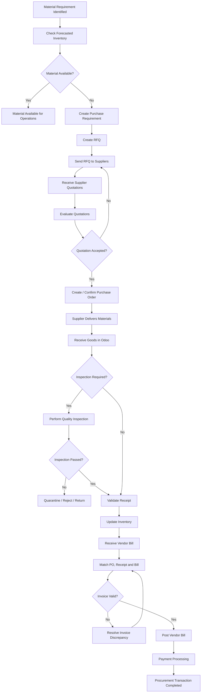
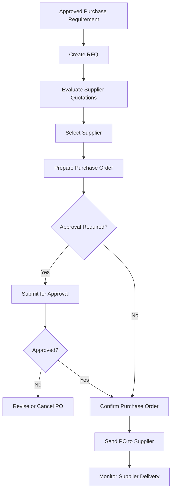
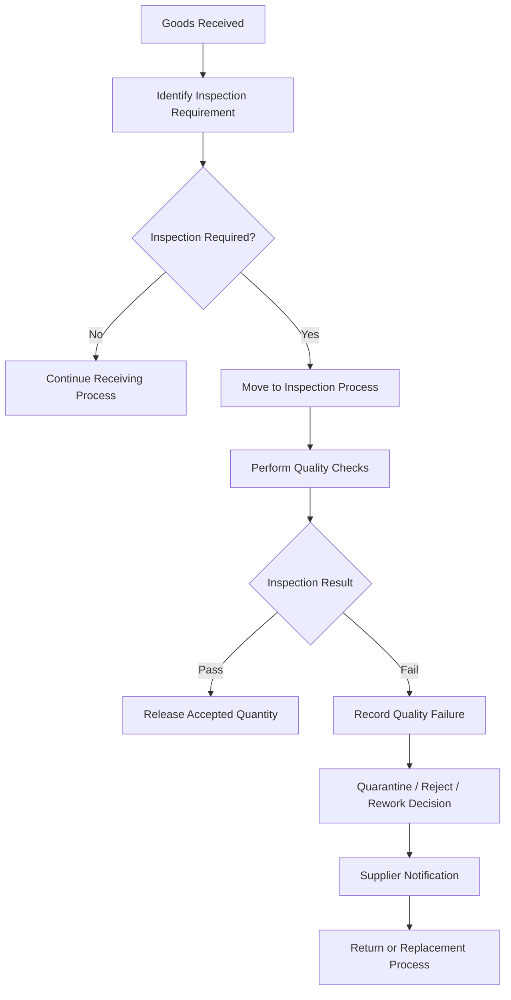

# Procurement Process

**Project:** Astrea Manufacturing — Manufacturing & Production Management ERP  
**Document ID:** AST-ERP-PROC-001  
**Document Type:** Business Process Documentation  
**ERP Platform:** Odoo 19  
**Database:** PostgreSQL  
**Status:** Draft — Portfolio Simulation  
**Version:** 1.0

---

## 1. Introduction

### 1.1 Purpose

This document defines the procurement business process for Astrea Manufacturing, covering the acquisition of raw materials, components, and other production-related supplies required to support manufacturing operations.

The purpose is to establish a standardized, controlled, and traceable procurement process that integrates purchasing activities with inventory management, manufacturing planning, quality control, and accounting.

The document also serves as a functional reference for implementing the procurement workflow in Odoo 19.

### 1.2 Business Background

Astrea Manufacturing operates a manufacturing facility producing industrial water pumps and electric motors.

The manufacturing operation depends on the timely availability of raw materials and components, including:

- Steel Housing
- Copper Wire
- Bearing Set
- Impeller
- Fastener Set
- Electrical Control Unit

Without a structured procurement process, the company may experience:

- Production delays caused by material shortages.
- Excessive inventory levels.
- Uncontrolled purchasing activities.
- Inconsistent vendor pricing.
- Inadequate supplier performance monitoring.
- Inaccurate purchase and inventory records.
- Delays in invoice verification and payment processing.

The proposed procurement process is designed to address these operational challenges through standardized workflows and centralized ERP management.

### 1.3 Business Objectives

The procurement process aims to achieve the following objectives:

| ID | Business Objective | Expected Outcome |
|---|---|---|
| PROC-OBJ-001 | Ensure material availability | Reduce production interruptions caused by material shortages |
| PROC-OBJ-002 | Standardize purchasing activities | Establish consistent purchasing procedures |
| PROC-OBJ-003 | Improve supplier management | Maintain reliable supplier information and performance records |
| PROC-OBJ-004 | Control purchasing expenditure | Improve purchase price visibility and approval controls |
| PROC-OBJ-005 | Improve inventory coordination | Integrate purchasing with inventory replenishment |
| PROC-OBJ-006 | Improve procurement traceability | Maintain end-to-end purchasing transaction history |
| PROC-OBJ-007 | Improve financial accuracy | Ensure accurate purchase order, receipt, and vendor bill reconciliation |

### 1.4 Scope

**In Scope**

- Supplier master data management.
- Purchase requisition and material requirement identification.
- RFQ generation and management.
- Supplier quotation comparison.
- Vendor selection.
- Purchase order creation and confirmation.
- Incoming material receipt.
- Quality inspection coordination.
- Supplier delivery tracking.
- Vendor bill verification.
- Purchase order cancellation and modification.
- Procurement reporting and KPI monitoring.
- Integration with Inventory, Manufacturing, Quality, and Accounting.

**Out of Scope**

- Supplier contract legal management.
- Advanced strategic sourcing.
- Supplier portal customization.
- Automated supplier bidding.
- International trade compliance.
- Customs clearance.
- Complex landed cost allocation.
- Advanced vendor scorecard automation.

These capabilities may be considered in future implementation phases.

---

## 2. Procurement Operating Model

### 2.1 Procurement Organization

The proposed procurement operating model involves the following roles:

| Role | Responsibility |
|---|---|
| Production Planner | Identifies production material requirements |
| Warehouse Manager | Monitors inventory availability and replenishment requirements |
| Procurement Officer | Creates RFQs and manages purchasing transactions |
| Procurement Manager | Reviews supplier quotations and purchasing decisions |
| Purchase Approver | Approves purchases according to the authorization matrix |
| Warehouse Staff | Receives and verifies delivered materials |
| Quality Inspector | Performs incoming quality inspections |
| Finance Staff | Verifies vendor bills and accounting records |
| Finance Manager | Reviews financial transactions and payment authorization |

The actual organizational structure and approval authority must be validated during business requirements gathering.

### 2.2 Procurement Principles

The following principles govern the procurement process:

1. All purchases must have a valid business requirement.
2. Procurement transactions must be recorded in Odoo.
3. Supplier selection must consider price, quality, lead time, and reliability.
4. Purchase orders must be approved according to the applicable authorization policy.
5. Received materials must be verified against the corresponding purchase order.
6. Quality inspection must be performed when required by the product or business process.
7. Vendor bills must be reconciled against purchasing and receiving records.
8. Procurement transactions must maintain complete audit trails.

### 2.3 Procurement Categories

The proposed procurement categories are:

| Category | Description | Example |
|---|---|---|
| Raw Materials | Materials used in manufacturing | Steel Housing |
| Components | Components assembled into finished products | Bearing Set |
| Subassemblies | Previously manufactured or purchased assemblies | Electric Motor Assembly |
| Maintenance Supplies | Materials used for equipment maintenance | Lubricants |
| Operating Supplies | Materials required for daily operations | Packaging Materials |
| Services | External services purchased by the company | Equipment Maintenance Service |

The initial portfolio implementation focuses primarily on raw materials and manufacturing components.

---

## 3. Procurement Process Overview

### 3.1 High-Level Process Flow

The procurement process follows this sequence:

1. Material requirement identification.
2. Purchase requirement validation.
3. RFQ creation.
4. Supplier quotation collection.
5. Supplier quotation evaluation.
6. Purchase order confirmation.
7. Supplier order fulfillment.
8. Incoming material receipt.
9. Quality inspection, where applicable.
10. Inventory update.
11. Vendor bill verification.
12. Accounting and payment processing.

### 3.2 End-to-End Process Diagram



### 3.3 Process Participants

| Process Stage | Responsible Department | Supporting Department |
|---|---|---|
| Material requirement | Production / Warehouse | Manufacturing |
| RFQ preparation | Procurement | Warehouse |
| Supplier evaluation | Procurement | Production / Quality |
| Purchase approval | Authorized Approver | Procurement |
| Goods receipt | Warehouse | Procurement |
| Quality inspection | Quality | Warehouse |
| Vendor bill verification | Finance | Procurement / Warehouse |
| Payment processing | Finance | Management |

---

## 4. Material Requirement Identification

### 4.1 Purpose

Material requirement identification determines whether additional raw materials or components must be purchased to support production operations.

The requirement may originate from:

- Manufacturing demand.
- Minimum stock replenishment rules.
- Confirmed customer orders.
- Production planning.
- Manual purchase requests.
- Maintenance and operational requirements.

### 4.2 Material Requirement Sources

| Source | Description | Example |
|---|---|---|
| Manufacturing Order | Material required to execute an MO | Copper Wire for EM200 |
| Reordering Rule | Replenishment based on forecasted inventory | Bearing Set |
| Manual Request | Purchase request initiated by an authorized employee | Emergency component purchase |
| Forecasted Demand | Expected future material consumption | Materials for upcoming production |
| Maintenance Request | Materials required for equipment maintenance | Lubricants |

### 4.3 Inventory Availability Assessment

Before creating a purchase requirement, the procurement process must consider the material's inventory position.

The assessment should include:

- On-hand quantity.
- Reserved quantity.
- Incoming quantity.
- Outgoing quantity.
- Forecasted quantity.
- Existing purchase orders.
- Supplier lead time.
- Expected production consumption.

A simplified forecasted quantity calculation is:

```text
Forecasted Quantity =
    On Hand Quantity
    + Incoming Quantity
    - Outgoing Quantity
```

This formula is a conceptual representation. Actual Odoo forecast calculations depend on stock moves, reservations, locations, routes, and transaction states.

### 4.4 Replenishment Example

The following example uses illustrative inventory data.

| Material | On Hand | Incoming | Outgoing | Forecasted |
|---|---:|---:|---:|---:|
| Steel Housing | 35 | 0 | 20 | 15 |
| Copper Wire | 70 | 30 | 40 | 60 |
| Bearing Set | 18 | 0 | 5 | 13 |
| Impeller | 25 | 10 | 15 | 20 |
| Fastener Set | 120 | 0 | 40 | 80 |
| Electrical Control Unit | 8 | 0 | 3 | 5 |

Assuming the illustrative minimum quantities below:

| Material | Minimum Quantity | Forecasted Quantity | Replenishment Required |
|---|---:|---:|---|
| Steel Housing | 20 | 15 | Yes |
| Copper Wire | 30 | 60 | No |
| Bearing Set | 20 | 13 | Yes |
| Impeller | 15 | 20 | No |
| Fastener Set | 50 | 80 | No |
| Electrical Control Unit | 10 | 5 | Yes |

**Important:** These are simulated values for portfolio demonstration, not actual company inventory records.

### 4.5 Business Rules

| Rule ID | Business Rule |
|---|---|
| PROC-BR-001 | Purchase requirements must originate from an identifiable business need. |
| PROC-BR-002 | Inventory availability must be evaluated before initiating replenishment. |
| PROC-BR-003 | Forecasted inventory should be considered when evaluating replenishment requirements. |
| PROC-BR-004 | Existing incoming purchase orders must be considered to avoid duplicate purchasing. |
| PROC-BR-005 | Emergency purchases must follow a defined authorization process. |
| PROC-BR-006 | Purchase quantities must consider minimum order quantities and supplier constraints where applicable. |

---

## 5. Purchase Requisition Management

### 5.1 Purpose

A purchase requisition represents an internal request to acquire materials or services.

It establishes the business justification and required quantity before procurement commits to purchasing from a supplier.

### 5.2 Requisition Information

A purchase requisition should contain:

| Field | Description |
|---|---|
| Requisition Number | Unique request reference |
| Request Date | Date the request is created |
| Requesting Department | Department initiating the request |
| Requested By | Employee responsible for the request |
| Product | Requested material or service |
| Quantity | Required quantity |
| Unit of Measure | Product UoM |
| Required Date | Expected availability date |
| Destination | Warehouse or receiving location |
| Business Justification | Reason for the purchase |
| Priority | Normal, High, or Emergency |
| Approval Status | Current approval status |

### 5.3 Requisition Approval

The proposed approval process:

1. Requesting department submits a requisition.
2. Department manager reviews the requirement.
3. Warehouse checks current and forecasted inventory.
4. Procurement reviews sourcing requirements.
5. Authorized approver approves or rejects the request.
6. Approved requirements become available for procurement execution.

### 5.4 Approval Matrix

The following is an illustrative authorization structure.

| Purchase Value | Approval Authority |
|---|---|
| Up to IDR 5,000,000 | Department Manager |
| IDR 5,000,001 – IDR 25,000,000 | Procurement Manager |
| IDR 25,000,001 – IDR 100,000,000 | Finance Manager |
| Above IDR 100,000,000 | General Manager |

These thresholds are proposed portfolio assumptions, not actual Astrea Manufacturing policies.

**Implementation consideration:** Standard Odoo Purchase workflows do not automatically imply a complete purchase requisition approval system. A separate approval workflow, configuration, or custom development may be required depending on the final business requirements and installed modules.

---

## 6. Request for Quotation (RFQ)

### 6.1 Purpose

An RFQ is created to request commercial offers from potential suppliers.

It provides procurement with an opportunity to compare supplier pricing, delivery commitments, and purchasing conditions before confirming an order.

### 6.2 RFQ Creation

The Procurement Officer creates an RFQ containing:

- Supplier.
- Product.
- Requested quantity.
- Unit of measure.
- Expected delivery date.
- Unit price.
- Payment terms.
- Delivery terms.
- Destination warehouse.
- Additional purchasing requirements.

### 6.3 RFQ Supplier Selection

Suppliers should be selected based on:

| Evaluation Criteria | Description |
|---|---|
| Product Availability | Supplier can provide the required materials |
| Unit Price | Competitive purchasing price |
| Quality | Product conformity and historical quality performance |
| Delivery Lead Time | Ability to meet the required delivery date |
| Reliability | Historical delivery and fulfillment performance |
| Payment Terms | Financial and contractual conditions |
| Supplier Compliance | Required documentation and business compliance |

### 6.4 Supplier Quotation Comparison

Example:

**Product:** CMP003 — Bearing Set  
**Required Quantity:** 50 Units

| Evaluation Criteria | Supplier A | Supplier B | Supplier C |
|---|---:|---:|---:|
| Unit Price | IDR 120,000 | IDR 115,000 | IDR 125,000 |
| Delivery Lead Time | 7 Days | 14 Days | 5 Days |
| Quality Rating | 95% | 92% | 98% |
| Payment Terms | Net 30 | Net 30 | Net 45 |
| Delivery Reliability | 96% | 90% | 98% |

Illustrative supplier evaluation:

| Supplier | Price Score | Quality Score | Lead Time Score | Reliability Score |
|---|---:|---:|---:|---:|
| Supplier A | 95 | 95 | 85 | 96 |
| Supplier B | 100 | 92 | 65 | 90 |
| Supplier C | 91 | 98 | 100 | 98 |

Proposed weighted scoring:

```text
Supplier Score =
    (Price Score × 35%)
    + (Quality Score × 30%)
    + (Lead Time Score × 20%)
    + (Reliability Score × 15%)
```

Illustrative results:

| Supplier | Final Score |
|---|---:|
| Supplier A | 92.55 |
| Supplier B | 89.85 |
| Supplier C | 96.15 |

Supplier C receives the highest score in this example.

However, the lowest unit price must not automatically determine the winning supplier. Quality, availability, delivery reliability, and total procurement risk should also be considered.

### 6.5 RFQ Business Rules

| Rule ID | Business Rule |
|---|---|
| PROC-BR-007 | RFQs must contain valid product and quantity information. |
| PROC-BR-008 | Supplier quotations should be evaluated using defined procurement criteria. |
| PROC-BR-009 | Supplier selection must consider both commercial and operational requirements. |
| PROC-BR-010 | Supplier quotations must be retained for purchasing traceability. |
| PROC-BR-011 | Any deviation from the approved supplier selection process must be documented. |

---

## 7. Purchase Order Management

### 7.1 Purpose

A Purchase Order (PO) is the formal purchasing document issued to a supplier after the purchasing decision has been approved.

It establishes the commercial agreement for the requested materials or services.

### 7.2 Purchase Order Creation

The Purchase Order should include:

| Field | Description |
|---|---|
| PO Number | Unique purchase order reference |
| Supplier | Selected vendor |
| Order Date | Purchase order creation date |
| Expected Arrival | Expected delivery date |
| Product | Ordered product |
| Quantity | Ordered quantity |
| Unit Price | Agreed purchase price |
| Taxes | Applicable purchase taxes |
| Payment Terms | Agreed payment terms |
| Delivery Address | Receiving warehouse |
| Currency | Transaction currency |
| Buyer | Responsible procurement employee |
| Source Document | Related RFQ or purchasing request |

### 7.3 Purchase Order Workflow



### 7.4 Purchase Order Approval

The proposed purchasing approval controls include:

- Purchase amount validation.
- Budget availability verification.
- Supplier verification.
- Product and quantity validation.
- Price comparison review.
- Approval authority validation.

Approval thresholds must be configurable or implemented through an appropriate approval mechanism.

### 7.5 Purchase Order Modification

Any modification to a confirmed purchase order should be controlled.

Examples include:

- Quantity changes.
- Unit price changes.
- Delivery date changes.
- Supplier changes.
- Product substitutions.

Material changes may require renewed approval.

The system should preserve the original transaction history and record the user responsible for each modification.

### 7.6 Purchase Order Business Rules

| Rule ID | Business Rule |
|---|---|
| PROC-BR-012 | Confirmed purchase orders must have a valid supplier. |
| PROC-BR-013 | Purchase order quantities must be greater than zero. |
| PROC-BR-014 | Purchase orders must comply with the applicable approval policy. |
| PROC-BR-015 | Confirmed purchase orders must be communicated to suppliers. |
| PROC-BR-016 | Changes to confirmed orders must be controlled and traceable. |
| PROC-BR-017 | Purchase orders must reference the originating requirement where applicable. |

---

## 8. Supplier Delivery Management

### 8.1 Purpose

Supplier delivery management monitors the fulfillment of confirmed purchase orders.

The Procurement Officer is responsible for monitoring expected delivery dates and coordinating with suppliers when delays or discrepancies occur.

### 8.2 Delivery Monitoring

The procurement team should monitor:

- Expected delivery date.
- Supplier confirmation.
- Delivery status.
- Outstanding quantity.
- Partial delivery.
- Delayed delivery.
- Supplier communication.
- Potential production impact.

### 8.3 Supplier Delivery Status

| Status | Description |
|---|---|
| Not Confirmed | Supplier has not confirmed the order |
| Confirmed | Supplier has accepted the purchase order |
| In Progress | Supplier is preparing the order |
| Partially Delivered | Only part of the ordered quantity has arrived |
| Fully Delivered | All ordered quantities have arrived |
| Delayed | Delivery is beyond the expected date |
| Cancelled | Supplier order has been cancelled |

These statuses describe the proposed business monitoring model. They should not be assumed to be identical to standard Odoo purchase order states.

### 8.4 Partial Delivery

A supplier may deliver less than the ordered quantity.

Example:

| Description | Quantity |
|---|---:|
| Ordered Quantity | 100 Units |
| First Delivery | 60 Units |
| Outstanding Quantity | 40 Units |

The warehouse should record the actual received quantity.

The remaining quantity must remain traceable and should be followed up with the supplier.

### 8.5 Supplier Delay Management

When a supplier fails to meet the expected delivery date:

1. Procurement identifies the delayed purchase order.
2. Procurement contacts the supplier.
3. Supplier provides a revised delivery commitment.
4. Production Planner assesses the production impact.
5. Procurement evaluates alternative sourcing when necessary.
6. The updated delivery commitment is recorded.
7. Relevant stakeholders are notified.

### 8.6 Business Rules

| Rule ID | Business Rule |
|---|---|
| PROC-BR-018 | Supplier deliveries must be monitored against confirmed purchase orders. |
| PROC-BR-019 | Partial deliveries must be recorded using actual received quantities. |
| PROC-BR-020 | Outstanding quantities must remain traceable. |
| PROC-BR-021 | Supplier delivery delays must be communicated to relevant stakeholders. |
| PROC-BR-022 | Material substitutions require appropriate authorization. |

---

## 9. Goods Receipt Management

### 9.1 Purpose

Goods receipt verifies that materials delivered by suppliers match the corresponding purchase order.

The receiving process is primarily performed by the Warehouse Department.

### 9.2 Goods Receipt Procedure

1. Supplier delivers materials to the warehouse.
2. Warehouse Staff identifies the corresponding purchase order.
3. Delivered products are checked against the purchase order.
4. Quantity is physically counted.
5. Product identity and condition are verified.
6. Lot or serial numbers are recorded when required.
7. Required quality inspections are initiated.
8. Accepted quantities are processed into the appropriate inventory location.
9. Discrepancies are documented and communicated.

### 9.3 Goods Receipt Verification

| Verification Item | Description |
|---|---|
| Purchase Order | Confirm the correct purchase order |
| Supplier | Verify the delivering supplier |
| Product | Confirm product identity |
| Quantity | Compare actual and ordered quantities |
| Unit of Measure | Verify the receiving UoM |
| Product Condition | Check for physical damage |
| Packaging | Check packaging condition |
| Lot Number | Record lot number when applicable |
| Serial Number | Record serial number when applicable |
| Delivery Document | Retain supplier delivery documentation |

### 9.4 Goods Receipt Example

Purchase Order:

| Product | Ordered Quantity |
|---|---:|
| CMP001 — Steel Housing | 100 Units |

Actual supplier delivery:

| Product | Delivered Quantity | Accepted Quantity | Rejected Quantity |
|---|---:|---:|---:|
| CMP001 — Steel Housing | 100 | 95 | 5 |

The receiving team records the physical delivery and identifies the five rejected units.

The accepted and rejected quantities must be handled according to the configured inventory and quality process.

### 9.5 Goods Receipt Business Rules

| Rule ID | Business Rule |
|---|---|
| PROC-BR-023 | Goods receipts must reference an appropriate source document. |
| PROC-BR-024 | Actual received quantities must be recorded accurately. |
| PROC-BR-025 | Over-receipts must follow the configured receiving policy. |
| PROC-BR-026 | Damaged or non-conforming products must be identified. |
| PROC-BR-027 | Traceability information must be recorded when required. |
| PROC-BR-028 | Partial receipts must preserve the outstanding purchase quantity. |

---

## 10. Incoming Quality Inspection

### 10.1 Purpose

Incoming quality inspection ensures that purchased materials comply with the company's quality requirements before they are released for production use.

### 10.2 Inspection Requirements

Inspection requirements may depend on:

- Product category.
- Supplier quality history.
- Material criticality.
- Purchase order requirements.
- Applicable engineering specifications.
- Regulatory or customer requirements.

### 10.3 Inspection Process



### 10.4 Quality Inspection Criteria

Example for Steel Housing:

| Inspection Item | Description |
|---|---|
| Dimensional Accuracy | Verify dimensions against engineering specifications |
| Surface Condition | Check for scratches, cracks, or defects |
| Material Specification | Verify material conformity |
| Quantity | Verify accepted quantity |
| Documentation | Check required supplier documentation |

Actual inspection criteria must be obtained from approved engineering specifications and quality procedures.

### 10.5 Non-Conforming Materials

When materials fail inspection:

1. Quality Inspector records the inspection failure.
2. Affected quantities are identified.
3. Non-conforming materials are segregated or placed in an appropriate restricted location.
4. Quality Manager determines the disposition.
5. Procurement communicates the issue to the supplier.
6. The supplier may provide replacement materials, corrective action, or credit.
7. The transaction is updated according to the approved disposition.

Possible dispositions include:

- Accept under approved deviation.
- Return to supplier.
- Replace defective materials.
- Rework.
- Scrap.

Acceptance under deviation must require documented authorization.

### 10.6 Quality Business Rules

| Rule ID | Business Rule |
|---|---|
| PROC-BR-029 | Products requiring incoming inspection must follow the defined quality process. |
| PROC-BR-030 | Failed inspection quantities must not be released for unrestricted production consumption. |
| PROC-BR-031 | Non-conforming materials must be traceable. |
| PROC-BR-032 | Quality disposition must be authorized. |
| PROC-BR-033 | Supplier quality issues must be recorded for supplier performance monitoring. |

---

## 11. Vendor Bill Management

### 11.1 Purpose

Vendor bill management verifies supplier invoices against purchasing and receiving records before they are posted in accounting.

This process helps prevent duplicate invoices, incorrect charges, and payment discrepancies.

### 11.2 Vendor Bill Verification

The Finance Department verifies:

- Supplier identity.
- Invoice reference.
- Invoice date.
- Invoice amount.
- Purchase order reference.
- Received quantity.
- Unit price.
- Taxes.
- Additional charges.
- Payment terms.
- Currency.

### 11.3 Three-Way Matching

The proposed invoice verification process uses three-way matching:

1. Purchase Order: What the company ordered.
2. Goods Receipt: What the company received.
3. Vendor Bill: What the supplier invoiced.

Example:

| Verification Item | Purchase Order | Goods Receipt | Vendor Bill |
|---|---:|---:|---:|
| Product | Bearing Set | Bearing Set | Bearing Set |
| Quantity | 50 | 50 | 50 |
| Unit Price | IDR 120,000 | N/A | IDR 120,000 |
| Subtotal | IDR 6,000,000 | N/A | IDR 6,000,000 |

The invoice is consistent with the purchasing and receiving records in this example.

### 11.4 Invoice Discrepancy Handling

Examples of discrepancies:

| Discrepancy | Required Action |
|---|---|
| Invoice quantity exceeds received quantity | Investigate with supplier and warehouse |
| Invoice price differs from PO | Verify approved price changes |
| Duplicate invoice | Reject or resolve duplicate transaction |
| Incorrect tax | Request correction |
| Incorrect supplier | Validate supplier documentation |
| Missing receipt | Investigate delivery and receipt status |

### 11.5 Vendor Bill Business Rules

| Rule ID | Business Rule |
|---|---|
| PROC-BR-034 | Vendor bills must reference valid supplier transactions where applicable. |
| PROC-BR-035 | Invoice quantities and prices must be verified. |
| PROC-BR-036 | Invoice discrepancies must be resolved before payment authorization. |
| PROC-BR-037 | Duplicate invoices must be prevented or identified. |
| PROC-BR-038 | Vendor bills must follow the company's accounting approval policy. |

---

## 12. Procurement Returns and Supplier Claims

### 12.1 Purpose

This process manages materials that must be returned to suppliers due to defects, incorrect deliveries, or other purchasing discrepancies.

### 12.2 Return Scenarios

- Defective materials.
- Incorrect product delivery.
- Excessive delivery.
- Damaged materials.
- Non-compliant materials.
- Supplier replacement agreements.

### 12.3 Return Process

1. Identify the affected materials.
2. Verify the original receipt and purchase order.
3. Obtain the required return authorization.
4. Record the supplier return.
5. Update inventory quantities.
6. Notify the supplier.
7. Obtain replacement materials or a credit note where applicable.
8. Reconcile the supplier claim with accounting records.

### 12.4 Business Rules

| Rule ID | Business Rule |
|---|---|
| PROC-BR-039 | Supplier returns must reference the original receipt or purchasing transaction where possible. |
| PROC-BR-040 | Returned quantities must be accurately recorded. |
| PROC-BR-041 | Supplier claims must be documented. |
| PROC-BR-042 | Replacement deliveries must remain traceable to the original issue. |

---

## 13. Supplier Master Data Management

### 13.1 Purpose

Supplier master data provides centralized information about vendors used in procurement transactions.

### 13.2 Supplier Information

| Field | Description |
|---|---|
| Supplier Name | Registered supplier name |
| Supplier Code | Internal supplier reference |
| Address | Supplier address |
| Contact Person | Main supplier representative |
| Email | Supplier contact email |
| Phone | Supplier contact number |
| Tax Identification | Applicable tax identification |
| Payment Terms | Agreed payment terms |
| Currency | Transaction currency |
| Bank Information | Approved supplier bank information |
| Supplier Category | Supplier classification |
| Active Status | Supplier availability |

Sensitive supplier banking and tax information must be accessible only to authorized users.

### 13.3 Supplier Evaluation

The procurement department should periodically evaluate suppliers using:

- Purchase price competitiveness.
- On-time delivery.
- Product quality.
- Defect rate.
- Responsiveness.
- Order fulfillment reliability.
- Documentation accuracy.

### 13.4 Supplier Performance Indicators

| KPI | Description |
|---|---|
| On-Time Delivery Rate | Percentage of deliveries received on or before the agreed date |
| Supplier Defect Rate | Percentage of received units rejected due to quality issues |
| Purchase Price Variance | Difference between actual purchase price and reference price |
| Order Fulfillment Rate | Percentage of ordered quantities fulfilled |
| Supplier Response Time | Time required to respond to purchasing inquiries |

Example formulas:

```text
On-Time Delivery Rate =
    (On-Time Deliveries / Total Deliveries) × 100

Supplier Defect Rate =
    (Rejected Quantity / Total Received Quantity) × 100

Order Fulfillment Rate =
    (Delivered Quantity / Ordered Quantity) × 100
```

KPI calculation rules must define how partial deliveries, cancelled orders, and split shipments are counted.

---

## 14. Procurement Reporting and KPIs

### 14.1 Procurement Dashboard

The proposed procurement dashboard should provide visibility into:

- Total purchase orders.
- Total purchasing expenditure.
- Open purchase orders.
- Pending RFQs.
- Overdue supplier deliveries.
- Pending goods receipts.
- Supplier delivery performance.
- Supplier quality performance.
- Purchase price variance.

### 14.2 Key Performance Indicators

| KPI | Formula | Illustrative Target |
|---|---|---:|
| On-Time Delivery Rate | On-time deliveries / total deliveries × 100 | ≥ 95% |
| Supplier Defect Rate | Rejected quantity / received quantity × 100 | ≤ 2% |
| PO Processing Time | Average time from approved requirement to PO confirmation | Baseline TBD |
| Purchase Price Variance | Actual price compared with approved reference price | Baseline TBD |
| Order Fulfillment Rate | Delivered quantity / ordered quantity × 100 | ≥ 98% |
| Emergency Purchase Rate | Emergency purchase orders / total purchase orders × 100 | ≤ 5% |
| Invoice Matching Rate | Bills matching approved purchasing and receiving records / total bills × 100 | ≥ 98% |

Targets are illustrative portfolio assumptions and must not be presented as actual business achievements.

### 14.3 Reporting Frequency

| Report | Frequency | Responsible Department |
|---|---|---|
| Open Purchase Orders | Daily | Procurement |
| Overdue Deliveries | Daily | Procurement |
| Pending Receipts | Daily | Warehouse |
| Supplier Quality Report | Monthly | Quality |
| Supplier Performance Report | Monthly | Procurement |
| Purchase Expenditure Report | Monthly | Finance |
| Purchase Price Variance | Monthly | Procurement / Finance |

---

## 15. Odoo 19 Functional Implementation

### 15.1 Required Applications

The proposed procurement implementation uses the following Odoo applications:

| Application | Purpose |
|---|---|
| Purchase | RFQs, supplier quotations, purchase orders |
| Inventory | Goods receipts, internal transfers, supplier returns |
| Manufacturing | Production material requirements |
| Quality | Incoming material inspection, where configured |
| Accounting / Invoicing | Vendor bills and supplier payments |

Application availability and accounting functionality depend on the installed Odoo edition, localization, and configuration.

### 15.2 Purchase Configuration

The following configurations should be reviewed:

- Purchase units of measure.
- Vendor records.
- Vendor product prices.
- Purchase taxes.
- Payment terms.
- Purchase order approval requirements.
- Purchase order reporting.
- Product purchase settings.

### 15.3 Supplier Configuration

Supplier records should be created with accurate commercial and operational information.

Supplier product information may include:

- Vendor.
- Vendor product name.
- Vendor product code.
- Minimum quantity.
- Purchase price.
- Currency.
- Supplier lead time.

Vendor-specific pricing and lead-time data should be validated against actual supplier quotations.

### 15.4 Purchase Order Workflow in Odoo

The standard purchase workflow generally follows:

1. Create an RFQ.
2. Select a supplier.
3. Add products and quantities.
4. Review prices and delivery dates.
5. Send the RFQ to the supplier.
6. Confirm the purchase order after acceptance.
7. Receive the ordered products through Inventory.
8. Create and verify the vendor bill.
9. Post the vendor bill and process payment according to accounting policy.

The exact menu labels and workflow behavior should be validated in the installed Odoo 19 environment.

### 15.5 Replenishment Integration

Procurement must integrate with inventory replenishment.

The intended relationship is:

```text
Inventory / Manufacturing Demand
             |
             v
      Replenishment Logic
             |
             v
      Procurement Requirement
             |
             v
             RFQ
             |
             v
      Purchase Order
             |
             v
       Goods Receipt
             |
             v
      Inventory Updated
```

Depending on product routes and replenishment configuration, Odoo may generate purchase quotations or other replenishment documents automatically.

A replenishment rule is not simply a comparison against on-hand stock. Forecasted quantities, stock moves, routes, and procurement scheduling must be considered.

### 15.6 Quality Integration

For products requiring incoming inspection:

- Configure applicable quality control points.
- Define inspection instructions.
- Determine inspection frequency.
- Define failure handling.
- Configure appropriate inventory segregation or disposition procedures.

The exact interaction between Quality checks and receipt validation must be tested in the installed environment.

### 15.7 Accounting Integration

The accounting process should cover:

- Vendor bill creation.
- Purchase order reference.
- Receipt-based invoice verification where applicable.
- Tax configuration.
- Accounts payable.
- Payment registration.
- Supplier credit notes.

Accounting configuration must follow the selected Indonesian localization and applicable accounting policies.

### 15.8 Customization Considerations

Potential custom development requirements include:

| Requirement | Proposed Solution | Priority |
|---|---|---|
| Purchase requisition approval | Approval workflow or custom module | Medium |
| Multi-level purchase approval | Approval configuration or custom module | High if required by policy |
| Supplier quotation scoring | Custom evaluation model or controlled external evaluation | Medium |
| Supplier performance dashboard | Custom reporting | Medium |
| Purchase price variance alert | Automated reporting or custom logic | Medium |
| Advanced supplier portal | Custom integration | Low |
| Procurement budget control | Accounting / budget integration or custom development | Subject to scope |

Customization should only be developed when standard Odoo functionality and configuration cannot satisfy an approved requirement.

---

## 16. Roles and Access Control

### 16.1 Access Control Matrix

| Activity | Procurement Officer | Procurement Manager | Warehouse Staff | Quality Inspector | Finance Staff |
|---|---|---|---|---|---|
| View Suppliers | Yes | Yes | Read-only if required | Read-only if required | Yes |
| Create RFQ | Yes | Yes | No | No | No |
| Confirm Purchase Order | According to policy | Yes | No | No | No |
| Receive Products | No | No | Yes | No | No |
| Perform Quality Inspection | No | No | No | Yes | No |
| Create Vendor Bill | No | No | No | No | Yes |
| Post Vendor Bill | According to policy | No | No | No | According to policy |
| Review Procurement Reports | Yes | Yes | Limited | Limited | Yes |

This is a conceptual access matrix. Actual Odoo access rights and record rules must be configured and tested.

### 16.2 Segregation of Duties

The implementation should avoid assigning unrestricted purchasing authority to a single user.

Where practical:

- Purchase request creation should be separated from purchase approval.
- Purchase approval should be separated from goods receipt.
- Goods receipt should be separated from invoice posting.
- Vendor bank information changes should require controlled access.
- Accounting payment authorization should follow finance policy.

The exact separation depends on company size and operational staffing.

---

## 17. Procurement Exception Handling

### 17.1 Exception Scenarios

| Scenario | Expected Handling |
|---|---|
| Supplier rejects RFQ | Select an alternative supplier |
| Supplier quotation exceeds budget | Re-evaluate or request approval |
| Supplier delivers late | Record delay and assess production impact |
| Supplier delivers incorrect product | Record discrepancy and initiate return |
| Supplier delivers defective material | Initiate quality disposition |
| Supplier delivers partial quantity | Record actual receipt and monitor balance |
| Invoice price differs from PO | Investigate and resolve discrepancy |
| Duplicate supplier invoice | Prevent or identify duplicate posting |
| Purchase order is cancelled | Apply controlled cancellation and review related stock moves |

### 17.2 Escalation Matrix

| Issue | First Responsible Role | Escalation |
|---|---|---|
| Material shortage | Procurement Officer | Procurement Manager |
| Supplier delay | Procurement Officer | Procurement Manager / Production Manager |
| Quality rejection | Quality Inspector | Quality Manager |
| Invoice discrepancy | Finance Staff | Finance Manager |
| Unauthorized purchase | Procurement Manager | General Manager |
| Critical production disruption | Production Planner | Production Manager |

---

## 18. Procurement Process Acceptance Criteria

The procurement implementation will be considered functionally acceptable when the following conditions are met:

| ID | Acceptance Criteria |
|---|---|
| PROC-AC-001 | Authorized users can maintain supplier master data. |
| PROC-AC-002 | Procurement users can create RFQs. |
| PROC-AC-003 | RFQs can be converted into purchase orders through the approved workflow. |
| PROC-AC-004 | Purchase orders contain valid supplier and product information. |
| PROC-AC-005 | Purchase order approval controls operate according to the configured policy. |
| PROC-AC-006 | Purchase orders can be received through Inventory. |
| PROC-AC-007 | Partial deliveries are recorded accurately. |
| PROC-AC-008 | Incoming quality inspections can be performed for applicable products. |
| PROC-AC-009 | Non-conforming materials can be identified and handled according to the approved process. |
| PROC-AC-010 | Vendor bills can be verified against purchasing and receiving records. |
| PROC-AC-011 | Procurement users can identify open and overdue purchase orders. |
| PROC-AC-012 | Supplier performance information can be reported using defined KPI rules. |
| PROC-AC-013 | Procurement transactions maintain appropriate traceability. |
| PROC-AC-014 | Access rights prevent unauthorized purchasing activities. |
| PROC-AC-015 | Procurement transactions integrate correctly with Inventory and Accounting. |

Acceptance criteria must be validated through test execution and UAT. No criteria should be marked as passed before evidence is collected.

---

## 19. Assumptions and Constraints

### 19.1 Assumptions

| ID | Assumption |
|---|---|
| PROC-ASM-001 | Astrea Manufacturing operates one primary warehouse. |
| PROC-ASM-002 | Procurement primarily supports manufacturing material requirements. |
| PROC-ASM-003 | Supplier records are centrally maintained. |
| PROC-ASM-004 | Purchase orders are created and managed through Odoo. |
| PROC-ASM-005 | Supplier quotations are evaluated before purchasing commitments are made. |
| PROC-ASM-006 | Incoming inspection applies to selected materials. |
| PROC-ASM-007 | Procurement and inventory transactions are integrated. |
| PROC-ASM-008 | Vendor bills are managed through the configured accounting application. |

### 19.2 Constraints

| ID | Constraint |
|---|---|
| PROC-CON-001 | The initial implementation focuses on one manufacturing facility. |
| PROC-CON-002 | Advanced sourcing functionality is excluded from the initial scope. |
| PROC-CON-003 | Supplier integration is limited to standard communication unless otherwise approved. |
| PROC-CON-004 | Custom approval workflows may require additional development. |
| PROC-CON-005 | Accounting configuration depends on the selected Odoo edition and Indonesian localization. |
| PROC-CON-006 | All supplier and purchasing figures in this portfolio are illustrative. |

---

## 20. Open Questions

The following questions must be resolved during the requirements validation phase.

| ID | Question | Responsible Stakeholder |
|---|---|---|
| PROC-OQ-001 | Is a formal purchase requisition required before RFQ creation? | Procurement Manager |
| PROC-OQ-002 | What are the official purchase approval thresholds? | Management / Finance |
| PROC-OQ-003 | Is supplier quotation comparison mandatory for all purchases? | Procurement Manager |
| PROC-OQ-004 | How many supplier quotations are required for each purchasing category? | Procurement Manager |
| PROC-OQ-005 | Which materials require incoming quality inspection? | Quality Manager |
| PROC-OQ-006 | What is the permitted over-receipt tolerance? | Warehouse Manager |
| PROC-OQ-007 | Are partial deliveries allowed? | Procurement Manager |
| PROC-OQ-008 | What is the supplier invoice matching policy? | Finance Manager |
| PROC-OQ-009 | What supplier performance indicators should be monitored? | Procurement Manager |
| PROC-OQ-010 | Are supplier returns and replacements handled through a formal claim process? | Procurement / Quality |
| PROC-OQ-011 | Are purchase budgets controlled at department or company level? | Finance Manager |
| PROC-OQ-012 | Which payment terms and currencies are permitted? | Finance Manager |

These questions are open requirements, not confirmed business decisions.

---

## 21. Related Documents

| Document | Purpose |
|---|---|
| `00_business_requirements_gathering.md` | Requirements elicitation and stakeholder validation |
| `01_business_requirements.md` | Business requirements and business rules |
| `02_master_data_and_bom.md` | Product, component, BoM, and routing master data |
| `02_inventory_management.md` | Warehouse and inventory management processes |
| `03_functional_specification.md` | Functional requirements and Odoo implementation mapping |
| `04_technical_architecture.md` | Technical infrastructure and application architecture |
| `05_test_strategy_and_test_cases.md` | Testing strategy and validation scenarios |

The final document numbering should be standardized before portfolio publication.

---

## 22. Final Notes

This document describes the proposed procurement operating model for the Astrea Manufacturing portfolio project.

It is intended to demonstrate the ability to analyze and document procurement processes, identify business controls, define cross-functional integration, and translate business requirements into an Odoo ERP implementation approach.

All company information, supplier examples, purchasing values, approval thresholds, and KPI targets are simulated assumptions for portfolio purposes.

Before production implementation, the process must be validated against actual stakeholder requirements, procurement policies, supplier agreements, accounting policies, and the capabilities of the installed Odoo 19 edition.

**Document Status:** Draft — Portfolio Simulation  
**Next Recommended Activity:** Map procurement business rules and acceptance criteria to the Functional Specification and Test Strategy documents.