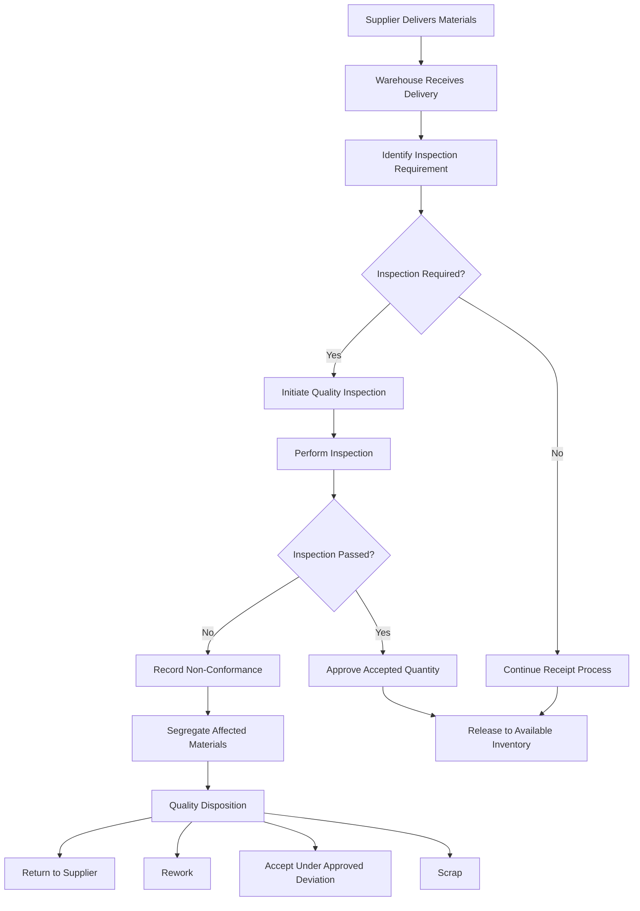
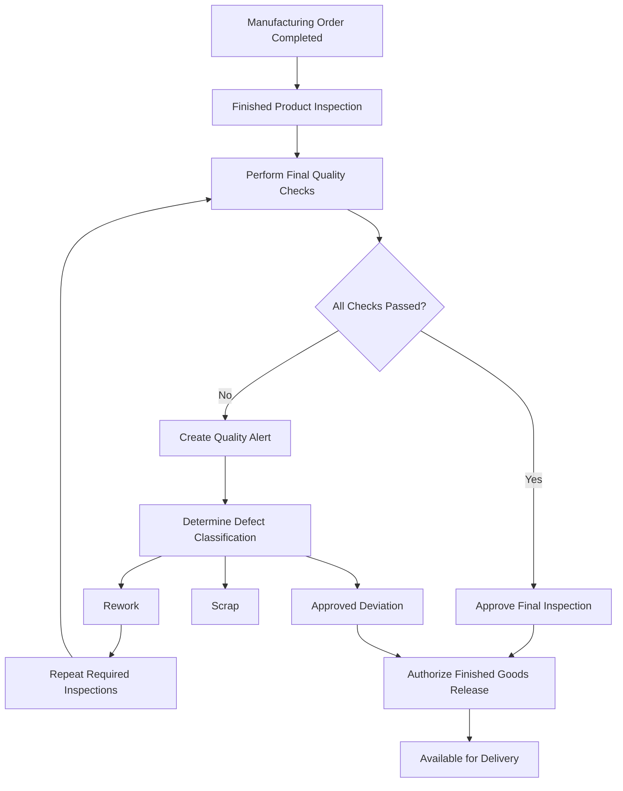
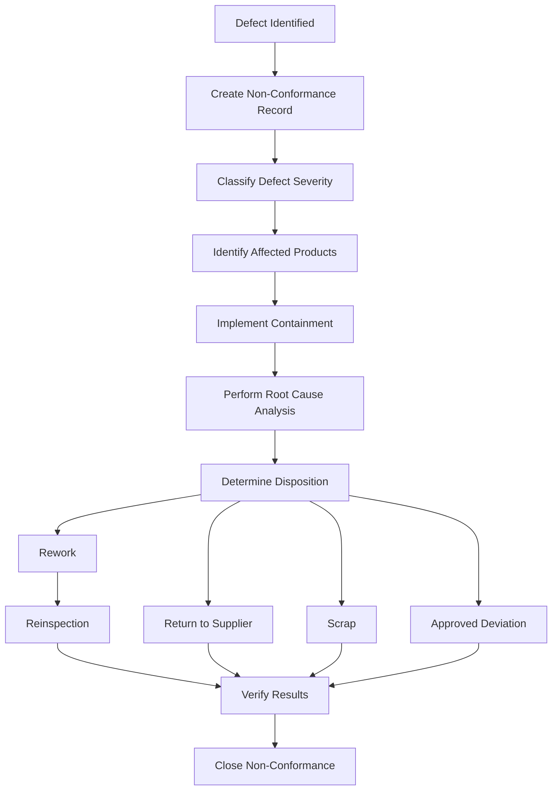
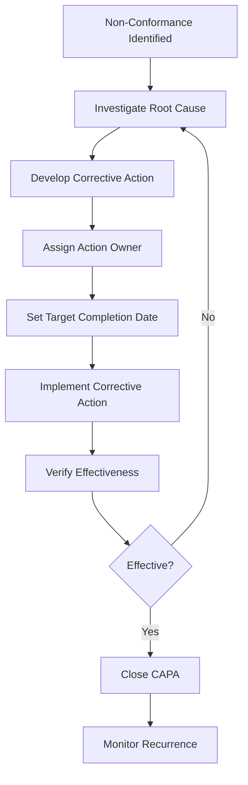

# Quality Management Process

**Project:** Astrea Manufacturing — Manufacturing & Production Management ERP  
**Document ID:** AST-ERP-QUAL-001  
**Document Type:** Business Process Documentation  
**ERP Platform:** Odoo 19  
**Database:** PostgreSQL  
**Status:** Draft — Portfolio Simulation  
**Version:** 1.0

---

## 1. Introduction

### 1.1 Purpose

This document defines the Quality Management business process for Astrea Manufacturing.

It establishes standardized quality control procedures to ensure that purchased materials, manufacturing operations, work-in-progress products, and finished goods comply with defined quality requirements.

The document also provides a functional reference for implementing Quality Management capabilities in Odoo 19.

### 1.2 Business Background

Astrea Manufacturing produces industrial water pumps and electric motors.

The manufacturing process involves multiple activities, including:

- Raw material procurement.
- Component receiving.
- Machining.
- Fabrication.
- Assembly.
- Electrical installation.
- Product testing.
- Finished goods inspection.
- Inventory storage and distribution.

Quality issues occurring at any stage may result in defective products, material waste, production delays, rework costs, customer complaints, and warranty claims.

A structured Quality Management process is therefore required to identify defects early, prevent non-conforming materials from entering production, and ensure that finished products meet established quality standards.

### 1.3 Business Objectives

| ID | Business Objective | Expected Outcome |
|---|---|---|
| QUAL-OBJ-001 | Improve incoming material quality | Prevent defective purchased materials from entering production |
| QUAL-OBJ-002 | Control manufacturing quality | Identify defects during production |
| QUAL-OBJ-003 | Ensure finished product conformity | Release only approved products |
| QUAL-OBJ-004 | Improve defect traceability | Maintain quality inspection and defect records |
| QUAL-OBJ-005 | Reduce production waste | Minimize scrap and unnecessary rework |
| QUAL-OBJ-006 | Improve supplier quality | Monitor and evaluate supplier quality performance |
| QUAL-OBJ-007 | Establish corrective actions | Prevent recurring quality problems |
| QUAL-OBJ-008 | Improve quality reporting | Provide measurable quality performance indicators |

### 1.4 Scope

**In Scope**

- Quality control planning.
- Incoming material inspection.
- In-process quality inspection.
- Manufacturing operation quality checks.
- Finished goods inspection.
- Quality control points.
- Quality alerts.
- Non-conformance management.
- Defect classification.
- Rework and scrap management.
- Corrective and preventive action.
- Supplier quality evaluation.
- Quality reporting and KPI monitoring.
- Integration with Purchase, Inventory, and Manufacturing.

**Out of Scope**

- Full laboratory information management systems.
- Advanced statistical process control.
- Automated machine vision inspection.
- External certification management.
- Regulatory submission management.
- Advanced product lifecycle management.
- IoT-based real-time quality monitoring.

These capabilities may be considered in future implementation phases.

---

## 2. Quality Management Operating Model

### 2.1 Quality Management Principles

The proposed quality management process follows these principles:

1. Quality requirements must be defined before production begins.
2. Critical incoming materials must be inspected according to approved inspection criteria.
3. Quality inspections must be performed at designated production stages.
4. Non-conforming products must be identified and controlled.
5. Quality decisions must be traceable to authorized personnel.
6. Defects must be categorized and analyzed.
7. Corrective actions must address identified root causes.
8. Quality records must be retained for audit and continuous improvement.
9. Product release must follow approved acceptance criteria.

### 2.2 Quality Management Stages

The quality management lifecycle consists of four primary stages.

| Stage | Description | Main Activity |
|---|---|---|
| Incoming Quality Control | Inspection of purchased materials | Verify supplier material conformity |
| In-Process Quality Control | Inspection during manufacturing | Detect defects during production |
| Final Quality Control | Inspection of completed products | Verify finished product conformity |
| Continuous Improvement | Analysis and prevention of recurring defects | CAPA and quality performance monitoring |

### 2.3 Quality Management Roles

| Role | Responsibility |
|---|---|
| Quality Manager | Owns quality policies and approves major quality decisions |
| Quality Inspector | Performs inspections and records inspection results |
| Production Manager | Ensures manufacturing processes comply with quality requirements |
| Production Supervisor | Monitors operational quality activities |
| Warehouse Manager | Ensures incoming and quarantined materials are properly controlled |
| Procurement Manager | Coordinates supplier quality issues |
| Maintenance Manager | Ensures equipment condition supports product quality |
| Engineering Manager | Defines technical specifications and engineering tolerances |
| Finance Manager | Reviews financial implications of scrap, rework, and supplier claims |

---

## 3. Quality Control Planning

### 3.1 Purpose

Quality control planning defines what must be inspected, when inspections must occur, how inspection results are evaluated, and what actions must be taken when defects are identified.

### 3.2 Quality Control Plan

A quality control plan should contain:

| Field | Description |
|---|---|
| Quality Plan ID | Unique quality plan reference |
| Product | Product or material being inspected |
| Inspection Stage | Incoming, in-process, or final |
| Inspection Characteristic | Parameter being evaluated |
| Inspection Method | Visual, dimensional, functional, or other method |
| Acceptance Criteria | Approved specification or tolerance |
| Inspection Frequency | Frequency or sampling rule |
| Responsible Role | Authorized inspection personnel |
| Required Equipment | Measurement or testing equipment |
| Reaction Plan | Required action when inspection fails |
| Document Reference | Related engineering or quality specification |

### 3.3 Inspection Frequency

Inspection frequency should depend on:

- Product criticality.
- Supplier quality history.
- Manufacturing process risk.
- Defect history.
- Customer requirements.
- Applicable engineering specifications.

Examples:

| Inspection Type | Proposed Frequency |
|---|---|
| Critical incoming materials | Every receipt or defined sampling plan |
| Non-critical incoming materials | Risk-based sampling |
| Machining dimensions | First-piece and defined periodic checks |
| Assembly verification | Each applicable production order or defined sampling |
| Electrical testing | Each finished unit |
| Final visual inspection | Each finished unit |

These are proposed operating assumptions. Actual sampling frequencies must be approved by Quality and Engineering.

### 3.4 Acceptance Criteria

Acceptance criteria must be based on controlled specifications.

Examples include:

- Dimensional tolerances.
- Material composition.
- Surface finish.
- Electrical resistance.
- Insulation resistance.
- Vibration limits.
- Leakage limits.
- Functional performance.
- Packaging requirements.

Acceptance criteria must not be invented during inspection. They must reference approved engineering drawings, technical specifications, or documented quality standards.

---

## 4. Incoming Quality Control (IQC)

### 4.1 Purpose

Incoming Quality Control verifies that purchased raw materials and components meet the required specifications before they are released for production consumption.

### 4.2 Inspection Scope

The initial portfolio scope includes:

| Product Code | Product Name | Proposed Inspection |
|---|---|---|
| CMP001 | Steel Housing | Dimensional and visual inspection |
| CMP002 | Copper Wire | Material specification and dimensional inspection |
| CMP003 | Bearing Set | Visual and dimensional inspection |
| CMP004 | Impeller | Dimensional and visual inspection |
| CMP005 | Fastener Set | Quantity and dimensional inspection |
| CMP006 | Electrical Control Unit | Visual and electrical inspection |

Inspection requirements must be validated against actual engineering specifications.

### 4.3 Incoming Inspection Process



### 4.4 Inspection Procedure

1. Warehouse receives the supplier delivery.
2. The purchase order and delivery documents are verified.
3. The system identifies applicable quality inspection requirements.
4. Quality Inspector performs the required inspection.
5. Results are recorded in the quality inspection record.
6. Inspection results are compared with approved acceptance criteria.
7. Accepted materials proceed through the receiving process.
8. Failed materials are identified and segregated.
9. Quality Manager determines the appropriate disposition.
10. Supplier claims or corrective actions are initiated when necessary.

### 4.5 Incoming Inspection Example

**Product:** CMP001 — Steel Housing

Illustrative inspection results:

| Inspection Characteristic | Acceptance Criteria | Actual Result | Status |
|---|---|---|---|
| Surface Condition | No visible cracks | No visible cracks | Pass |
| Outer Diameter | Approved drawing tolerance | Within tolerance | Pass |
| Inner Diameter | Approved drawing tolerance | Outside tolerance | Fail |
| Material Specification | Approved material grade | Conforming | Pass |

The affected unit must not be released as accepted inventory until its disposition has been authorized.

### 4.6 Incoming Quality Business Rules

| Rule ID | Business Rule |
|---|---|
| QUAL-BR-001 | Incoming inspection requirements must be defined for applicable materials. |
| QUAL-BR-002 | Inspection results must reference approved acceptance criteria. |
| QUAL-BR-003 | Failed incoming materials must be identified and segregated. |
| QUAL-BR-004 | Non-conforming materials must not be released for unrestricted production consumption. |
| QUAL-BR-005 | Quality disposition must be authorized. |
| QUAL-BR-006 | Supplier-related quality issues must be traceable to the corresponding purchase transaction. |

---

## 5. In-Process Quality Control (IPQC)

### 5.1 Purpose

In-Process Quality Control monitors product quality during manufacturing activities.

Its primary objective is to identify manufacturing defects before additional production operations increase the cost of correction.

### 5.2 Manufacturing Quality Checkpoints

The proposed manufacturing process contains the following quality checkpoints:

| Operation | Work Center | Inspection Activity |
|---|---|---|
| Machining | Machining | Dimensional verification |
| Fabrication | Fabrication | Welding and structural inspection |
| Assembly | Assembly | Component fitment and assembly verification |
| Testing | Testing | Functional and performance testing |

The exact inspection checkpoints must be defined by Engineering and Quality.

### 5.3 Machining Inspection

Proposed inspection activities:

- Dimensional accuracy.
- Surface finish.
- Hole diameter.
- Component alignment.
- Visual defects.

Example:

| Characteristic | Inspection Method | Result |
|---|---|---|
| Outer Diameter | Caliper / micrometer | Pass / Fail |
| Hole Diameter | Bore gauge | Pass / Fail |
| Surface Finish | Visual / approved measurement method | Pass / Fail |

### 5.4 Fabrication Inspection

Proposed inspection activities:

- Weld appearance.
- Joint alignment.
- Structural conformity.
- Surface defects.
- Dimensional verification.

Example:

| Characteristic | Inspection Method | Result |
|---|---|---|
| Weld Appearance | Visual inspection | Pass / Fail |
| Joint Alignment | Measurement | Pass / Fail |
| Structural Condition | Approved inspection method | Pass / Fail |

### 5.5 Assembly Inspection

Proposed inspection activities:

- Correct component installation.
- Fastener installation.
- Mechanical alignment.
- Electrical connection.
- Assembly completeness.

Example:

| Characteristic | Inspection Method | Result |
|---|---|---|
| Component Completeness | Checklist | Pass / Fail |
| Fastener Installation | Visual / torque verification | Pass / Fail |
| Shaft Alignment | Approved measurement method | Pass / Fail |
| Electrical Connection | Visual / electrical test | Pass / Fail |

### 5.6 In-Process Inspection Workflow

```mermaid
flowchart TD
    A["Manufacturing Operation Starts"] --> B["Perform Production Activity"]
    B --> C["Reach Quality Checkpoint"]
    C --> D["Perform Inspection"]
    D --> E{"Inspection Passed?"}

    E -->|Yes| F["Continue Next Operation"]
    E -->|No| G["Create Quality Alert"]
    G --> H["Identify Affected Quantity"]
    H --> I["Determine Disposition"]

    I --> J["Rework"]
    I --> K["Scrap"]
    I --> L["Accept Under Approved Deviation"]

    J --> M["Reinspect"]
    M --> E
    K --> N["Record Scrap"]
    L --> F
```



### 5.7 In-Process Quality Business Rules

| Rule ID | Business Rule |
|---|---|
| QUAL-BR-007 | Critical manufacturing operations must have defined inspection requirements. |
| QUAL-BR-008 | Inspection results must be recorded at the designated production stage. |
| QUAL-BR-009 | Failed inspections must generate a documented quality issue. |
| QUAL-BR-010 | Affected work-in-progress quantities must be identifiable. |
| QUAL-BR-011 | Reworked products must be inspected again before release. |
| QUAL-BR-012 | Production personnel must not override quality dispositions without authorization. |

---

## 6. Final Quality Control (FQC)

### 6.1 Purpose

Final Quality Control ensures that completed products satisfy the required technical, functional, and visual specifications before being released as finished goods.

### 6.2 Finished Products

The initial portfolio covers:

| Product Code | Product Name | Product Type |
|---|---|---|
| WP100 | Industrial Water Pump | Finished Good |
| EM200 | Industrial Electric Motor | Finished Good / Subassembly depending on final BoM design |

The final product classification must remain consistent with the approved master data and BoM documentation.

### 6.3 Final Inspection Requirements

The proposed final inspection checklist includes:

| Inspection Category | Inspection Activity |
|---|---|
| Visual Inspection | Verify external appearance and workmanship |
| Dimensional Inspection | Verify dimensions against specifications |
| Mechanical Inspection | Verify assembly and mechanical functionality |
| Electrical Inspection | Verify electrical characteristics where applicable |
| Functional Testing | Verify product operation |
| Leakage Testing | Verify pump leakage requirements where applicable |
| Vibration Testing | Verify approved vibration limits where applicable |
| Packaging Inspection | Verify packaging and product identification |
| Documentation | Verify required product records |

### 6.4 Final Inspection Workflow



### 6.5 Finished Goods Release

A finished product may be released only when:

- Required inspections are completed.
- All mandatory checks pass.
- Open critical quality issues are resolved.
- Required traceability records are available.
- The authorized quality personnel approve release.

An approved deviation may permit release only under a documented and authorized exception.

### 6.6 Final Quality Business Rules

| Rule ID | Business Rule |
|---|---|
| QUAL-BR-013 | Finished products must undergo the defined final inspection process. |
| QUAL-BR-014 | Mandatory inspection checks must be completed before quality release. |
| QUAL-BR-015 | Failed final inspections must trigger documented quality handling. |
| QUAL-BR-016 | Finished goods release must follow the approved quality authorization process. |
| QUAL-BR-017 | Final inspection results must remain traceable to the manufacturing order and product. |

---

## 7. Quality Control Points

### 7.1 Purpose

Quality Control Points define when and how quality checks are triggered during operational processes.

They establish standardized inspection requirements based on product, operation, or process characteristics.

### 7.2 Proposed Quality Control Points

| QCP ID | Process | Product / Operation | Control Type | Inspection |
|---|---|---|---|---|
| QCP-001 | Incoming | Steel Housing | Measure / Visual | Dimensional and surface inspection |
| QCP-002 | Incoming | Copper Wire | Measure / Visual | Specification and dimensional inspection |
| QCP-003 | Incoming | Bearing Set | Measure / Visual | Component conformity |
| QCP-004 | Machining | Machining Operation | Measure | Dimensional inspection |
| QCP-005 | Fabrication | Fabrication Operation | Visual | Weld and structural inspection |
| QCP-006 | Assembly | Assembly Operation | Worksheet / Checklist | Assembly verification |
| QCP-007 | Testing | WP100 | Test | Pump functional testing |
| QCP-008 | Testing | EM200 | Test | Motor functional testing |
| QCP-009 | Final | WP100 | Checklist | Final product inspection |
| QCP-010 | Final | EM200 | Checklist | Final product inspection |

### 7.3 Quality Control Point Configuration

For each control point, define:

- Control point name.
- Product or product category.
- Operation or manufacturing stage.
- Inspection type.
- Inspection instructions.
- Frequency.
- Responsible user or team.
- Acceptance criteria.
- Failure handling procedure.

### 7.4 Odoo Implementation Considerations

Odoo Quality supports configurable quality control points and quality checks.

Depending on the selected control type and process configuration, inspection activities may include:

- Pass/Fail checks.
- Measure checks.
- Worksheet-based checks.
- Product testing.
- Visual verification.

The exact available control types and their behavior must be verified against the installed Odoo 19 edition.

A quality control point creates or schedules checks according to its configuration. It should not be assumed that every quality check automatically blocks every stock movement or manufacturing operation. Blocking behavior, operation integration, and user permissions must be explicitly configured and tested.

---

## 8. Non-Conformance Management

### 8.1 Purpose

Non-Conformance Management controls products, materials, or processes that fail to meet approved requirements.

The process ensures that defects are documented, contained, evaluated, and resolved appropriately.

### 8.2 Non-Conformance Classification

| Classification | Description | Example |
|---|---|---|
| Critical | Defect may cause safety or major functional failure | Electrical insulation failure |
| Major | Defect significantly affects functionality or product conformity | Incorrect shaft dimension |
| Minor | Defect has limited impact but does not meet specifications | Cosmetic surface defect |
| Observation | Potential issue requiring monitoring | Repeated measurement variation |

Classification criteria must be defined by the Quality Manager and must consider product safety and customer requirements.

### 8.3 Non-Conformance Record

Each non-conformance record should include:

| Field | Description |
|---|---|
| NC Number | Unique non-conformance reference |
| Date | Date of identification |
| Source | Incoming, in-process, or final inspection |
| Product | Affected product |
| Lot / Serial Number | Traceability reference |
| Manufacturing Order | Related manufacturing transaction |
| Purchase Order | Related procurement transaction, if applicable |
| Defect Category | Type of defect |
| Severity | Critical, Major, Minor, or Observation |
| Description | Detailed defect description |
| Affected Quantity | Quantity affected |
| Reported By | User identifying the issue |
| Assigned To | Responsible person |
| Containment Action | Immediate action |
| Disposition | Approved resolution |
| Root Cause | Identified underlying cause |
| Corrective Action | Action to eliminate the cause |
| Verification | Evidence of effectiveness |
| Status | Current issue status |

### 8.4 Non-Conformance Workflow



### 8.5 Containment Actions

Containment actions may include:

- Segregating affected inventory.
- Blocking affected lots from production consumption.
- Suspending affected manufacturing operations.
- Identifying potentially affected finished products.
- Inspecting related inventory.
- Notifying relevant departments.
- Preventing shipment of affected finished goods.

Containment must be proportionate to the risk and approved by authorized personnel.

### 8.6 Non-Conformance Business Rules

| Rule ID | Business Rule |
|---|---|
| QUAL-BR-018 | Identified non-conformances must be documented. |
| QUAL-BR-019 | Defects must be classified according to approved severity criteria. |
| QUAL-BR-020 | Affected quantities and traceability references must be recorded. |
| QUAL-BR-021 | Appropriate containment actions must be implemented. |
| QUAL-BR-022 | Disposition decisions must be authorized. |
| QUAL-BR-023 | Critical non-conformances must be escalated immediately. |
| QUAL-BR-024 | Non-conformance records must retain investigation and resolution history. |

---

## 9. Rework and Scrap Management

### 9.1 Purpose

Rework and scrap management defines how defective materials or products are handled after quality inspection.

The objective is to recover acceptable products where technically feasible while ensuring defective items are not mistakenly released.

### 9.2 Rework Process

Rework is appropriate when a non-conforming product can be restored to specification through an approved process.

The process includes:

1. Identify the defective product.
2. Create or update the non-conformance record.
3. Obtain an approved rework decision.
4. Define rework instructions.
5. Perform rework.
6. Record labor and material consumption where required.
7. Perform the required reinspection.
8. Approve or reject the reworked product.

### 9.3 Scrap Process

Scrap is appropriate when a product cannot be economically or technically restored to an acceptable condition.

The process includes:

1. Identify the affected quantity.
2. Obtain scrap authorization.
3. Record the scrap reason.
4. Execute the appropriate inventory scrap transaction.
5. Update inventory quantities.
6. Record associated material and financial impact.

### 9.4 Rework vs. Scrap Decision

| Evaluation Criteria | Rework | Scrap |
|---|---|---|
| Technical Feasibility | Product can be restored | Product cannot be restored |
| Cost | Acceptable recovery cost | Recovery cost exceeds acceptable threshold |
| Quality Risk | Can be verified through reinspection | Cannot reliably meet requirements |
| Production Impact | Recovery is operationally acceptable | Disposal or replacement is preferable |
| Authorization | Required | Required |

### 9.5 Odoo Integration

Potential Odoo implementation options:

- Quality alerts for defect documentation.
- Inventory scrap operations for inventory disposal.
- Manufacturing orders or additional operations for controlled rework.
- Stock locations for segregating non-conforming inventory.
- Quality checks for reinspection.

The appropriate implementation depends on whether rework is performed within the original manufacturing order or through a separate rework process.

Do not assume that creating a quality alert automatically performs a stock quarantine, scrap transaction, or rework manufacturing order.

---

## 10. Corrective and Preventive Action (CAPA)

### 10.1 Purpose

CAPA establishes a structured approach to identifying root causes, implementing corrective actions, and preventing recurring quality problems.

### 10.2 Corrective Action

Corrective action addresses the root cause of an identified non-conformance.

Examples:

- Correcting an incorrect machining setup.
- Replacing defective supplier materials.
- Updating an assembly procedure.
- Repairing malfunctioning production equipment.
- Improving operator training.

### 10.3 Preventive Action

Preventive action addresses potential causes of future quality problems.

Examples:

- Revising supplier qualification criteria.
- Introducing preventive equipment maintenance.
- Improving inspection frequency.
- Updating manufacturing process instructions.
- Introducing additional quality checkpoints.

### 10.4 Root Cause Analysis

The proposed root cause analysis methods include:

**5 Whys**

A structured technique that repeatedly asks why a defect occurred until an actionable underlying cause is identified.

**Fishbone Diagram**

A method for categorizing possible causes into:

- Man.
- Machine.
- Method.
- Material.
- Measurement.
- Environment.

**Pareto Analysis**

A method for identifying the defect categories contributing most significantly to overall quality problems.

### 10.5 CAPA Workflow



### 10.6 CAPA Record

| Field | Description |
|---|---|
| CAPA Number | Unique CAPA reference |
| Related NC | Related non-conformance |
| Problem Description | Identified quality issue |
| Root Cause | Confirmed underlying cause |
| Corrective Action | Action addressing the root cause |
| Preventive Action | Action preventing recurrence |
| Action Owner | Responsible employee |
| Target Date | Planned completion |
| Completion Date | Actual completion |
| Verification Method | Method used to assess effectiveness |
| Effectiveness Result | Effective / Ineffective |
| Approval | Authorized approval |
| Status | Open / In Progress / Verification / Closed |

### 10.7 CAPA Business Rules

| Rule ID | Business Rule |
|---|---|
| QUAL-BR-025 | Significant or recurring quality issues must undergo root cause analysis. |
| QUAL-BR-026 | Corrective actions must address identified root causes. |
| QUAL-BR-027 | Each corrective action must have an assigned owner. |
| QUAL-BR-028 | Corrective actions must have target completion dates. |
| QUAL-BR-029 | Effectiveness must be verified before CAPA closure. |
| QUAL-BR-030 | Ineffective corrective actions must be reassessed. |

---

## 11. Supplier Quality Management

### 11.1 Purpose

Supplier Quality Management evaluates the quality performance of external suppliers and identifies opportunities to improve incoming material conformity.

### 11.2 Supplier Quality Indicators

| KPI | Formula | Description |
|---|---|---|
| Supplier Defect Rate | Rejected quantity / received quantity × 100 | Measures supplier material defects |
| Supplier Acceptance Rate | Accepted quantity / received quantity × 100 | Measures incoming acceptance |
| Supplier Quality Incident Rate | Quality incidents / total receipts × 100 | Measures frequency of quality incidents |
| Supplier CAPA Closure Rate | Closed supplier CAPAs / total due supplier CAPAs × 100 | Measures corrective action completion |

### 11.3 Supplier Quality Review

The Quality and Procurement Departments should periodically review:

- Incoming inspection results.
- Defect frequency.
- Rejected quantities.
- Supplier corrective actions.
- Repeat quality incidents.
- Material replacement performance.
- Supplier responsiveness.

### 11.4 Supplier Escalation

| Condition | Proposed Action |
|---|---|
| Repeated minor defects | Supplier improvement request |
| Major defect | Formal supplier corrective action |
| Critical defect | Immediate containment and management escalation |
| Recurring unresolved issues | Supplier performance review and possible sourcing reassessment |

Supplier suspension or disqualification must follow an approved supplier governance policy.

---

## 12. Quality Traceability

### 12.1 Purpose

Quality traceability connects inspection records with purchasing, inventory, manufacturing, and finished product transactions.

### 12.2 Traceability Requirements

The system should support traceability between:

- Supplier.
- Purchase order.
- Incoming receipt.
- Material lot or serial number.
- Quality inspection.
- Manufacturing order.
- Component consumption.
- Finished product.
- Final inspection.
- Customer delivery, where applicable.

### 12.3 Example Traceability Chain

```text
Supplier
   |
   v
Purchase Order
   |
   v
Incoming Receipt
   |
   v
Material Lot / Serial Number
   |
   v
Incoming Quality Inspection
   |
   v
Inventory
   |
   v
Manufacturing Order
   |
   v
Component Consumption
   |
   v
Finished Product
   |
   v
Final Quality Inspection
   |
   v
Customer Delivery
```

### 12.4 Traceability Business Rules

| Rule ID | Business Rule |
|---|---|
| QUAL-BR-031 | Quality records must reference relevant source transactions. |
| QUAL-BR-032 | Lot or serial traceability must be maintained where required. |
| QUAL-BR-033 | Manufacturing orders must retain relevant component traceability. |
| QUAL-BR-034 | Finished product quality records must be retrievable. |
| QUAL-BR-035 | Quality history must support investigation of supplier and production defects. |

---

## 13. Quality Reporting and KPIs

### 13.1 Quality Dashboard

The proposed Quality Dashboard should include:

- Total quality checks.
- Passed inspections.
- Failed inspections.
- Open quality alerts.
- Non-conformance by severity.
- Supplier defect rate.
- Production defect rate.
- Rework quantity.
- Scrap quantity.
- CAPA status.
- Final inspection pass rate.

### 13.2 Key Performance Indicators

| KPI | Formula | Illustrative Target |
|---|---|---:|
| First Pass Yield (FPY) | Units passing first inspection without rework / total inspected units × 100 | ≥ 95% |
| Defect Rate | Defective units / total inspected units × 100 | ≤ 2% |
| Scrap Rate | Scrapped quantity / total processed quantity × 100 | ≤ 1% |
| Rework Rate | Reworked quantity / total processed quantity × 100 | ≤ 3% |
| Incoming Acceptance Rate | Accepted incoming quantity / total inspected incoming quantity × 100 | ≥ 98% |
| Final Inspection Pass Rate | Units passing final inspection / total units inspected × 100 | ≥ 98% |
| CAPA Closure Rate | Closed CAPAs / total CAPAs due × 100 | ≥ 95% |

Targets are illustrative and must be validated using an actual baseline before being treated as operational commitments.

### 13.3 Reporting Frequency

| Report | Frequency | Responsible Department |
|---|---|---|
| Daily Inspection Results | Daily | Quality |
| Open Quality Alerts | Daily | Quality |
| Incoming Material Defect Report | Weekly | Quality / Procurement |
| Production Defect Report | Weekly | Quality / Production |
| Scrap and Rework Report | Weekly | Production / Quality |
| Supplier Quality Performance | Monthly | Quality / Procurement |
| CAPA Status Report | Monthly | Quality |
| Quality Performance Dashboard | Monthly | Quality Manager |

### 13.4 Pareto Analysis

Quality reporting should identify the most frequent or costly defect categories.

Example simulated dataset:

| Defect Category | Defect Count |
|---|---:|
| Dimensional Defect | 35 |
| Surface Defect | 25 |
| Assembly Defect | 18 |
| Electrical Defect | 12 |
| Packaging Defect | 10 |

The Quality Manager should prioritize investigation based on defect frequency, severity, cost, and operational risk.

A high-frequency minor defect must not automatically take priority over a low-frequency safety-critical defect.

---

## 14. Odoo 19 Functional Implementation

### 14.1 Required Applications

| Application | Purpose |
|---|---|
| Quality | Quality control points, checks, and alerts |
| Manufacturing | In-process quality control and production integration |
| Inventory | Incoming inspection and inventory segregation |
| Purchase | Supplier and purchase transaction integration |
| Maintenance | Equipment reliability information relevant to quality |
| Accounting / Invoicing | Financial impact of scrap, rework, and supplier claims |

Application availability and feature details depend on the installed Odoo edition and configuration.

### 14.2 Quality Configuration

The initial configuration should include:

1. Install and configure the Quality application.
2. Define quality teams.
3. Configure quality control points.
4. Define inspection instructions.
5. Configure applicable inspection types.
6. Define inspection frequency.
7. Associate checks with relevant products or operations.
8. Define failure handling procedures.
9. Configure quality alert categories.
10. Define access rights.

### 14.3 Quality Control Point Mapping

| QCP ID | Odoo Integration Area | Proposed Configuration |
|---|---|---|
| QCP-001 | Inventory Receipt | Incoming steel housing inspection |
| QCP-002 | Inventory Receipt | Incoming copper wire inspection |
| QCP-003 | Inventory Receipt | Incoming bearing inspection |
| QCP-004 | Manufacturing Operation | Machining dimensional check |
| QCP-005 | Manufacturing Operation | Fabrication visual check |
| QCP-006 | Manufacturing Operation | Assembly checklist |
| QCP-007 | Manufacturing Operation | WP100 functional test |
| QCP-008 | Manufacturing Operation | EM200 functional test |
| QCP-009 | Final Inspection | WP100 final quality checklist |
| QCP-010 | Final Inspection | EM200 final quality checklist |

### 14.4 Quality Alert Configuration

Quality alerts should be used to document quality issues requiring investigation or follow-up.

Suggested alert categories:

- Incoming Material Defect.
- Manufacturing Process Defect.
- Final Product Defect.
- Supplier Quality Issue.
- Equipment-Related Defect.
- Customer Complaint.
- Documentation Non-Conformance.

Quality alerts should contain clear descriptions, responsible users, priority, and resolution information.

However, a quality alert is not automatically a complete CAPA or non-conformance management system. If formal CAPA workflows, root cause analysis, action tracking, and effectiveness verification are required, additional configuration or custom development may be necessary.

### 14.5 Quality Control Integration with Manufacturing

Quality checks should be associated with relevant manufacturing operations where required.

Example:

| Manufacturing Operation | Work Center | Quality Activity |
|---|---|---|
| Machining | Machining | Dimensional inspection |
| Fabrication | Fabrication | Welding inspection |
| Assembly | Assembly | Assembly verification |
| Testing | Testing | Functional testing |

The inspection process should be tested to confirm whether failed checks prevent progression according to the approved operational policy.

### 14.6 Inventory Integration

For non-conforming inventory, the implementation should determine:

- Whether dedicated quarantine locations are required.
- Whether inventory should be moved to a restricted location.
- Who can release restricted inventory.
- How rejected quantities are returned or scrapped.
- How accepted quantities are released.
- How lot and serial tracking are maintained.

A quality failure must not be assumed to automatically move stock into quarantine. The relevant inventory operation and control must be configured explicitly.

### 14.7 Custom Development Considerations

| Requirement | Proposed Solution | Priority |
|---|---|---|
| Advanced non-conformance workflow | Custom model and workflow | Medium |
| Formal CAPA management | Custom module or suitable approved extension | Medium |
| Supplier quality scorecard | Custom reporting | Medium |
| Quality dashboard | Custom reporting / spreadsheet integration | Medium |
| Automated quarantine enforcement | Stock rules and controlled workflow customization | High if required |
| Advanced inspection sampling | Custom logic if standard controls are insufficient | Subject to requirements |
| Quality cost analysis | Accounting and manufacturing reporting integration | Medium |

Standard Odoo functionality should be evaluated first. Custom development should be limited to approved gaps.

---

## 15. Roles and Access Control

### 15.1 Quality Access Matrix

| Activity | Quality Inspector | Quality Manager | Production Supervisor | Warehouse Staff | Procurement Officer |
|---|---|---|---|---|---|
| View Quality Checks | Yes | Yes | Limited | Limited | Limited |
| Perform Inspection | Yes | Yes | According to policy | No | No |
| Create Quality Alert | Yes | Yes | Yes | Yes | Yes |
| Assign Quality Alert | No | Yes | No | No | No |
| Approve Quality Disposition | According to policy | Yes | No | No | No |
| Release Quarantined Materials | No | According to policy | No | According to policy | No |
| Review Supplier Quality | Limited | Yes | No | No | Yes |
| Review Quality Dashboard | Yes | Yes | Limited | Limited | Limited |
| Close CAPA | No | Yes | No | No | No |

Actual access rights must be implemented using Odoo security groups and record rules.

### 15.2 Segregation of Duties

Where practical:

- Inspection execution should be separated from major disposition approval.
- Quality release should be restricted to authorized users.
- Scrap authorization should be controlled.
- CAPA closure should require effectiveness verification.
- Supplier quality decisions should involve Quality and Procurement.

---

## 16. Quality Testing Scenarios

The following scenarios are proposed for validating the Quality Management implementation.

| Test ID | Scenario | Expected Result |
|---|---|---|
| QUAL-TC-001 | Create incoming quality control point | Control point is saved successfully |
| QUAL-TC-002 | Receive material requiring inspection | Required quality check is generated according to configuration |
| QUAL-TC-003 | Pass incoming inspection | Inspection result is recorded as passed |
| QUAL-TC-004 | Fail incoming inspection | Inspection failure is recorded and handled according to policy |
| QUAL-TC-005 | Inspect machining operation | In-process quality check is available |
| QUAL-TC-006 | Fail in-process inspection | Quality issue is recorded and escalated |
| QUAL-TC-007 | Perform assembly checklist | Checklist results are recorded |
| QUAL-TC-008 | Perform final inspection | Final quality results are recorded |
| QUAL-TC-009 | Create quality alert | Alert is assigned and traceable |
| QUAL-TC-010 | Segregate non-conforming inventory | Affected quantity is moved or restricted according to configuration |
| QUAL-TC-011 | Perform approved rework | Rework is recorded and required reinspection is completed |
| QUAL-TC-012 | Scrap defective material | Inventory and scrap records are updated |
| QUAL-TC-013 | Create CAPA record | Corrective action is assigned to an owner |
| QUAL-TC-014 | Verify CAPA effectiveness | Effectiveness result is recorded |
| QUAL-TC-015 | Trace supplier material defect | Original supplier and receipt records can be identified |
| QUAL-TC-016 | Trace finished product quality history | Relevant manufacturing and inspection records are retrievable |
| QUAL-TC-017 | Restrict unauthorized quality release | Unauthorized user cannot perform restricted activity |
| QUAL-TC-018 | Generate quality KPI report | KPI results match the underlying test data |

Detailed test procedures, prerequisites, test data, and execution evidence should be maintained in `05_test_strategy_and_test_cases.md`.

---

## 17. Quality Management Acceptance Criteria

| ID | Acceptance Criteria |
|---|---|
| QUAL-AC-001 | Authorized users can configure quality control points. |
| QUAL-AC-002 | Incoming quality checks can be generated for applicable receipts. |
| QUAL-AC-003 | Quality inspectors can record inspection results. |
| QUAL-AC-004 | In-process quality checks can be associated with relevant manufacturing operations. |
| QUAL-AC-005 | Final quality inspections can be performed for finished products. |
| QUAL-AC-006 | Failed inspections can be documented and escalated. |
| QUAL-AC-007 | Non-conforming materials can be identified and segregated. |
| QUAL-AC-008 | Quality dispositions follow the configured authorization policy. |
| QUAL-AC-009 | Reworked products undergo the required reinspection. |
| QUAL-AC-010 | Scrap transactions are traceable to the relevant quality issue. |
| QUAL-AC-011 | Quality alerts maintain investigation and resolution history. |
| QUAL-AC-012 | Supplier quality issues can be traced to purchasing transactions. |
| QUAL-AC-013 | CAPA actions can be assigned and tracked if included in the approved implementation scope. |
| QUAL-AC-014 | Quality history can be traced to relevant inventory and manufacturing transactions. |
| QUAL-AC-015 | Quality users have appropriate access rights. |
| QUAL-AC-016 | Quality reports can be generated using validated transaction data. |

Acceptance criteria must be validated through testing and UAT. No criteria should be marked as passed without supporting evidence.

---

## 18. Assumptions and Constraints

### 18.1 Assumptions

| ID | Assumption |
|---|---|
| QUAL-ASM-001 | Astrea Manufacturing has a designated Quality Department. |
| QUAL-ASM-002 | Engineering specifications define product acceptance criteria. |
| QUAL-ASM-003 | Critical incoming materials require inspection. |
| QUAL-ASM-004 | Selected manufacturing operations require in-process quality checks. |
| QUAL-ASM-005 | Finished products require final quality inspection. |
| QUAL-ASM-006 | Quality records are maintained centrally in Odoo. |
| QUAL-ASM-007 | Lot or serial traceability is configured where necessary. |
| QUAL-ASM-008 | Quality disposition decisions follow an authorized approval process. |

### 18.2 Constraints

| ID | Constraint |
|---|---|
| QUAL-CON-001 | The initial implementation covers one manufacturing facility. |
| QUAL-CON-002 | Advanced statistical quality analysis is excluded. |
| QUAL-CON-003 | Automated inspection equipment integration is excluded. |
| QUAL-CON-004 | Formal CAPA functionality may require additional development. |
| QUAL-CON-005 | Inspection criteria must be supplied or approved by Engineering and Quality. |
| QUAL-CON-006 | All quality examples and performance targets are simulated portfolio assumptions. |

---

## 19. Open Questions

The following questions must be resolved during requirements validation.

| ID | Question | Responsible Stakeholder |
|---|---|---|
| QUAL-OQ-001 | Which purchased materials require mandatory inspection? | Quality Manager |
| QUAL-OQ-002 | What inspection sampling methods should be used? | Quality Manager |
| QUAL-OQ-003 | What are the approved dimensional tolerances for each component? | Engineering Manager |
| QUAL-OQ-004 | Which manufacturing operations require mandatory quality checkpoints? | Production / Quality |
| QUAL-OQ-005 | What are the final acceptance criteria for WP100? | Engineering / Quality |
| QUAL-OQ-006 | What are the final acceptance criteria for EM200? | Engineering / Quality |
| QUAL-OQ-007 | Which defects are classified as critical, major, and minor? | Quality Manager |
| QUAL-OQ-008 | Who can authorize material release after a quality failure? | Quality Manager |
| QUAL-OQ-009 | What is the approved rework authorization process? | Production / Quality |
| QUAL-OQ-010 | What is the approved scrap authorization process? | Quality / Finance |
| QUAL-OQ-011 | Is a formal CAPA workflow required in the initial implementation? | Quality Manager |
| QUAL-OQ-012 | What supplier quality performance targets should be established? | Procurement / Quality |
| QUAL-OQ-013 | What is the required retention period for quality records? | Quality / Management |
| QUAL-OQ-014 | Are customer-specific inspection reports required? | Sales / Quality |

These questions remain open until validated with the relevant stakeholders.

---

## 20. Related Documents

| Document | Purpose |
|---|---|
| `00_business_requirements_gathering.md` | Requirements elicitation and stakeholder validation |
| `01_business_requirements.md` | Business requirements and business rules |
| `02_master_data_and_bom.md` | Product, component, BoM, and routing master data |
| `02_inventory_management.md` | Inventory and warehouse management |
| `03_procurement_process.md` | Procurement and supplier management |
| `03_functional_specification.md` | Functional requirements and Odoo implementation mapping |
| `04_technical_architecture.md` | Technical infrastructure and application architecture |
| `05_test_strategy_and_test_cases.md` | Testing strategy and validation scenarios |

The final document numbering should be standardized before portfolio publication.

---

## 21. Final Notes

This document defines the proposed Quality Management operating model for the Astrea Manufacturing portfolio project.

It demonstrates the ability to analyze and document quality processes, establish inspection checkpoints, manage non-conforming materials, define corrective actions, and integrate Quality Management with procurement, inventory, and manufacturing operations.

All company information, inspection examples, quality results, KPI targets, and process assumptions are simulated for portfolio purposes.

Before production implementation, the quality process must be validated against actual engineering specifications, inspection procedures, customer requirements, supplier agreements, and the capabilities of the installed Odoo 19 edition.

**Document Status:** Draft — Portfolio Simulation  
**Next Recommended Activity:** Map quality requirements and business rules to the Functional Specification and Test Strategy documents.