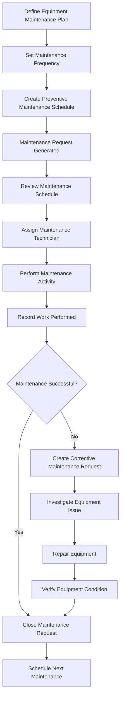
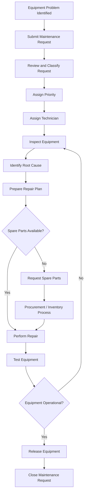

# Maintenance Management Process

**Project:** Astrea Manufacturing — Manufacturing & Production Management ERP  
**Document ID:** AST-ERP-MAINT-001  
**Document Type:** Business Process Documentation  
**ERP Platform:** Odoo 19  
**Database:** PostgreSQL  
**Status:** Draft — Portfolio Simulation  
**Version:** 1.0

---

## 1. Introduction

### 1.1 Purpose

This document defines the Maintenance Management business process for Astrea Manufacturing.

It establishes standardized procedures for maintaining production equipment, managing maintenance requests, scheduling preventive maintenance, resolving equipment breakdowns, controlling spare parts consumption, and monitoring maintenance performance.

The document also serves as a functional reference for implementing Maintenance Management capabilities in Odoo 19.

### 1.2 Business Background

Astrea Manufacturing operates a manufacturing facility producing industrial water pumps and electric motors.

The manufacturing process relies on several production work centers:

- Machining
- Fabrication
- Assembly
- Testing

Each work center depends on equipment that must remain operational to support production schedules.

Equipment failures can result in:

- Unplanned production downtime.
- Manufacturing order delays.
- Reduced production capacity.
- Increased maintenance costs.
- Material waste.
- Product quality issues.
- Missed customer delivery commitments.

A structured maintenance process is therefore necessary to improve equipment reliability, reduce unexpected failures, and maintain production continuity.

### 1.3 Business Objectives

| ID | Business Objective | Expected Outcome |
|---|---|---|
| MAINT-OBJ-001 | Improve equipment availability | Reduce production interruptions |
| MAINT-OBJ-002 | Establish preventive maintenance | Reduce unexpected equipment failures |
| MAINT-OBJ-003 | Standardize corrective maintenance | Ensure breakdowns are handled systematically |
| MAINT-OBJ-004 | Improve maintenance planning | Schedule maintenance activities efficiently |
| MAINT-OBJ-005 | Control maintenance expenditure | Improve maintenance cost visibility |
| MAINT-OBJ-006 | Improve spare parts availability | Ensure critical spare parts are available |
| MAINT-OBJ-007 | Improve maintenance traceability | Maintain complete equipment maintenance history |
| MAINT-OBJ-008 | Improve maintenance performance | Monitor equipment reliability and maintenance effectiveness |

### 1.4 Scope

**In Scope**

- Equipment master data management.
- Work center equipment mapping.
- Preventive maintenance.
- Corrective maintenance.
- Maintenance request management.
- Maintenance request prioritization.
- Maintenance scheduling.
- Equipment breakdown management.
- Maintenance work order execution.
- Spare parts consumption.
- Maintenance cost tracking.
- Equipment downtime monitoring.
- Maintenance reporting and KPIs.
- Integration with Manufacturing, Inventory, and Purchase.

**Out of Scope**

- Advanced computerized maintenance optimization.
- IoT-based predictive maintenance.
- Real-time machine condition monitoring.
- Advanced vibration analysis.
- Automated equipment sensor integration.
- External contractor portal.
- Advanced asset lifecycle financial management.

These capabilities may be considered in future implementation phases.

---

## 2. Maintenance Management Operating Model

### 2.1 Maintenance Strategy

The proposed maintenance strategy consists of two primary maintenance categories.

| Maintenance Type | Description | Example |
|---|---|---|
| Preventive Maintenance | Planned activities performed to reduce the likelihood of equipment failure | Scheduled lubrication and inspection |
| Corrective Maintenance | Maintenance activities performed after an equipment problem or failure is identified | Repairing a malfunctioning machine |

Predictive maintenance may be considered in a future phase when sufficient equipment condition data and monitoring infrastructure are available.

### 2.2 Maintenance Organization

| Role | Responsibility |
|---|---|
| Maintenance Manager | Owns maintenance policies, planning, and performance |
| Maintenance Supervisor | Assigns maintenance work and monitors execution |
| Maintenance Technician | Performs inspections, repairs, and maintenance activities |
| Production Manager | Coordinates maintenance activities with production schedules |
| Production Supervisor | Reports equipment problems and coordinates equipment availability |
| Warehouse Manager | Controls maintenance spare parts inventory |
| Procurement Officer | Purchases maintenance materials and spare parts |
| Quality Manager | Evaluates quality issues caused by equipment malfunction |
| Finance Manager | Reviews maintenance expenditure and financial impact |

### 2.3 Maintenance Principles

The maintenance process follows these principles:

1. All critical production equipment must be registered in the ERP system.
2. Equipment must be associated with the appropriate work center where applicable.
3. Preventive maintenance must follow an approved schedule.
4. Equipment breakdowns must be recorded and prioritized.
5. Maintenance work must be assigned to authorized personnel.
6. Equipment downtime must be recorded accurately.
7. Spare parts consumption must be traceable.
8. Equipment must be verified before being released for production.
9. Maintenance costs must be monitored.
10. Equipment maintenance history must remain accessible.

---

## 3. Equipment Master Data Management

### 3.1 Purpose

Equipment master data provides centralized information about machines, tools, and other maintainable assets used in manufacturing operations.

It supports maintenance planning, equipment tracking, request assignment, and performance monitoring.

### 3.2 Equipment Classification

The proposed equipment categories include:

| Category | Description | Example |
|---|---|---|
| Production Machinery | Equipment directly involved in manufacturing | CNC machine |
| Fabrication Equipment | Equipment used for fabrication operations | Welding machine |
| Assembly Equipment | Equipment used during assembly | Assembly tools |
| Testing Equipment | Equipment used for product testing | Hydraulic test bench |
| Measuring Equipment | Equipment used for dimensional verification | Digital caliper |
| Utility Equipment | Equipment supporting manufacturing operations | Air compressor |

### 3.3 Equipment Master Data Fields

Each equipment record should contain:

| Field | Description |
|---|---|
| Equipment Name | Equipment identification |
| Equipment Code | Unique equipment reference |
| Equipment Category | Equipment classification |
| Work Center | Associated production work center |
| Manufacturer | Equipment manufacturer |
| Model | Equipment model |
| Serial Number | Manufacturer serial number |
| Purchase Date | Original purchase date |
| Installation Date | Equipment installation date |
| Warranty Expiration | Warranty expiration date |
| Responsible Department | Department responsible for equipment |
| Maintenance Team | Assigned maintenance team |
| Location | Physical equipment location |
| Criticality | Equipment operational criticality |
| Operational Status | Current equipment condition |
| Maintenance Frequency | Planned maintenance interval |
| Documentation | Equipment manuals and technical documents |

### 3.4 Proposed Equipment Register

The following equipment records are simulated portfolio data.

| Equipment Code | Equipment Name | Work Center | Criticality |
|---|---|---|---|
| EQ-MCH-001 | CNC Turning Machine | Machining | High |
| EQ-MCH-002 | CNC Milling Machine | Machining | High |
| EQ-FAB-001 | MIG Welding Machine | Fabrication | High |
| EQ-FAB-002 | Hydraulic Press | Fabrication | Medium |
| EQ-ASM-001 | Assembly Workstation | Assembly | Medium |
| EQ-ASM-002 | Torque Wrench Set | Assembly | Medium |
| EQ-TST-001 | Hydraulic Test Bench | Testing | High |
| EQ-TST-002 | Electrical Testing Station | Testing | High |
| EQ-UTL-001 | Air Compressor | Shared Utility | High |

Actual equipment specifications, models, serial numbers, and maintenance requirements must be validated against manufacturer documentation.

### 3.5 Equipment Criticality Classification

Equipment criticality determines maintenance priority and planning requirements.

| Criticality | Description | Maintenance Priority |
|---|---|---|
| High | Failure can stop production or create significant safety or quality risks | Highest |
| Medium | Failure can reduce operational capacity but alternatives may exist | Moderate |
| Low | Failure has limited operational impact | Normal |

Criticality should consider:

- Production dependency.
- Equipment redundancy.
- Safety risks.
- Quality impact.
- Repair lead time.
- Spare parts availability.
- Financial impact of failure.

### 3.6 Equipment Business Rules

| Rule ID | Business Rule |
|---|---|
| MAINT-BR-001 | Critical maintainable equipment must be registered in the system. |
| MAINT-BR-002 | Equipment records must have unique identification references. |
| MAINT-BR-003 | Equipment should be associated with the relevant work center where applicable. |
| MAINT-BR-004 | Equipment criticality must be defined. |
| MAINT-BR-005 | Equipment documentation must be retained where available. |
| MAINT-BR-006 | Equipment master data changes must be restricted to authorized users. |

---

## 4. Preventive Maintenance Management

### 4.1 Purpose

Preventive Maintenance (PM) consists of planned maintenance activities performed at predetermined intervals to reduce equipment deterioration and unexpected breakdowns.

The objective is to maintain equipment reliability and minimize unplanned production downtime.

### 4.2 Preventive Maintenance Activities

Examples include:

- Lubrication.
- Cleaning.
- Mechanical inspection.
- Electrical inspection.
- Belt and bearing inspection.
- Calibration verification.
- Hydraulic system inspection.
- Cooling system inspection.
- Safety device inspection.
- Component replacement.

The maintenance activities must follow equipment manufacturer recommendations and approved engineering procedures.

### 4.3 Preventive Maintenance Schedule

The following schedule is illustrative.

| Equipment | Maintenance Activity | Frequency |
|---|---|---|
| CNC Turning Machine | Lubrication and mechanical inspection | Weekly |
| CNC Milling Machine | Spindle and axis inspection | Monthly |
| MIG Welding Machine | Cable and connection inspection | Monthly |
| Hydraulic Press | Hydraulic system inspection | Monthly |
| Assembly Workstation | General condition inspection | Monthly |
| Torque Wrench Set | Calibration verification | According to calibration policy |
| Hydraulic Test Bench | Hydraulic pressure system inspection | Monthly |
| Electrical Testing Station | Electrical safety and equipment verification | Monthly |
| Air Compressor | Filter and pressure system inspection | Monthly |

Maintenance frequencies are illustrative and must be validated against manufacturer instructions, actual usage, and equipment criticality.

### 4.4 Preventive Maintenance Workflow



### 4.5 Preventive Maintenance Procedure

1. Maintenance Manager defines the maintenance plan.
2. Equipment maintenance frequency is established.
3. Maintenance schedules are configured.
4. Maintenance requests are generated according to the configured scheduling method.
5. Maintenance Supervisor reviews the upcoming schedule.
6. A qualified technician is assigned.
7. The technician performs the maintenance activity.
8. Inspection results and work performed are recorded.
9. Any identified defects are escalated.
10. Maintenance request is closed after verification.
11. The next maintenance activity is scheduled.

### 4.6 Preventive Maintenance Checklist

Example for CNC Turning Machine:

| Inspection Item | Expected Condition | Result |
|---|---|---|
| Lubrication System | Operating correctly | Pass / Fail |
| Spindle Condition | No abnormal vibration | Pass / Fail |
| Cooling System | Adequate coolant flow | Pass / Fail |
| Machine Alignment | Within approved tolerance | Pass / Fail |
| Electrical Connections | Secure and undamaged | Pass / Fail |
| Safety Guards | Properly installed | Pass / Fail |
| Emergency Stop | Functioning correctly | Pass / Fail |

The checklist is a proposed maintenance template. Actual acceptance criteria must be defined by qualified maintenance personnel.

### 4.7 Preventive Maintenance Business Rules

| Rule ID | Business Rule |
|---|---|
| MAINT-BR-007 | Critical equipment must have an approved preventive maintenance plan. |
| MAINT-BR-008 | Maintenance frequency must follow approved equipment requirements. |
| MAINT-BR-009 | Preventive maintenance activities must be recorded. |
| MAINT-BR-010 | Maintenance tasks must be assigned to qualified personnel. |
| MAINT-BR-011 | Failed maintenance inspections must trigger appropriate follow-up actions. |
| MAINT-BR-012 | Maintenance records must be traceable to the relevant equipment. |

---

## 5. Corrective Maintenance Management

### 5.1 Purpose

Corrective Maintenance addresses equipment defects, malfunctions, and breakdowns that require repair or restoration.

The objective is to restore equipment functionality safely and minimize operational disruption.

### 5.2 Corrective Maintenance Sources

Corrective maintenance may originate from:

- Equipment breakdown.
- Abnormal equipment noise.
- Excessive vibration.
- Temperature abnormalities.
- Hydraulic leakage.
- Electrical failure.
- Mechanical component damage.
- Failed preventive maintenance inspection.
- Operator-reported equipment issues.

### 5.3 Corrective Maintenance Workflow



### 5.4 Corrective Maintenance Procedure

1. Equipment problem is identified.
2. Operator or supervisor submits a maintenance request.
3. Maintenance Supervisor reviews the request.
4. Problem severity and operational impact are evaluated.
5. Maintenance priority is assigned.
6. A technician is assigned.
7. Equipment is inspected.
8. Root cause is investigated where appropriate.
9. Required spare parts and tools are identified.
10. Repair work is performed.
11. Equipment functionality is verified.
12. Equipment is released for production.
13. Maintenance records are completed.
14. The request is closed.

### 5.5 Maintenance Request Priority

| Priority | Description | Example |
|---|---|---|
| 0 — Very High | Critical equipment failure affecting production or safety | CNC machine completely stopped |
| 1 — High | Significant malfunction affecting operational performance | Hydraulic pressure instability |
| 2 — Normal | Equipment issue with limited immediate operational impact | Minor mechanical adjustment |
| 3 — Low | Non-urgent maintenance observation | Cosmetic equipment damage |

Priority definitions must be aligned with the actual maintenance response policy.

### 5.6 Corrective Maintenance Business Rules

| Rule ID | Business Rule |
|---|---|
| MAINT-BR-013 | Equipment failures must be documented through maintenance requests. |
| MAINT-BR-014 | Maintenance requests must be prioritized according to operational impact. |
| MAINT-BR-015 | Critical equipment failures must be escalated immediately. |
| MAINT-BR-016 | Repair activities must be recorded. |
| MAINT-BR-017 | Equipment must be verified before returning to production. |
| MAINT-BR-018 | Maintenance closure must require sufficient completion information. |

---

## 6. Maintenance Request Management

### 6.1 Purpose

Maintenance Requests provide a controlled mechanism for reporting, reviewing, assigning, and tracking maintenance requirements.

### 6.2 Maintenance Request Information

Each maintenance request should include:

| Field | Description |
|---|---|
| Request Reference | Unique request identification |
| Equipment | Related equipment |
| Work Center | Associated production work center |
| Request Date | Date the request is submitted |
| Requested By | Person reporting the issue |
| Request Type | Preventive or corrective |
| Maintenance Category | Type of maintenance activity |
| Priority | Operational priority |
| Description | Detailed problem or activity description |
| Production Impact | Impact on manufacturing operations |
| Assigned Technician | Responsible maintenance technician |
| Scheduled Date | Planned maintenance date |
| Start Date | Actual maintenance start |
| Completion Date | Actual completion |
| Downtime | Equipment downtime |
| Parts Used | Spare parts consumed |
| Resolution | Description of work performed |
| Status | Current request status |

### 6.3 Maintenance Request Lifecycle

The proposed business lifecycle is:

| Status | Description |
|---|---|
| New | Request has been submitted |
| Under Review | Maintenance Supervisor is evaluating the request |
| Approved | Request has been accepted |
| In Progress | Maintenance work has started |
| Waiting for Parts | Required spare parts are unavailable |
| Completed | Maintenance work has been performed |
| Verified | Equipment functionality has been confirmed |
| Cancelled | Request has been cancelled with justification |

These are proposed business statuses. They should not be confused with standard Odoo Maintenance request stages, which are configurable.

### 6.4 Maintenance Request Approval

Approval requirements may depend on:

- Maintenance cost.
- Equipment criticality.
- Production impact.
- Required spare parts.
- External service requirements.
- Safety risks.

Emergency breakdown response should not be delayed by unnecessary administrative approval, but any emergency work must be documented and reviewed afterward.

---

## 7. Equipment Downtime Management

### 7.1 Purpose

Equipment downtime management records periods when production equipment is unavailable or operating below its intended capacity.

Downtime data supports production planning, maintenance analysis, and equipment reliability monitoring.

### 7.2 Downtime Categories

| Category | Description | Example |
|---|---|---|
| Planned Maintenance | Scheduled equipment maintenance | Monthly CNC maintenance |
| Unplanned Breakdown | Unexpected equipment failure | Spindle failure |
| Setup / Adjustment | Equipment preparation or adjustment | Machine changeover |
| Material Waiting | Equipment cannot operate due to missing materials | Material shortage |
| Quality Hold | Production stopped due to quality concerns | Failed inspection |
| External Utility Failure | Equipment unavailable due to external utility problems | Power interruption |

Only equipment-related downtime should be included in equipment reliability calculations. Material waiting, quality holds, and external utility failures should be classified separately to avoid distorting maintenance KPIs.

### 7.3 Downtime Record

| Field | Description |
|---|---|
| Downtime Reference | Unique downtime reference |
| Equipment | Affected equipment |
| Work Center | Associated work center |
| Downtime Category | Reason for downtime |
| Start Time | Time equipment became unavailable |
| End Time | Time equipment became operational |
| Duration | Total downtime |
| Related Maintenance Request | Associated maintenance transaction |
| Root Cause | Identified cause |
| Production Impact | Estimated operational impact |

### 7.4 Downtime Calculation

```text
Downtime Duration =
    Equipment Restoration Time
    - Equipment Failure Time
```

Example:

| Description | Value |
|---|---|
| Equipment | EQ-MCH-001 |
| Failure Time | 09:00 |
| Restoration Time | 12:30 |
| Downtime | 3.5 Hours |

### 7.5 Downtime Business Rules

| Rule ID | Business Rule |
|---|---|
| MA