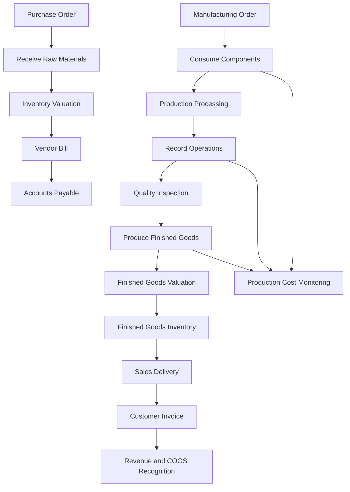

# Costing and Accounting
**Project:** Astrea Manufacturing – Manufacturing & Production Management ERP  
**Document ID:** FIN-001  
**File:** `documentations/06_costing_and_accounting.md`  
**ERP Platform:** Odoo 19  
**Database:** PostgreSQL  
**Company Currency:** Indonesian Rupiah (IDR)  
**Document Status:** Proposed Design – Portfolio Simulation  
**Version:** 1.0

---

## 1. Introduction

### 1.1 Purpose

This document defines the costing and accounting framework for Astrea Manufacturing's manufacturing operations using Odoo 19.

It establishes how the company will:

- Calculate manufacturing costs.
- Determine raw material and finished goods inventory valuation.
- Record production-related accounting transactions.
- Manage direct material, direct labor, and manufacturing overhead.
- Monitor production cost variances.
- Integrate Procurement, Inventory, Manufacturing, Quality, Maintenance, Sales, and Accounting.
- Generate financial and management reports.

The objective is to establish a consistent financial control framework across the manufacturing lifecycle.

### 1.2 Business Background

Astrea Manufacturing produces industrial equipment, including:

- WP100 – Industrial Water Pump.
- EM200 – Industrial Electric Motor.

The manufacturing process consumes raw materials and components, uses multiple work centers, and generates finished goods.

Production costs must be traceable from material procurement through manufacturing execution and finished goods inventory.

### 1.3 Objectives

| ID | Objective | Expected Outcome |
|---|---|---|
| FIN-OBJ-001 | Establish standardized product costing | Consistent product cost calculation |
| FIN-OBJ-002 | Improve inventory valuation accuracy | Reliable inventory asset values |
| FIN-OBJ-003 | Capture manufacturing expenses | Visibility into production costs |
| FIN-OBJ-004 | Monitor production cost variance | Better cost control |
| FIN-OBJ-005 | Integrate inventory and accounting | Reduced manual journal entries |
| FIN-OBJ-006 | Improve financial reporting | Reliable management information |
| FIN-OBJ-007 | Strengthen financial controls | Better transaction traceability |

---

## 2. Costing and Accounting Scope

### 2.1 In Scope

The implementation covers:

1. Chart of Accounts.
2. Accounting Journals.
3. Product Cost Configuration.
4. Inventory Valuation.
5. Raw Material Costing.
6. Manufacturing Order Costing.
7. Direct Labor Cost.
8. Manufacturing Overhead.
9. Work Center Cost.
10. Landed Cost.
11. Scrap and Production Loss.
12. Manufacturing Cost Variance.
13. Inventory Accounting.
14. Cost of Goods Sold.
15. Financial Reporting.
16. Period-End Closing and Reconciliation.

### 2.2 Out of Scope

The following activities are excluded from the initial implementation:

- Full payroll processing.
- Tax filing and statutory reporting automation.
- Advanced activity-based costing.
- Complex intercompany accounting.
- Consolidated financial statements.
- Advanced standard-cost variance allocation.
- Full budgeting and financial planning.
- Fixed asset depreciation automation beyond basic accounting integration.

These capabilities may be considered in future implementation phases.

---

## 3. Cost Accounting Principles

### 3.1 Manufacturing Cost Components

Manufacturing costs are classified into three primary categories.

| Cost Component | Description | Examples |
|---|---|---|
| Direct Material | Materials physically consumed in production | Steel Housing, Copper Wire, Bearing Set |
| Direct Labor | Labor directly associated with production operations | Machining and Assembly operators |
| Manufacturing Overhead | Indirect production expenses | Electricity, factory rent, maintenance-related overhead |

The basic manufacturing cost formula is:

**Total Manufacturing Cost**

`Direct Material + Direct Labor + Manufacturing Overhead`

**Unit Manufacturing Cost**

`Total Manufacturing Cost / Good Finished Quantity`

The calculation must account for actual consumed quantities, production output, and applicable cost allocation policies.

### 3.2 Product Cost Classification

Products are classified into the following categories:

| Product Category | Examples | Costing Consideration |
|---|---|---|
| Raw Materials | Steel Housing, Copper Wire | Purchase cost and landed cost |
| Components | Bearing Set, Impeller | Purchase or manufactured component cost |
| Subassemblies | EM200, if used as a manufactured subassembly | Component and operation costs |
| Finished Goods | WP100, EM200 | Complete manufacturing cost |
| Maintenance Spare Parts | Bearings, belts, filters | Inventory purchase cost |
| Consumables | Lubricants and cleaning materials | Inventory or expense policy |

Product classification must be consistent with the product and BoM master data.

### 3.3 Costing Principles

The following principles apply:

- Every inventory movement must have an appropriate financial treatment.
- Product cost must be traceable to its source.
- Direct production costs must be distinguished from indirect expenses.
- Inventory valuation must reconcile with accounting records.
- Scrap and abnormal losses must not be hidden inside normal production costs.
- Cost allocation rules must be documented and consistently applied.
- Financial postings must follow the selected accounting localization and accounting policy.

---

## 4. Costing Methodology

### 4.1 Available Costing Methods

Odoo 19 supports three primary inventory costing methods.

| Costing Method | Description | Characteristics |
|---|---|---|
| Standard Price | Uses a manually maintained fixed unit cost | Purchase price differences can be monitored separately |
| AVCO | Uses a weighted average unit cost | Incoming receipts update the average cost |
| FIFO | Values outgoing quantities using the oldest remaining incoming cost layers | Cost changes over time are reflected through receipt layers |

### 4.2 Proposed Costing Method

For the portfolio implementation, the proposed starting configuration is:

| Product Category | Proposed Method | Reason |
|---|---|---|
| Raw Materials | AVCO | Suitable for frequently purchased materials with changing prices |
| Purchased Components | AVCO | Simplifies average-cost tracking |
| Manufactured Subassemblies | AVCO | Supports rolling average valuation |
| Finished Goods | AVCO | Provides a consistent average inventory valuation |
| Maintenance Spare Parts | AVCO | Simplifies replenishment and cost tracking |

**Important:** This is a proposed configuration, not a universal accounting recommendation. The final costing method must be approved based on the company's accounting policy, reporting requirements, applicable standards, and Odoo configuration.

FIFO may be preferable when the business requires cost-layer traceability. Standard Price may be appropriate when the business operates a controlled standard-cost system with formal variance analysis.

### 4.3 AVCO Calculation

The weighted average cost formula is:

`New Average Cost = (Existing Inventory Value + Incoming Inventory Value) / (Existing Quantity + Incoming Quantity)`

Illustrative example:

| Transaction | Quantity | Unit Cost | Total Value |
|---|---:|---:|---:|
| Opening Stock | 100 | Rp50,000 | Rp5,000,000 |
| Purchase Receipt | 50 | Rp60,000 | Rp3,000,000 |
| Total | 150 | - | Rp8,000,000 |

New average cost:

`Rp8,000,000 / 150 = Rp53,333.33`

The resulting average cost is approximately Rp53,333.33 per unit.

This example excludes other valuation adjustments, such as applicable landed costs.

---

## 5. Inventory Valuation Configuration

### 5.1 Inventory Valuation Policy

The proposed accounting design uses automated inventory valuation, subject to confirmation of the company's accounting policy and localization.

The inventory valuation configuration must define:

- Costing method.
- Inventory valuation method.
- Stock valuation account.
- Stock variation account.
- Production-related accounts.
- Inventory loss account.
- Accounting journal.
- Product category account properties.

Odoo's inventory valuation and accounting configuration must be tested together before production use.

### 5.2 Perpetual and Periodic Valuation

| Valuation Method | Description | Consideration |
|---|---|---|
| Perpetual | Inventory value is reflected through ongoing accounting valuation transactions | Provides more continuous accounting visibility |
| Periodic | Inventory accounting valuation is synchronized through closing procedures | Requires controlled period-end valuation and reconciliation |

The exact posting behavior also depends on the accounting mode, localization, and transaction type.

**Proposed portfolio configuration:** Automated inventory valuation with a perpetual-style control process.

The final configuration must be validated against the selected Odoo 19 localization and accounting policy. Do not assume that every stock movement generates an identical journal entry under every accounting configuration.

### 5.3 Product Category Configuration

Suggested categories:

| Category | Costing Method | Inventory Valuation |
|---|---|---|
| Raw Materials | AVCO | Automated |
| Components | AVCO | Automated |
| Subassemblies | AVCO | Automated |
| Finished Goods | AVCO | Automated |
| Maintenance Spare Parts | AVCO | Automated |
| Consumables | AVCO or expense policy | Depends on accounting treatment |

### 5.4 Inventory Valuation Controls

The Finance team must periodically verify:

1. Inventory valuation in the Inventory application.
2. Inventory asset balance in the General Ledger.
3. Stock movements not yet invoiced.
4. Vendor bills not yet matched with receipts.
5. Negative stock and unusual valuation changes.
6. Inventory adjustments and scrap transactions.
7. Production-related valuation entries.

The Inventory Valuation report should be reconciled with the corresponding accounting balances.

---

## 6. Chart of Accounts

### 6.1 Chart of Accounts Design

The following chart of accounts is a proposed management-oriented structure.

It is illustrative and must be reconciled with the Indonesian fiscal localization, applicable accounting standards, and the company's approved chart of accounts.

Do not replace the official localization-generated accounts blindly.

### 6.2 Proposed Accounts

| Code | Account Name | Account Type |
|---|---|---|
| 110000 | Cash and Cash Equivalents | Bank and Cash |
| 120000 | Accounts Receivable | Receivable |
| 130000 | Raw Material Inventory | Current Assets |
| 131000 | Component Inventory | Current Assets |
| 132000 | Work in Progress Inventory | Current Assets |
| 133000 | Finished Goods Inventory | Current Assets |
| 134000 | Maintenance Spare Parts Inventory | Current Assets |
| 135000 | Inventory in Transit | Current Assets |
| 139000 | Inventory Valuation Clearing | Current Assets |
| 140000 | Prepaid Expenses | Current Assets |
| 150000 | Property, Plant and Equipment | Fixed Assets |
| 159000 | Accumulated Depreciation | Fixed Assets |
| 210000 | Accounts Payable | Payable |
| 220000 | Accrued Expenses | Current Liabilities |
| 230000 | Taxes Payable | Current Liabilities |
| 240000 | Goods Received Not Invoiced | Current Liabilities |
| 250000 | Salaries Payable | Current Liabilities |
| 310000 | Share Capital | Equity |
| 320000 | Retained Earnings | Equity |
| 410000 | Sales Revenue – Finished Goods | Income |
| 420000 | Other Operating Revenue | Income |
| 510000 | Cost of Goods Sold – Finished Goods | Expenses |
| 511000 | Cost of Goods Sold – Components | Expenses |
| 520000 | Direct Labor Expense | Expenses |
| 530000 | Manufacturing Overhead | Expenses |
| 531000 | Factory Electricity Expense | Expenses |
| 532000 | Factory Rent Expense | Expenses |
| 533000 | Maintenance Expense | Expenses |
| 534000 | Factory Depreciation Expense | Expenses |
| 540000 | Scrap and Production Loss | Expenses |
| 550000 | Purchase Price Variance | Expenses |
| 560000 | Inventory Adjustment Expense | Expenses |
| 570000 | Inventory Valuation Adjustment | Expenses |
| 580000 | Freight and Import Expense | Expenses |
| 590000 | General Administrative Expenses | Expenses |

### 6.3 Account Configuration Rules

- Account codes must be unique.
- Account types must be selected correctly.
- Reconciliation must be enabled where appropriate.
- Receivable and payable accounts must use the correct account types.
- Inventory accounts must be configured through the appropriate product categories and stock valuation settings.
- Account mapping must be validated before posting transactions.
- Tax accounts must be provided by the applicable localization.

**Important:** The account codes above are project design references. They are not a claim that these exact codes are the official Indonesian chart of accounts.

---

## 7. Accounting Journals

### 7.1 Proposed Journals

| Journal Code | Journal Name | Journal Type | Purpose |
|---|---|---|---|
| BNK | Bank Journal | Bank | Bank transactions |
| CS | Cash Journal | Cash | Cash transactions |
| SALE | Sales Journal | Sales | Customer invoices |
| PUR | Purchase Journal | Purchase | Vendor bills |
| INV | Inventory Valuation Journal | General | Inventory valuation entries |
| MFG | Manufacturing Journal | General | Manufacturing-related accounting entries where applicable |
| GEN | General Journal | General | Manual adjustments and accruals |

### 7.2 Journal Configuration

Each journal should define:

- Journal name.
- Journal type.
- Short code.
- Default accounts where applicable.
- Currency.
- Sequence configuration.
- Allowed accounts where appropriate.
- Company access.

The Inventory Valuation Journal must be configured consistently with the inventory valuation setup.

A separate Manufacturing Journal may be used for reporting or specific accounting entries, but creating a journal does not automatically cause every manufacturing transaction to post into that journal.

---

## 8. Raw Material Costing

### 8.1 Material Cost Components

Raw material cost may include:

- Supplier purchase price.
- Applicable non-recoverable taxes, where accounting policy requires inclusion.
- Freight and transportation.
- Import duties and other eligible acquisition costs.
- Insurance and handling charges.
- Other directly attributable acquisition costs.

Recoverable taxes should not automatically be included in inventory cost.

### 8.2 Example: Copper Wire Procurement

Illustrative purchase transaction:

| Description | Amount |
|---|---:|
| Quantity | 100 Meters |
| Purchase Price per Meter | Rp25,000 |
| Purchase Subtotal | Rp2,500,000 |
| Freight | Rp100,000 |
| Total Eligible Acquisition Cost | Rp2,600,000 |

Unit acquisition cost:

`Rp2,600,000 / 100 = Rp26,000 per Meter`

This example assumes freight is eligible for capitalization into inventory and excludes recoverable VAT.

### 8.3 Landed Cost

Landed cost represents eligible additional costs associated with bringing purchased goods to their intended location and condition.

Examples:

- Freight.
- Customs duties.
- Insurance.
- Port handling.
- Other directly attributable acquisition charges.

Landed cost allocation methods may include:

- Equal allocation.
- By quantity.
- By current cost.
- By weight.
- By volume.

The selected allocation method must reflect the nature of the expense.

For example, freight based on shipment weight should not automatically be allocated equally across products with significantly different weights.

### 8.4 Landed Cost Workflow

1. Create a Purchase Order.
2. Confirm the Purchase Order.
3. Receive the purchased goods.
4. Validate the incoming stock transfer.
5. Record the supplier's additional cost.
6. Create a Landed Cost record where supported by the configured Odoo workflow.
7. Select eligible incoming transfers.
8. Select the appropriate allocation method.
9. Validate the Landed Cost.
10. Review the resulting inventory valuation adjustments.
11. Reconcile related vendor bills and accounting entries.

The availability and exact workflow must be verified against the installed Odoo 19 applications and product configuration.

---

## 9. Manufacturing Cost Calculation

### 9.1 Manufacturing Cost Structure

A manufacturing order can include:

| Cost Component | Source |
|---|---|
| Component Cost | BoM components |
| Direct Labor Cost | Employee operation cost where configured |
| Work Center Cost | Work center operation cost |
| Additional Production Cost | Approved additional cost allocation |
| Scrap and Rework | Actual production loss and rework transactions |

Odoo calculates manufacturing order costs using the BoM components and operations, work center costs, and employee operation costs where configured.

The displayed MO cost should not automatically be treated as a complete absorption-costing result unless the relevant costs and allocation rules have actually been configured.

### 9.2 Direct Material Cost

Formula:

`Direct Material Cost = Σ (Actual Component Quantity Consumed × Applicable Component Unit Cost)`

Example:

| Component | Quantity | Unit Cost | Total |
|---|---:|---:|---:|
| Steel Housing | 1 | Rp450,000 | Rp450,000 |
| Copper Wire | 5 | Rp26,000 | Rp130,000 |
| Bearing Set | 2 | Rp75,000 | Rp150,000 |
| Impeller | 1 | Rp180,000 | Rp180,000 |
| Fastener Set | 1 | Rp20,000 | Rp20,000 |
| Electrical Control Unit | 1 | Rp250,000 | Rp250,000 |
| **Total** | | | **Rp1,180,000** |

The quantities and costs are illustrative assumptions.

### 9.3 Direct Labor Cost

Direct labor cost is calculated using:

`Direct Labor Cost = Actual Labor Hours × Labor Rate per Hour`

Illustrative example:

| Operation | Labor Hours | Labor Rate | Total |
|---|---:|---:|---:|
| Machining | 2.0 | Rp35,000 | Rp70,000 |
| Fabrication | 1.5 | Rp30,000 | Rp45,000 |
| Assembly | 1.0 | Rp30,000 | Rp30,000 |
| Testing | 0.5 | Rp35,000 | Rp17,500 |
| **Total** | **5.0** | | **Rp162,500** |

This example uses a hypothetical hourly labor rate.

If employee costs are configured in Odoo, verify whether the operation cost already includes the relevant labor component before adding another labor allocation. Otherwise, labor may be double-counted.

### 9.4 Manufacturing Overhead

Manufacturing overhead includes indirect production costs.

Examples:

- Electricity.
- Factory rent.
- Equipment depreciation.
- Indirect labor.
- Production supervision.
- Equipment maintenance.
- Factory insurance.

A simple overhead allocation formula is:

`Overhead Rate = Budgeted Manufacturing Overhead / Budgeted Allocation Base`

`Applied Overhead = Actual Allocation Base Used × Overhead Rate`

Possible allocation bases:

- Machine hours.
- Direct labor hours.
- Production units.
- Other documented cost drivers.

### 9.5 Work Center Cost

The proposed work centers are:

| Work Center | Cost Driver | Illustrative Cost per Hour |
|---|---|---:|
| Machining | Machine hours | Rp80,000 |
| Fabrication | Machine hours | Rp65,000 |
| Assembly | Labor and workstation hours | Rp45,000 |
| Testing | Testing equipment hours | Rp55,000 |

These figures are example operating rates, not validated production costs.

Before using these rates, determine whether they represent:

- Direct machine operating costs.
- Labor costs.
- Factory overhead.
- A combined work center rate.

The classification must prevent duplicate allocation of the same cost.

### 9.6 Illustrative WP100 Manufacturing Cost

The following example demonstrates the relationship between material, labor, and overhead.

| Cost Component | Amount |
|---|---:|
| Direct Material | Rp1,180,000 |
| Direct Labor | Rp162,500 |
| Applied Manufacturing Overhead | Rp240,000 |
| **Total Manufacturing Cost** | **Rp1,582,500** |

Assume one good finished product is produced:

`Unit Manufacturing Cost = Rp1,582,500 / 1 = Rp1,582,500`

If more than one good unit is produced, divide the applicable total cost by the good output quantity.

This calculation is a management-costing example. It is not a guarantee that Odoo's displayed MO cost will equal this amount without additional configuration or custom cost allocation.

---

## 10. Work in Progress (WIP)

### 10.1 WIP Concept

Work in Progress represents production costs associated with products that have not yet reached their completed manufacturing stage.

WIP may include:

- Consumed raw materials.
- Components issued to production.
- Direct labor incurred.
- Applied manufacturing overhead.

The accounting treatment of WIP depends on the inventory valuation method and the configured production-location accounts.

### 10.2 WIP Monitoring

Finance and Production should monitor:

- Open Manufacturing Orders.
- Consumed material value.
- Remaining production quantities.
- Production completion status.
- Long-running manufacturing orders.
- Unusual negative or excessive WIP balances.

### 10.3 WIP Control Rules

| Rule ID | Business Rule |
|---|---|
| FIN-BR-001 | Production-related inventory movements must be traceable to manufacturing transactions. |
| FIN-BR-002 | Material consumption must be supported by actual inventory movement records. |
| FIN-BR-003 | Open Manufacturing Orders must be reviewed at period-end. |
| FIN-BR-004 | WIP balances must be reconciled with production activity. |
| FIN-BR-005 | Completed production must be reviewed for valuation consistency. |

---

## 11. Manufacturing Accounting Flow

### 11.1 End-to-End Process

The diagram represents the business process, not an exact journal-entry sequence. Actual accounting entries depend on valuation settings, accounting mode, localization, and transaction posting events.

### 11.2 Procurement Accounting

A typical procurement lifecycle involves:

1. Purchase Order confirmation.
2. Goods receipt.
3. Vendor bill registration.
4. Vendor bill validation.
5. Accounts payable recognition.
6. Payment and reconciliation.

A Purchase Order by itself does not necessarily create a posted accounting entry.

### 11.3 Manufacturing Accounting

Manufacturing accounting must reflect:

- Component consumption.
- Production location valuation.
- Finished goods production.
- Scrap and inventory loss.
- Applicable valuation adjustments.

Odoo's production-location account configuration can influence how manufacturing valuation entries are recorded.

### 11.4 Sales Accounting

Sales transactions may involve:

- Revenue recognition.
- Accounts receivable.
- Tax liabilities.
- Cost of goods sold.
- Finished goods inventory reduction.

The exact recognition timing depends on the selected accounting mode and invoicing/delivery configuration.

---

## 12. Illustrative Accounting Entries

The entries below are conceptual accounting examples to explain debit and credit relationships. They are not guaranteed to match the exact journal entries generated by every Odoo 19 configuration.

### 12.1 Raw Material Receipt

Assume raw materials are received with a value of Rp2,500,000.

Illustrative perpetual valuation entry:

| Account | Debit | Credit |
|---|---:|---:|
| Raw Material Inventory | Rp2,500,000 | - |
| Inventory Valuation Clearing / GRNI | - | Rp2,500,000 |

The clearing account represents the receipt-related accounting position before the vendor bill is fully matched.

### 12.2 Vendor Bill

Assume the supplier invoice matches the received goods.

| Account | Debit | Credit |
|---|---:|---:|
| Inventory Valuation Clearing / GRNI | Rp2,500,000 | - |
| Accounts Payable | - | Rp2,500,000 |

Recoverable taxes, if applicable, are recorded separately according to the tax configuration.

### 12.3 Component Consumption

Assume Rp1,180,000 of components are consumed in production.

Conceptual production valuation entry:

| Account | Debit | Credit |
|---|---:|---:|
| Work in Progress / Production Account | Rp1,180,000 | - |
| Raw Material and Component Inventory | - | Rp1,180,000 |

The actual account mapping and posting behavior must be verified using the selected Odoo production-location configuration.

### 12.4 Finished Goods Production

Assume the completed finished goods valuation is Rp1,582,500.

Conceptual entry:

| Account | Debit | Credit |
|---|---:|---:|
| Finished Goods Inventory | Rp1,582,500 | - |
| Work in Progress / Production Account | - | Rp1,582,500 |

This illustration assumes the full cost is capitalized into the finished goods inventory.

Do not post this entry manually if Odoo already generated the corresponding valuation entry.

### 12.5 Finished Goods Sale

Assume finished goods with a cost of Rp1,582,500 are delivered to a customer.

Illustrative cost recognition:

| Account | Debit | Credit |
|---|---:|---:|
| Cost of Goods Sold | Rp1,582,500 | - |
| Finished Goods Inventory | - | Rp1,582,500 |

The exact posting timing depends on the accounting configuration.

### 12.6 Revenue Recognition

Assume the selling price is Rp2,200,000, excluding applicable taxes.

| Account | Debit | Credit |
|---|---:|---:|
| Accounts Receivable | Rp2,200,000 | - |
| Sales Revenue | - | Rp2,200,000 |

Taxes must be added separately according to the applicable tax rules.

### 12.7 Illustrative Gross Profit

| Description | Amount |
|---|---:|
| Sales Revenue | Rp2,200,000 |
| Cost of Goods Sold | Rp1,582,500 |
| **Gross Profit** | **Rp617,500** |
| **Gross Margin** | **28.07%** |

Formula:

`Gross Margin = (Revenue - COGS) / Revenue × 100%`

This example excludes selling expenses, administrative expenses, tax, and other operating costs.

---

## 13. Scrap and Production Loss

### 13.1 Scrap Classification

Scrap and production losses should be categorized according to their operational cause.

| Category | Example |
|---|---|
| Material Defect | Defective raw material |
| Machining Defect | Incorrect dimensions |
| Fabrication Defect | Welding failure |
| Assembly Defect | Incorrect component installation |
| Testing Failure | Product fails functional testing |
| Handling Damage | Product damaged during movement |

### 13.2 Accounting Treatment

Scrap may affect inventory valuation and production costs.

The treatment should distinguish:

- Normal production loss.
- Abnormal production loss.
- Reworkable products.
- Recoverable scrap materials.
- Irrecoverable scrap.

Abnormal losses should be reviewed separately rather than automatically capitalized into good finished products.

### 13.3 Scrap Controls

- Every scrap transaction must have a reason.
- Scrap quantities must be recorded.
- Quality or Production approval must be obtained where required.
- Scrap valuation must be reviewed.
- Recovered materials must be tracked separately.
- Financial impact must be visible in reporting.

---

## 14. Production Cost Variance Analysis

### 14.1 Purpose

Cost variance analysis compares expected production costs against actual production costs.

It helps management identify:

- Material price changes.
- Excessive material consumption.
- Production inefficiencies.
- Labor overruns.
- Machine operating inefficiencies.
- Scrap and rework costs.

### 14.2 Variance Categories

| Variance Type | Formula / Interpretation |
|---|---|
| Material Price Variance | Actual purchase price compared with reference price |
| Material Usage Variance | Actual material quantity compared with expected quantity |
| Labor Rate Variance | Actual labor rate compared with reference rate |
| Labor Efficiency Variance | Actual labor hours compared with expected hours |
| Overhead Spending Variance | Actual overhead compared with budgeted overhead |
| Overhead Efficiency Variance | Applied overhead compared with expected allocation |

### 14.3 Material Price Variance

Formula:

`Material Price Variance = (Actual Price - Standard Price) × Actual Quantity Purchased`

Illustrative example:

| Description | Value |
|---|---:|
| Standard Price | Rp25,000 |
| Actual Price | Rp26,000 |
| Quantity | 100 |
| Price Variance | Rp100,000 Unfavorable |

### 14.4 Material Usage Variance

Formula:

`Material Usage Variance = (Actual Quantity - Standard Quantity) × Standard Price`

Illustrative example:

| Description | Value |
|---|---:|
| Standard Quantity | 5 Meters |
| Actual Quantity | 5.5 Meters |
| Standard Price | Rp25,000 |
| Usage Variance | Rp12,500 Unfavorable |

### 14.5 Labor Efficiency Variance

Formula:

`Labor Efficiency Variance = (Actual Hours - Standard Hours) × Standard Labor Rate`

Illustrative example:

| Description | Value |
|---|---:|
| Standard Hours | 5 |
| Actual Hours | 6 |
| Standard Rate | Rp30,000 |
| Efficiency Variance | Rp30,000 Unfavorable |

### 14.6 Variance Analysis Rules

| Rule ID | Business Rule |
|---|---|
| FIN-BR-006 | Production cost variance must be reviewed periodically. |
| FIN-BR-007 | Significant variances must have documented explanations. |
| FIN-BR-008 | Material price changes must be traceable to procurement transactions. |
| FIN-BR-009 | Excessive material consumption must be investigated. |
| FIN-BR-010 | Labor and machine time overruns must be reviewed. |
| FIN-BR-011 | Scrap and rework costs must be included in production performance analysis. |

**Implementation caveat:** These formulas describe a management accounting methodology. A complete standard-cost variance accounting system may require additional configuration, reporting, or custom development. Do not assume Odoo automatically posts all these variance categories as separate journal entries.

---

## 15. Maintenance Cost Accounting

### 15.1 Maintenance Cost Categories

Maintenance costs are classified into:

| Cost Category | Examples |
|---|---|
| Spare Parts | Bearings, belts, filters |
| Maintenance Labor | Technician working hours |
| External Services | Third-party repair services |
| Preventive Maintenance | Scheduled inspections and servicing |
| Corrective Maintenance | Breakdown repairs |
| Equipment Overhead | Related maintenance support costs |

### 15.2 Maintenance Cost Calculation

Formula:

`Total Maintenance Cost = Spare Parts + Labor + External Services + Other Allocated Costs`

### 15.3 Maintenance Cost Reporting

Maintenance costs should be analyzed by:

- Equipment.
- Work Center.
- Maintenance Type.
- Maintenance Request.
- Cost Category.
- Reporting Period.

### 15.4 Accounting Policy

Spare parts consumed in maintenance must be recorded through appropriate inventory movements.

Routine repair and maintenance expenses are generally treated as period expenses under the applicable accounting policy.

Major equipment improvements may require capitalization when recognition criteria are met. This decision must be made by Finance, not automatically based on the Maintenance request category.

---

## 16. Accounting Integration with Odoo 19

### 16.1 Required Applications

| Application | Purpose |
|---|---|
| Accounting | General Ledger and financial reporting |
| Invoicing | Customer and supplier invoices |
| Purchase | Procurement transactions |
| Inventory | Stock valuation and inventory movement |
| Manufacturing | Production costing |
| Quality | Quality-related inventory and production controls |
| Maintenance | Maintenance expense and spare parts tracking |
| Sales | Sales and revenue transactions |

The exact application availability depends on the installed Odoo edition and configuration.

### 16.2 Product Configuration

For relevant product categories and products, configure:

- Product type.
- Cost.
- Costing method.
- Inventory valuation.
- Income account.
- Expense account.
- Inventory accounts.
- Applicable taxes.
- Units of measure.

Account fields and valuation settings must be validated using the actual database localization.

### 16.3 Manufacturing Configuration

Configure and verify:

- Bill of Materials.
- Component quantities.
- Manufacturing operations.
- Work centers.
- Work center costs.
- Employee operation costs where applicable.
- Production locations.
- Cost of Production account where applicable.

### 16.4 Inventory Configuration

Configure and verify:

- Warehouse and locations.
- Product categories.
- Costing methods.
- Inventory valuation.
- Stock valuation accounts.
- Inventory loss accounts.
- Production location accounts.
- Landed cost settings where applicable.

### 16.5 Accounting Configuration

Configure and verify:

- Chart of Accounts.
- Accounting Journals.
- Fiscal localization.
- Taxes.
- Receivable and payable accounts.
- Inventory valuation accounts.
- Financial reporting periods.
- User permissions.

---

## 17. Financial Reporting

### 17.1 Required Reports

| Report | Purpose | Responsible Department |
|---|---|---|
| Balance Sheet | Financial position | Finance |
| Profit and Loss | Financial performance | Finance |
| General Ledger | Account transaction details | Finance |
| Trial Balance | Debit and credit balance verification | Finance |
| Inventory Valuation | Inventory asset value | Finance / Warehouse |
| Manufacturing Order Cost | Production cost analysis | Production / Finance |
| Cost of Goods Sold | Cost of sold products | Finance |
| Purchase Analysis | Procurement cost analysis | Procurement |
| Maintenance Cost Report | Equipment maintenance cost | Maintenance |
| Scrap Report | Production loss analysis | Quality / Production |

### 17.2 Manufacturing Cost Dashboard

Suggested KPIs:

| KPI | Formula |
|---|---|
| Unit Manufacturing Cost | Total Manufacturing Cost / Good Output |
| Material Cost Ratio | Direct Material / Total Manufacturing Cost × 100% |
| Labor Cost Ratio | Direct Labor / Total Manufacturing Cost × 100% |
| Overhead Cost Ratio | Manufacturing Overhead / Total Manufacturing Cost × 100% |
| Cost Variance | Actual Cost - Reference Cost |
| Scrap Cost Ratio | Scrap Cost / Total Manufacturing Cost × 100% |
| Production Gross Margin | (Revenue - COGS) / Revenue × 100% |

### 17.3 Inventory Financial Dashboard

Suggested KPIs:

- Total Inventory Value.
- Raw Material Inventory Value.
- Work in Progress Value.
- Finished Goods Inventory Value.
- Inventory Turnover.
- Inventory Write-Off.
- Slow-Moving Inventory.
- Inventory Valuation Difference.

### 17.4 Financial Performance Dashboard

Suggested KPIs:

- Total Revenue.
- Cost of Goods Sold.
- Gross Profit.
- Gross Margin.
- Operating Expenses.
- Operating Profit.
- Net Profit.
- Accounts Receivable.
- Accounts Payable.
- Cash Position.

All KPI definitions and reporting periods must be standardized before the dashboard is used for management decisions.

---

## 18. Period-End Closing and Reconciliation

### 18.1 Closing Activities

Finance should perform the following activities at each accounting period-end:

1. Review all purchase receipts.
2. Review vendor bills not yet received or matched.
3. Review goods received but not invoiced.
4. Review inventory valuation.
5. Reconcile stock valuation with General Ledger.
6. Review open Manufacturing Orders.
7. Review Work in Progress balances.
8. Review scrap and inventory adjustments.
9. Review landed cost adjustments.
10. Review accounts payable and receivable.
11. Review accrued expenses.
12. Review depreciation and maintenance expenses.
13. Generate required closing entries.
14. Review financial statements.
15. Obtain appropriate closing approval.

### 18.2 Reconciliation Checklist

| Control ID | Control Activity | Expected Result |
|---|---|---|
| FIN-CTL-001 | Inventory valuation reconciliation | Inventory and accounting balances are explainable |
| FIN-CTL-002 | WIP review | Open production balances are supported |
| FIN-CTL-003 | GRNI reconciliation | Unbilled receipts are identified |
| FIN-CTL-004 | Vendor bill reconciliation | Supplier liabilities are accurate |
| FIN-CTL-005 | Scrap review | Losses are appropriately classified |
| FIN-CTL-006 | Landed cost review | Eligible acquisition costs are allocated |
| FIN-CTL-007 | COGS review | Cost recognition is consistent |
| FIN-CTL-008 | Journal review | Posted entries are approved and traceable |
| FIN-CTL-009 | Financial statement review | Statements are internally consistent |

### 18.3 Period Locking

After closing approval:

- Lock completed accounting periods according to company policy.
- Restrict backdated postings.
- Require authorization for reopening.
- Preserve an audit trail for adjustments.
- Document reasons for material corrections.

---

## 19. Roles and Responsibilities

| Role | Responsibility |
|---|---|
| Finance Manager | Approves accounting policy and financial controls |
| Accountant | Manages journals, reconciliations, and closing |
| Cost Accountant | Analyzes manufacturing costs and variances |
| Procurement Manager | Controls supplier pricing and procurement costs |
| Warehouse Manager | Ensures accurate stock movements |
| Production Manager | Monitors manufacturing cost and output |
| Maintenance Manager | Controls maintenance expenses |
| Quality Manager | Monitors scrap and quality-related losses |
| ERP Administrator | Maintains configuration and access controls |

### 19.1 Segregation of Duties

Where practical:

- Procurement users should not approve their own supplier invoices.
- Warehouse users should not independently approve material write-offs.
- Production users should not alter accounting policies.
- Accountants should not bypass stock movement controls to force inventory balances.
- ERP administrators should not perform financial approvals merely because they have technical access.

Access rights must follow the approved responsibility matrix.

---

## 20. Financial Business Rules

| Rule ID | Business Rule |
|---|---|
| FIN-BR-012 | Every financial transaction must use the appropriate accounting journal. |
| FIN-BR-013 | Inventory valuation must be configured consistently across relevant product categories. |
| FIN-BR-014 | Product costs must be traceable to procurement or manufacturing activities. |
| FIN-BR-015 | Landed costs must be allocated using an approved method. |
| FIN-BR-016 | Recoverable taxes must be treated according to applicable accounting policy. |
| FIN-BR-017 | Manufacturing costs must distinguish material, labor, and overhead. |
| FIN-BR-018 | Work center cost assumptions must be documented. |
| FIN-BR-019 | Duplicate cost allocation is prohibited. |
| FIN-BR-020 | Scrap must be recorded with an appropriate reason. |
| FIN-BR-021 | Abnormal production losses must be reviewed separately. |
| FIN-BR-022 | Production cost variances must be reviewed periodically. |
| FIN-BR-023 | Inventory valuation must reconcile with accounting balances. |
| FIN-BR-024 | Period-end WIP must be reviewed. |
| FIN-BR-025 | Accounting adjustments require appropriate authorization. |
| FIN-BR-026 | Posted financial transactions must retain an audit trail. |

---

## 21. Testing Scenarios

### 21.1 Accounting Configuration Tests

| Test ID | Scenario | Expected Result |
|---|---|---|
| FIN-TC-001 | Verify chart of accounts | Required accounts exist and have correct types |
| FIN-TC-002 | Verify accounting journals | Journals are configured correctly |
| FIN-TC-003 | Verify product category accounts | Correct accounts are assigned |
| FIN-TC-004 | Verify inventory valuation settings | Valuation configuration matches the design |
| FIN-TC-005 | Verify company currency | IDR is configured correctly |

### 21.2 Procurement and Inventory Costing Tests

| Test ID | Scenario | Expected Result |
|---|---|---|
| FIN-TC-006 | Receive raw materials | Inventory quantity and valuation update correctly |
| FIN-TC-007 | Register vendor bill | Payable and related accounting entries are correct |
| FIN-TC-008 | Receive materials at different prices | AVCO updates according to the configured method |
| FIN-TC-009 | Apply landed cost | Eligible inventory valuation is adjusted |
| FIN-TC-010 | Return purchased materials | Inventory and accounting adjustments are traceable |

### 21.3 Manufacturing Cost Tests

| Test ID | Scenario | Expected Result |
|---|---|---|
| FIN-TC-011 | Confirm Manufacturing Order | Expected component and operation costs are available |
| FIN-TC-012 | Consume components | Actual component consumption is recorded |
| FIN-TC-013 | Record work center operations | Operation cost data is recorded correctly |
| FIN-TC-014 | Complete manufacturing | Finished goods quantity and valuation are correct |
| FIN-TC-015 | Record production scrap | Scrap quantity and valuation impact are traceable |
| FIN-TC-016 | Review MO cost | Manufacturing cost details are available |
| FIN-TC-017 | Review production variance | Reference and actual cost differences are reportable |

### 21.4 Accounting and Financial Reporting Tests

| Test ID | Scenario | Expected Result |
|---|---|---|
| FIN-TC-018 | Deliver finished goods | Inventory valuation changes correctly |
| FIN-TC-019 | Create customer invoice | Revenue and receivable are recorded correctly |
| FIN-TC-020 | Review COGS | Cost recognition follows accounting configuration |
| FIN-TC-021 | Reconcile inventory valuation | Stock valuation and General Ledger are explainable |
| FIN-TC-022 | Review open WIP | Outstanding production balances are identifiable |
| FIN-TC-023 | Perform period-end closing | Closing activities are completed and documented |
| FIN-TC-024 | Restrict a closed period | Unauthorized backdated posting is prevented |

### 21.5 Test Execution Requirements

Each test must record:

- Test ID.
- Requirement reference.
- Preconditions.
- Test data.
- Execution steps.
- Expected result.
- Actual result.
- Evidence.
- Execution status.
- Defect reference.
- Tester.
- Execution date.

Test statuses:

- Not Executed.
- Passed.
- Failed.
- Blocked.
- Retest Required.

No test result should be marked as Passed without execution evidence.

---

## 22. Acceptance Criteria

| Acceptance ID | Acceptance Criteria |
|---|---|
| FIN-AC-001 | Chart of Accounts is configured and validated |
| FIN-AC-002 | Accounting journals are configured |
| FIN-AC-003 | Inventory valuation method is configured |
| FIN-AC-004 | Product categories have appropriate accounting properties |
| FIN-AC-005 | Raw material valuation is traceable |
| FIN-AC-006 | Landed cost can be recorded and reviewed |
| FIN-AC-007 | Manufacturing Order costs can be reviewed |
| FIN-AC-008 | Work center and operation cost configuration is validated |
| FIN-AC-009 | Production scrap is traceable |
| FIN-AC-010 | Inventory valuation can be reconciled with accounting |
| FIN-AC-011 | Cost of Goods Sold is recorded according to the selected accounting configuration |
| FIN-AC-012 | Period-end reconciliation procedures are documented |
| FIN-AC-013 | Financial reports are available to authorized users |
| FIN-AC-014 | Financial access controls are tested |
| FIN-AC-015 | All critical finance test cases pass |

---

## 23. Assumptions and Constraints

### 23.1 Assumptions

- Astrea Manufacturing is a hypothetical manufacturing company.
- Odoo 19 is used as the ERP platform.
- Company currency is IDR.
- The initial scope covers one manufacturing facility.
- Inventory, Purchase, Manufacturing, and Accounting applications are installed.
- Product and BoM data are maintained according to the project master-data documents.
- Financial transactions use simulated portfolio data.
- Costing policies are proposed and require formal validation.
- The company uses a single-company configuration for the initial implementation.

### 23.2 Constraints

- Exact account codes depend on the installed Indonesian fiscal localization.
- Tax treatment requires review by a qualified accounting or tax professional.
- Actual manufacturing overhead allocation depends on available operational data.
- Standard Odoo functionality may not provide every advanced variance report described in this document.
- Additional development may be necessary for advanced cost allocation and management reporting.
- Inventory valuation and journal behavior must be tested in the actual Odoo 19 database.

### 23.3 Open Questions

| Question ID | Question | Responsible Role |
|---|---|---|
| FIN-OQ-001 | Which inventory costing method will be formally approved? | Finance Manager |
| FIN-OQ-002 | Will inventory valuation use a perpetual or periodic approach? | Finance Manager |
| FIN-OQ-003 | Which Indonesian fiscal localization and account structure will be used? | Finance Manager |
| FIN-OQ-004 | Which taxes are applicable to purchases and sales? | Tax / Finance |
| FIN-OQ-005 | What is the approved manufacturing overhead allocation method? | Cost Accountant |
| FIN-OQ-006 | Are employee operation costs maintained in Odoo? | HR / Production |
| FIN-OQ-007 | Will work center cost include labor, machine depreciation, and electricity? | Finance / Production |
| FIN-OQ-008 | How will normal and abnormal production losses be classified? | Finance / Quality |
| FIN-OQ-009 | Will WIP be monitored through dedicated accounts or production valuation accounts? | Finance |
| FIN-OQ-010 | Which cost variance reports require custom development? | Finance / ERP Team |
| FIN-OQ-011 | What is the approved policy for capitalizing landed costs? | Finance |
| FIN-OQ-012 | What is the approved treatment for major equipment improvements? | Finance / Maintenance |

---

## 24. Related Documents

| Document | Relationship |
|---|---|
| `00_business_requirements_gathering.md` | Requirements elicitation and validation |
| `01_business_requirements.md` | Business requirements and business rules |
| `02_master_data_and_bom.md` | Product, component, BoM, and routing data |
| `02_inventory_management.md` | Inventory operations and valuation inputs |
| `03_procurement_process.md` | Purchase transactions and supplier costs |
| `04_quality_management.md` | Quality losses, scrap, and rework |
| `05_maintenance_management.md` | Maintenance expenses and spare parts |
| `04_technical_architecture.md` | Technical architecture |
| `05_test_strategy_and_test_cases.md` | Overall testing strategy |

---

## 25. Official References

1. Odoo 19 – Inventory Valuation  
   https://www.odoo.com/documentation/19.0/applications/finance/accounting/get_started/inventory_valuation.html

2. Odoo 19 – Manufacturing Order Costs  
   https://www.odoo.com/documentation/19.0/applications/inventory_and_mrp/manufacturing/basic_setup/mo_costs.html

3. Odoo 19 – Chart of Accounts  
   https://www.odoo.com/documentation/19.0/applications/finance/accounting/getting_started/initial_configuration/chart_of_accounts.html

4. Odoo 19 – Journals  
   https://www.odoo.com/documentation/19.0/applications/finance/accounting/get_started/journals.html

5. Odoo 19 – Inventory Valuation Cheat Sheet  
   https://www.odoo.com/documentation/19.0/applications/inventory_and_mrp/inventory/inventory_valuation/cheat_sheet.html

These references should be checked against the installed Odoo 19 edition and localization before implementation.

---

## 26. Final Notes

This document establishes the proposed costing and accounting framework for the Astrea Manufacturing portfolio project.

The implementation should prioritize:

1. Correct product and category accounting configuration.
2. Consistent inventory valuation.
3. Traceable manufacturing cost calculation.
4. Proper accounting integration.
5. Reliable period-end reconciliation.
6. Clear cost variance reporting.
7. Strong financial access controls.

The most important implementation principle is to distinguish **Odoo's inventory valuation, Manufacturing Order cost calculation, and management accounting cost allocation**. They are related, but they are not automatically identical.

A successful implementation must demonstrate not only that manufacturing transactions can be completed, but also that the resulting inventory values, accounting entries, and cost reports can be explained and reconciled.

**End of Document**